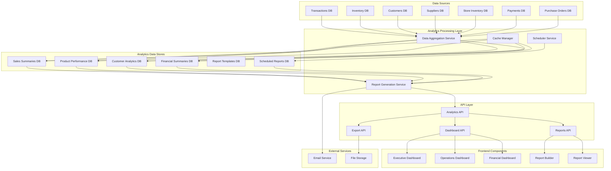
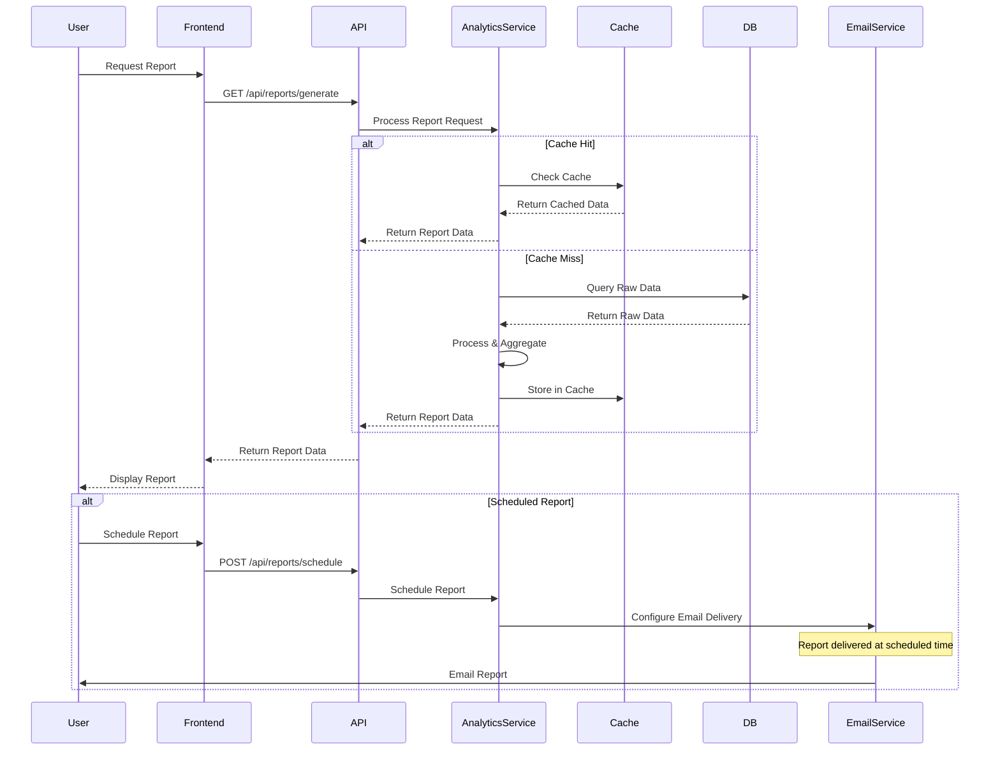
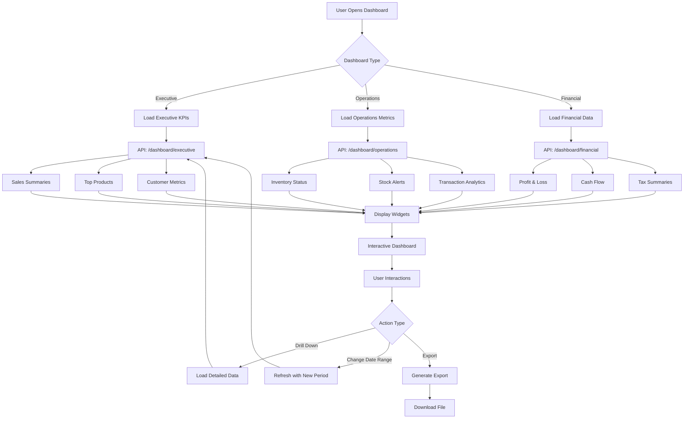
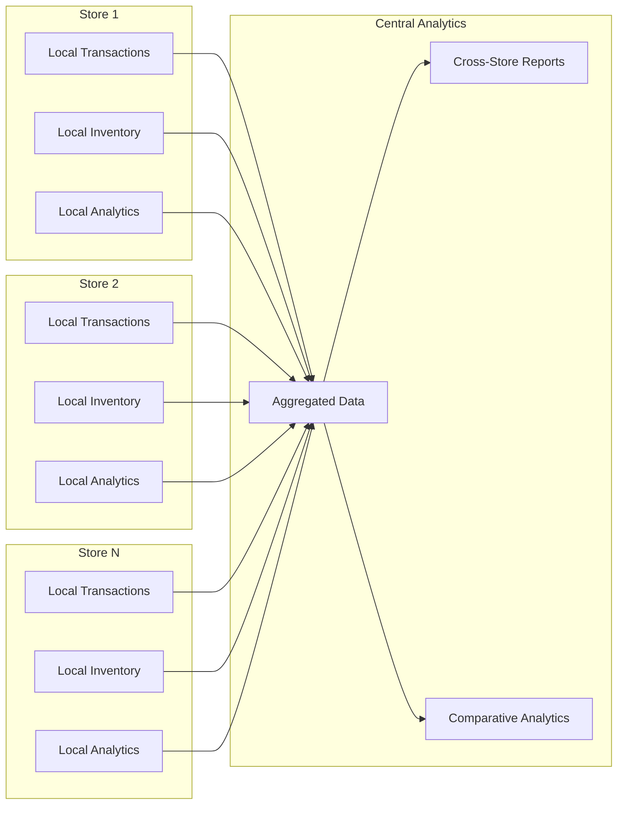
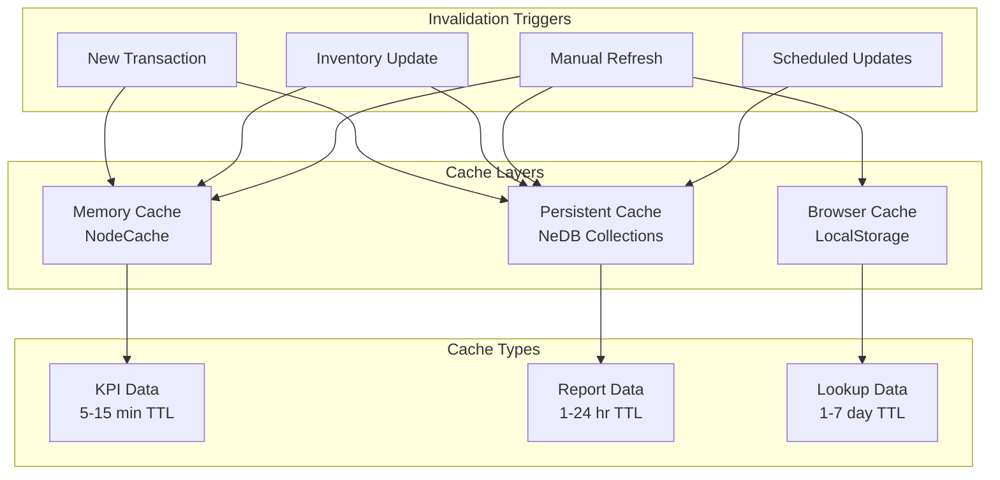
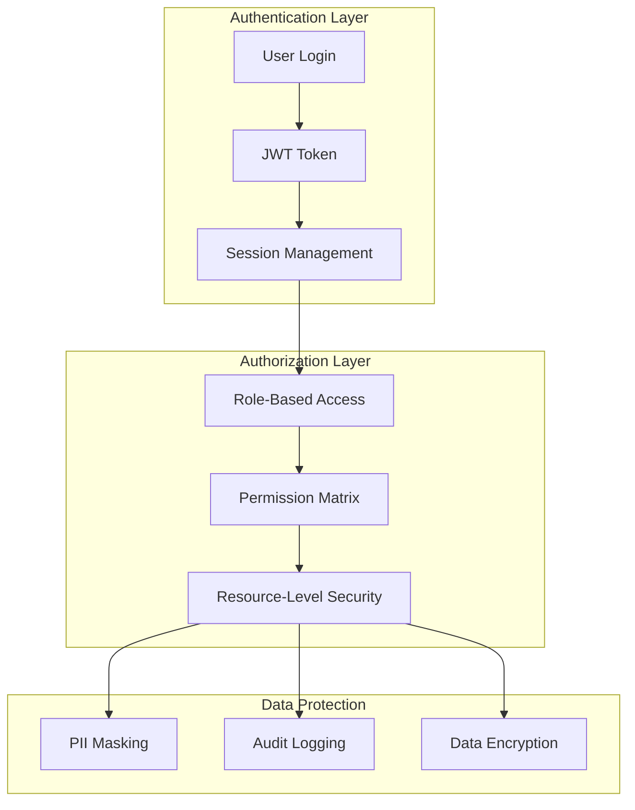

# Enhanced Reports and Analytics System Architecture Diagram

## System Architecture Overview



## Report Generation Flow



## Dashboard Data Flow



## Multi-Store Data Architecture



## Caching Strategy



## Security Architecture



## Performance Optimization

```mermaid
graph TD
    A[Report Request] --> B{Complexity Check}
    
    B -->|Simple| C[Direct Query]
    B -->|Complex| D[Background Processing]
    
    C --> E[Memory Cache Check]
    E -->|Hit| F[Return Cached Result]
    E -->|Miss| G[Query Database]
    
    D --> H[Worker Thread]
    H --> I[Process in Background]
    I --> J[Store Result]
    I --> K[Notify Client]
    
    G --> L[Update Cache]
    L --> M[Return Result]
    
    J --> N[Update Cache]
    K --> O[Fetch Result]
    
    F --> P[Return Result]
    M --> P
    O --> P