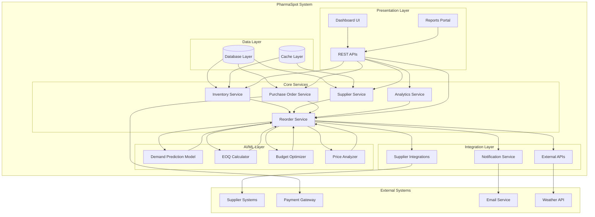
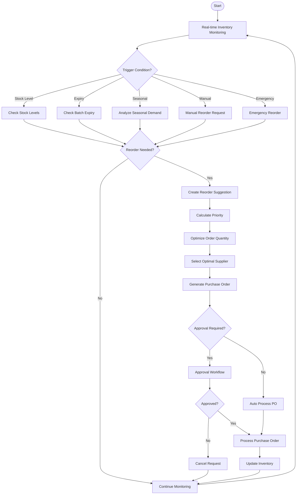
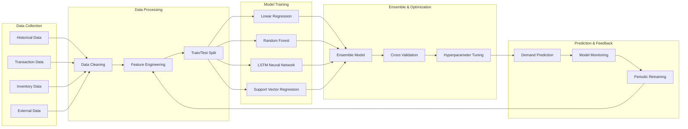
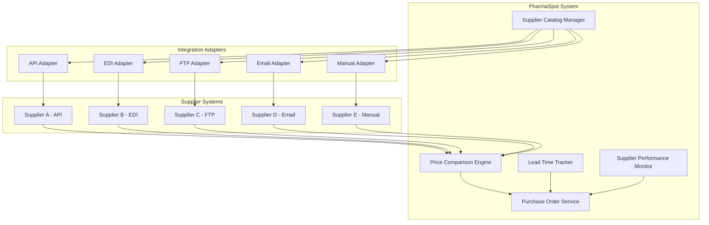
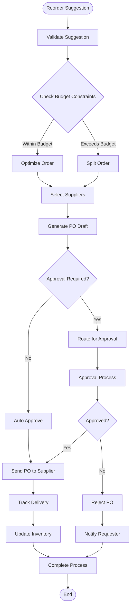
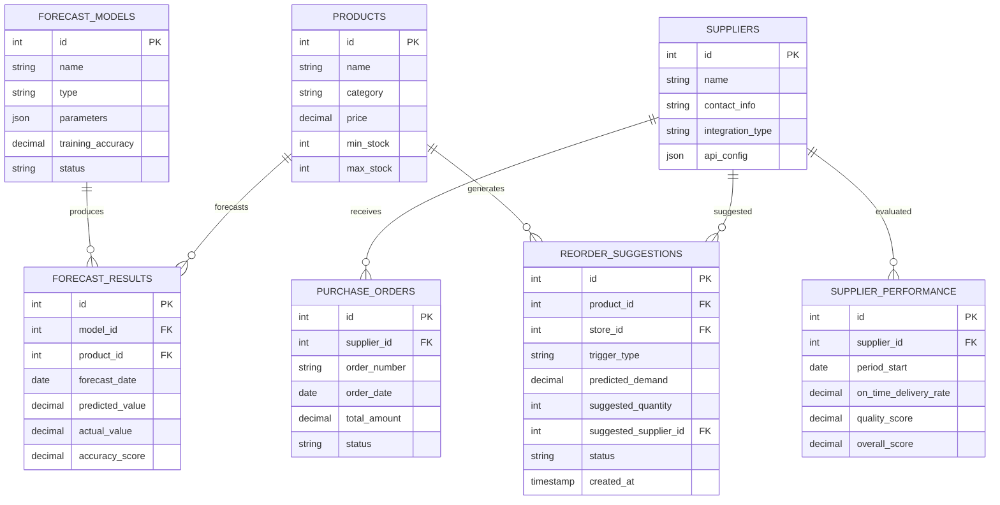
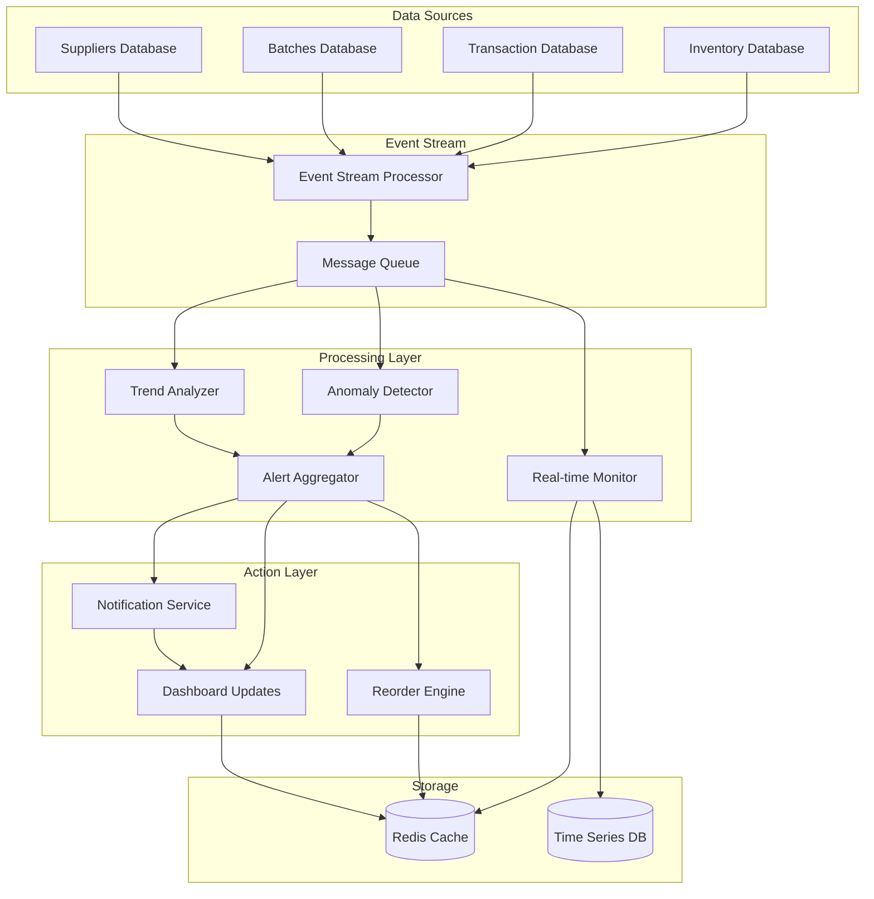
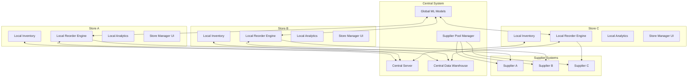
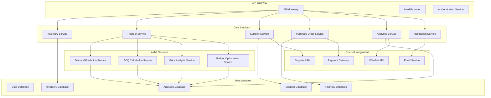
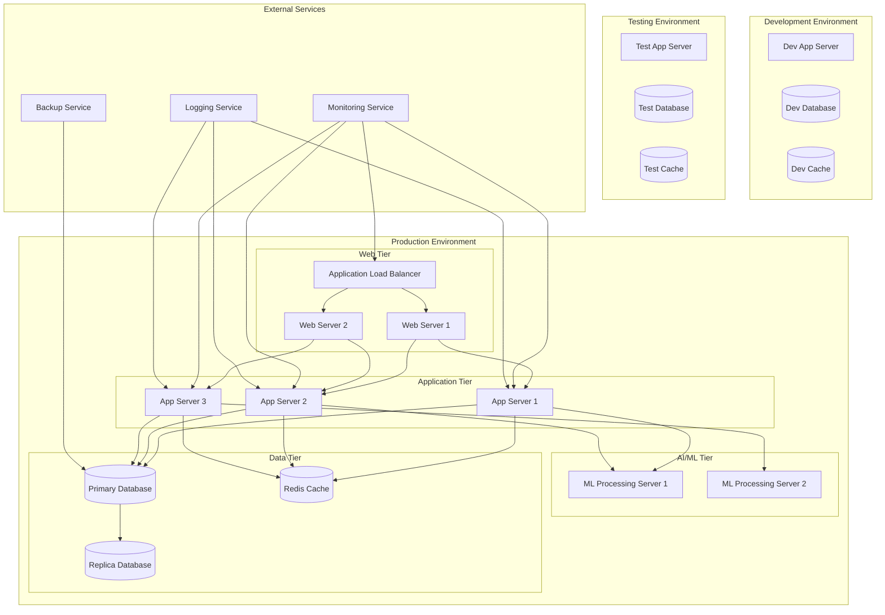

# Automated Reordering System - Architecture Diagrams

## 1. High-Level System Architecture

## 2. Reorder Trigger System Flow

## 3. AI/ML Prediction Pipeline

## 4. Supplier Integration Architecture

## 5. Purchase Order Automation Flow

## 6. Database Schema Relationships

## 7. Real-Time Monitoring Architecture

## 8. Multi-Store Reordering Architecture

## 9. Microservices Architecture

## 10. Deployment Architecture

These diagrams provide a comprehensive visual representation of the automated reordering system architecture, covering all major components and their interactions. The system is designed to be scalable, maintainable, and capable of handling complex reordering scenarios with AI/ML-driven decision making.