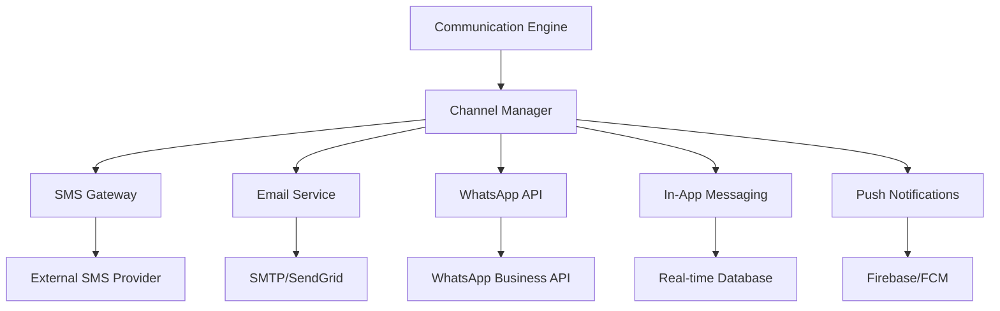
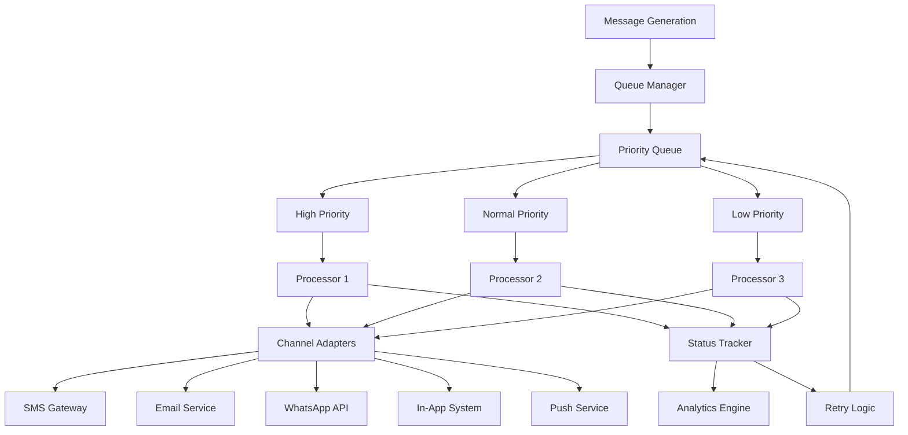

# Customer Communication Architecture for PharmaSpot

## Executive Summary

This document outlines the comprehensive architecture for customer communication features in PharmaSpot, designed to manage multi-channel communications with customers across various touchpoints. The system supports SMS, email, WhatsApp, in-app messaging, and future push notifications, with advanced features including campaign management, customer segmentation, template management, and detailed analytics.

## 1. Communication Channels Architecture

### 1.1 Multi-Channel Communication Framework



### 1.2 Channel-Specific Implementations

#### SMS Messaging
- **Provider Integration**: Pluggable SMS gateway architecture supporting multiple providers
- **Use Cases**: Appointment reminders, prescription alerts, short notifications
- **Limitations**: 160 characters per message, delivery reports dependent on provider
- **Configuration**: Provider settings, API keys, rate limiting

#### Email Communication
- **Existing Integration**: Leverages current email-service.js with enhancements
- **Use Cases**: Detailed receipts, prescription information, promotional content
- **Features**: HTML templates, PDF attachments, delivery tracking
- **Configuration**: SMTP settings, template management, bounce handling

#### WhatsApp Integration
- **API Integration**: WhatsApp Business API with message templates
- **Use Cases**: Rich media messages, interactive responses, document sharing
- **Features**: Template messages, media attachments, quick replies
- **Compliance**: Template pre-approval, opt-in management

#### In-App Messaging
- **Real-time Delivery**: WebSocket-based messaging for logged-in users
- **Storage**: Persistent message history in database
- **Features**: Read receipts, typing indicators, rich content
- **Integration**: Direct integration with main application UI

#### Push Notifications (Future)
- **Platform Support**: Firebase Cloud Messaging (Android), Apple Push Notification Service (iOS)
- **Use Cases**: Time-sensitive alerts, promotional notifications
- **Features**: Rich notifications, deep linking, analytics
- **Implementation**: Service worker architecture for background processing

## 2. Communication Types and Use Cases

### 2.1 Prescription-Related Communications

#### Prescription Reminders
- **Trigger**: Prescription due for refill
- **Channels**: SMS, WhatsApp, Email
- **Frequency**: Based on medication schedule
- **Content**: Medication name, refill instructions, pharmacy contact

#### Refill Notifications
- **Trigger**: Prescription ready for refill
- **Channels**: SMS, WhatsApp, Email, In-App
- **Content**: Ready notification, pickup/delivery options, payment methods

#### Test Results
- **Trigger**: Lab results available
- **Channels**: Email, In-App (secure), SMS (notification only)
- **Compliance**: HIPAA considerations, secure delivery
- **Content**: Result availability, access instructions, doctor follow-up

### 2.2 Appointment Communications

#### Appointment Reminders
- **Trigger**: Scheduled appointment approaching
- **Channels**: SMS, WhatsApp, Email
- **Timing**: Configurable intervals (24h, 2h before)
- **Content**: Date/time, location, preparation instructions, cancellation link

#### Appointment Confirmations
- **Trigger**: Appointment scheduled/modified
- **Channels**: All channels based on preference
- **Content**: Confirmation details, calendar attachment, reschedule options

#### Cancellation/Reschedule Notifications
- **Trigger**: Appointment changes
- **Channels**: All channels
- **Content**: Change details, new appointment info, confirmation required

### 2.3 Health and Wellness Communications

#### Medication Adherence Messages
- **Trigger**: Daily/weekly medication schedules
- **Channels**: SMS, WhatsApp, In-App
- **Personalization**: Based on customer's prescription schedule
- **Content**: Reminder time, medication name, dosage instructions

#### Health Tips
- **Trigger**: Scheduled campaigns
- **Channels**: Email, In-App
- **Segmentation**: Based on customer conditions, medications
- **Content**: Health advice, medication information, lifestyle tips

### 2.4 Promotional Communications

#### Special Offers
- **Trigger**: Marketing campaigns
- **Channels**: All channels based on preference
- **Personalization**: Based on purchase history, loyalty tier
- **Content**: Discount details, expiration dates, redemption instructions

#### New Product Announcements
- **Trigger**: Product launches
- **Channels**: Email, In-App
- **Targeting**: Based on purchase categories, health conditions
- **Content**: Product details, benefits, availability

### 2.5 Personal Communications

#### Birthday/Anniversary Wishes
- **Trigger**: Customer's special dates
- **Channels**: All channels
- **Personalization**: Name, special offer
- **Content**: Greeting message, exclusive discount

#### Loyalty Program Updates
- **Trigger**: Points earned, tier changes, rewards available
- **Channels**: In-App, Email, SMS
- **Content**: Points balance, tier benefits, reward options

## 3. Campaign Management System

### 3.1 Campaign Creation and Management

#### Campaign Definition
```javascript
{
  id: "campaign_unique_id",
  name: "Summer Health Campaign",
  description: "Promotional campaign for summer wellness products",
  type: "PROMOTIONAL|REMINDER|INFORMATIONAL",
  priority: "HIGH|MEDIUM|LOW",
  channels: ["email", "sms", "whatsapp"],
  schedule: {
    type: "IMMEDIATE|SCHEDULED|RECURRING",
    startDate: "2023-06-01T00:00:00Z",
    endDate: "2023-06-30T23:59:59Z",
    recurrence: {
      frequency: "DAILY|WEEKLY|MONTHLY",
      daysOfWeek: [1, 3, 5], // Monday, Wednesday, Friday
      timeOfDay: "10:00"
    }
  },
  targeting: {
    customerSegments: ["senior_citizens", "chronic_patients"],
    specificCustomers: ["customer_id_1", "customer_id_2"],
    excludeCustomers: ["customer_id_3"],
    conditions: {
      ageRange: { min: 60, max: 100 },
      lastPurchaseDate: { before: "2023-05-01" },
      categories: ["wellness", "vitamins"],
      loyaltyTier: ["Gold", "Platinum"]
    }
  },
  content: {
    templates: {
      email: "template_id_email",
      sms: "template_id_sms",
      whatsapp: "template_id_whatsapp"
    },
    personalizationData: {
      discountCode: "SUMMER20",
      validUntil: "2023-06-30"
    }
  },
  throttling: {
    messagesPerHour: 100,
    messagesPerDay: 1000,
    cooldownPeriod: 72 // hours
  },
  status: "DRAFT|SCHEDULED|RUNNING|PAUSED|COMPLETED|CANCELLED",
  metrics: {
    sent: 0,
    delivered: 0,
    read: 0,
    clicked: 0,
    converted: 0,
    unsubscribed: 0
  }
}
```

### 3.2 Customer Segmentation

#### Dynamic Segmentation
- **Demographic Segments**: Age, gender, location
- **Behavioral Segments**: Purchase frequency, categories, average order value
- **Health-Based Segments**: Conditions, medications, prescription patterns
- **Loyalty Segments**: Tier, points balance, engagement level
- **Communication Segments**: Preferred channels, consent status, engagement history

#### Segment Management Interface
- **Visual Builder**: Drag-and-drop segment creation
- **Preview System**: Show affected customers before campaign launch
- **Performance Tracking**: Segment effectiveness over time
- **Auto-Update**: Dynamic segments based on changing customer data

### 3.3 Campaign Scheduling and Automation

#### Time-Based Scheduling
- **Campaign Calendar**: Visual calendar with campaign timeline
- **Conflict Detection**: Prevent overlapping campaigns to same segments
- **Optimal Send Times**: AI-based recommendations based on engagement data
- **Time Zone Handling**: Automatic adjustment to customer's local time

#### Trigger-Based Automation
- **Event Triggers**: Prescription refill due, birthday, tier change
- **Behavioral Triggers**: Cart abandonment, website browsing patterns
- **Lifecycle Triggers**: Welcome series, re-engagement campaigns
- **Integration Points**: Connect with prescription, loyalty, transaction systems

## 4. Template Management System

### 4.1 Template Structure and Types

#### Template Definition
```javascript
{
  id: "template_unique_id",
  name: "Prescription Refill Reminder",
  description: "Template for notifying customers about prescription refills",
  type: "SMS|EMAIL|WHATSAPP|IN_APP|PUSH",
  category: "PRESCRIPTION|APPOINTMENT|PROMOTIONAL|PERSONAL",
  language: "en|es|fr|hi|...",

  // Channel-specific content
  content: {
    sms: {
      body: "Hi {{customerName}}, your prescription for {{medicationName}} is ready for refill. Visit {{pharmacyName}} or call {{pharmacyPhone}}.",
      characterLimit: 160
    },
    email: {
      subject: "Your Prescription Refill is Ready",
      htmlBody: "<html>...</html>",
      textBody: "Hi {{customerName}}...",
      attachments: ["prescription_details.pdf"]
    },
    whatsapp: {
      templateName: "prescription_refill_ready",
      parameters: {
        customer_name: "{{customerName}}",
        medication_name: "{{medicationName}}",
        pharmacy_name: "{{pharmacyName}}"
      }
    }
  },

  // Personalization variables
  variables: [
    {
      name: "customerName",
      type: "STRING",
      description: "Customer's full name",
      required: true,
      defaultValue: "Valued Customer"
    },
    {
      name: "medicationName",
      type: "STRING",
      description: "Name of the medication",
      required: true
    }
  ],

  // Template metadata
  isActive: true,
  isDefault: false,
  version: "1.0",
  createdBy: "user_id",
  createdAt: "2023-06-01T00:00:00Z",
  updatedAt: "2023-06-15T00:00:00Z",
  
  // Approval workflow
  approvalStatus: "PENDING|APPROVED|REJECTED",
  approvedBy: "manager_id",
  approvedAt: "2023-06-02T00:00:00Z",
  
  // Analytics
  usageCount: 0,
  lastUsed: null,
  performance: {
    openRate: 0,
    clickRate: 0,
    conversionRate: 0
  }
}
```

### 4.2 Multi-Language Support

#### Internationalization Framework
- **Language Detection**: Based on customer preference, location
- **Template Variants**: Same template in multiple languages
- **Fallback System**: Default language if preferred language unavailable
- **RTL Support**: Right-to-left language support for Arabic, Hebrew

#### Variable Localization
- **Date/Time Formats**: Locale-appropriate formatting
- **Currency Formatting**: Local currency symbols and formats
- **Content Adaptation**: Culturally appropriate messaging

### 4.3 Template Approval Workflow

#### Multi-Stage Approval Process
1. **Creation**: User creates template with draft status
2. **Review**: Manager/Pharmacist reviews content for accuracy
3. **Compliance Check**: Legal/compliance team validates regulatory requirements
4. **Testing**: Test send to internal users
5. **Approval**: Final approval and activation
6. **Version Control**: Track changes and maintain version history

#### Approval Roles and Permissions
- **Creator**: Can create and edit own templates
- **Reviewer**: Can review and comment on templates
- **Approver**: Can approve/reject templates
- **Admin**: Full access to all templates and settings

## 5. Customer Preferences and Consent Management

### 5.1 Comprehensive Preference System

#### Preference Structure
```javascript
{
  customerId: "customer_unique_id",
  
  // Channel preferences
  channels: {
    sms: {
      enabled: true,
      phoneNumber: "+1234567890",
      consent: {
        marketing: false,
        transactional: true,
        appointment: true,
        prescription: true
      },
      consentDate: "2023-01-15T00:00:00Z",
      consentIP: "192.168.1.1"
    },
    email: {
      enabled: true,
      emailAddress: "customer@example.com",
      consent: {
        marketing: true,
        transactional: true,
        appointment: true,
        prescription: true,
        newsletter: false
      },
      consentDate: "2023-01-15T00:00:00Z"
    },
    whatsapp: {
      enabled: true,
      phoneNumber: "+1234567890",
      consent: {
        marketing: false,
        transactional: true,
        appointment: true
      },
      consentDate: "2023-01-15T00:00:00Z"
    },
    inApp: {
      enabled: true,
      consent: {
        marketing: true,
        transactional: true,
        appointment: true,
        prescription: true
      }
    },
    push: {
      enabled: false,
      deviceTokens: ["token1", "token2"],
      consent: {
        marketing: false,
        transactional: false
      }
    }
  },

  // Communication type preferences
  communicationTypes: {
    appointmentReminders: {
      enabled: true,
      preferredChannel: "sms",
      frequency: "24h_before",
      quietHours: {
        start: "22:00",
        end: "08:00"
      }
    },
    prescriptionRefills: {
      enabled: true,
      preferredChannel: "whatsapp",
      frequency: "7_days_before",
      autoRefill: false
    },
    promotionalMessages: {
      enabled: true,
      maxPerWeek: 2,
      preferredCategories: ["wellness", "vitamins"]
    },
    healthTips: {
      enabled: true,
      frequency: "weekly",
      topics: ["medication_adherence", "general_health"]
    },
    birthdayWishes: {
      enabled: true,
      includeOffer: true
    }
  },

  // Global preferences
  global: {
    quietHours: {
      enabled: true,
      start: "22:00",
      end: "08:00",
      timezone: "America/New_York",
      emergencyOverride: true
    },
    frequencyLimits: {
      maxPerDay: 5,
      maxPerWeek: 20,
      cooldownPeriod: 2 // hours between messages
    },
    language: "en",
    timezone: "America/New_York"
  },

  // Metadata
  updatedAt: "2023-06-01T00:00:00Z",
  updatedBy: "customer_self|admin_id",
  lastConsentUpdate: "2023-01-15T00:00:00Z"
}
```

### 5.2 Consent Management and Compliance

#### Granular Consent System
- **Communication Type Consent**: Separate consent for different message types
- **Channel-Specific Consent**: Consent per communication channel
- **Purpose-Based Consent**: Marketing vs. transactional messages
- **Time-Bound Consent**: Consent expiration with renewal requirements

#### Consent Tracking and Audit
- **Consent History**: Complete log of consent changes
- **IP and Timestamp**: Record of when/where consent was given
- **Method Tracking**: How consent was obtained (form, verbal, digital)
- **Withdrawal Process**: Easy opt-out with confirmation

### 5.3 Preference Management Interface

#### Customer-Facing Preferences
- **Mobile App Settings**: In-app preference management
- **Web Portal**: Online preference center
- **SMS Commands**: Text-based preference changes (STOP, START)
- **Email Preferences**: Preference management links in emails

#### Staff Interface
- **Customer Service Override**: Temporary preference changes for specific situations
- **Bulk Updates**: Update preferences for customer segments
- **Preference Analytics**: Track preference changes and impact

## 6. Integration Points with Existing Systems

### 6.1 Customer Management Integration

#### Customer Data Synchronization
- **Real-time Updates**: Customer changes trigger preference updates
- **Profile Integration**: Communication preferences in customer profile
- **Segmentation Data**: Purchase history, demographics for targeting
- **Status Changes**: Account status affects communication eligibility

#### API Integration Points
```javascript
// Customer API extensions for communication
GET /api/customer/:customerId/communication-preferences
PUT /api/customer/:customerId/communication-preferences
POST /api/customer/:customerId/consent-update

// Webhooks from customer system
POST /api/communication/webhook/customer-created
POST /api/communication/webhook/customer-updated
POST /api/communication/webhook/customer-deleted
```

### 6.2 Prescription Management Integration

#### Prescription-Based Triggers
- **Refill Reminders**: Based on prescription fill date and days supply
- **New Prescription Notifications**: When new prescription is added
- **Expiry Alerts**: Before prescription expires
- **Pickup Notifications**: When prescription is ready for collection

#### Integration Architecture
```javascript
// Prescription API extensions
GET /api/prescriptions/:id/communication-status
POST /api/prescriptions/:id/schedule-reminders

// Webhooks from prescription system
POST /api/communication/webhook/prescription-created
POST /api/communication/webhook/prescription-refilled
POST /api/communication/webhook/prescription-expiring
```

### 6.3 Loyalty Program Integration

#### Loyalty-Based Communications
- **Points Earned Notifications**: When points are credited
- **Tier Change Notifications**: When customer moves to new tier
- **Reward Expiration**: Before points/rewards expire
- **Special Offers**: Tier-exclusive promotions

#### Integration Points
```javascript
// Loyalty API extensions
GET /api/loyalty/customer/:customerId/communication-preferences
POST /api/loyalty/customer/:customerId/notify-points-change

// Webhooks from loyalty system
POST /api/communication/webhook/points-earned
POST /api/communication/webhook/tier-changed
POST /api/communication/webhook/reward-expired
```

### 6.4 Transaction and Delivery Integration

#### Transaction-Based Communications
- **Receipt Delivery**: Automatic receipt sending based on preference
- **Payment Confirmations**: When payments are processed
- **Refund Notifications**: When refunds are issued
- **Delivery Updates**: Real-time delivery status changes

#### Integration Architecture
```javascript
// Transaction API extensions
POST /api/transactions/:id/send-receipt
GET /api/transactions/:id/communication-status

// Webhooks from transaction system
POST /api/communication/webhook/transaction-completed
POST /api/communication/webhook/payment-confirmed
POST /api/communication/webhook/refund-processed
```

## 7. Comprehensive Database Schema

### 7.1 Communication Logs and History

#### Communications Table
```sql
CREATE TABLE communications (
    id VARCHAR(50) PRIMARY KEY,
    customer_id VARCHAR(50) NOT NULL,
    transaction_id VARCHAR(50),
    prescription_id VARCHAR(50),
    appointment_id VARCHAR(50),
    campaign_id VARCHAR(50),
    template_id VARCHAR(50),
    
    -- Channel and type
    channel VARCHAR(20) NOT NULL, -- SMS, EMAIL, WHATSAPP, IN_APP, PUSH
    type VARCHAR(30) NOT NULL, -- APPOINTMENT_REMINDER, PRESCRIPTION_REFILL, etc.
    category VARCHAR(20) NOT NULL, -- TRANSACTIONAL, PROMOTIONAL, INFORMATIONAL
    
    -- Content
    subject VARCHAR(255),
    content TEXT NOT NULL,
    attachments TEXT, -- JSON array of attachment paths
    
    -- Recipients
    recipient VARCHAR(255) NOT NULL,
    cc_recipients TEXT, -- JSON array
    bcc_recipients TEXT, -- JSON array
    
    -- Status tracking
    status VARCHAR(20) DEFAULT 'PENDING', -- PENDING, SENT, DELIVERED, READ, FAILED
    sent_at TIMESTAMP,
    delivered_at TIMESTAMP,
    read_at TIMESTAMP,
    failed_at TIMESTAMP,
    error_message TEXT,
    
    -- Metadata
    priority INTEGER DEFAULT 1, -- 1=Low, 2=Normal, 3=High
    cost DECIMAL(10,4), -- Cost of sending this message
    provider VARCHAR(50), -- External provider used
    provider_message_id VARCHAR(100), -- External message ID for tracking
    
    -- Personalization
    personalization_data TEXT, -- JSON object with variables used
    
    -- Audit
    created_by VARCHAR(50),
    created_at TIMESTAMP DEFAULT CURRENT_TIMESTAMP,
    updated_at TIMESTAMP DEFAULT CURRENT_TIMESTAMP,
    
    -- Indexes
    INDEX idx_communications_customer (customer_id),
    INDEX idx_communications_transaction (transaction_id),
    INDEX idx_communications_campaign (campaign_id),
    INDEX idx_communications_status (status),
    INDEX idx_communications_channel (channel),
    INDEX idx_communications_type (type),
    INDEX idx_communications_created (created_at),
    
    -- Foreign keys
    FOREIGN KEY (customer_id) REFERENCES customers(id),
    FOREIGN KEY (transaction_id) REFERENCES transactions(id),
    FOREIGN KEY (prescription_id) REFERENCES prescriptions(id),
    FOREIGN KEY (campaign_id) REFERENCES campaigns(id),
    FOREIGN KEY (template_id) REFERENCES templates(id)
);
```

### 7.2 Customer Preferences and Consent

#### Customer Preferences Table
```sql
CREATE TABLE customer_communication_preferences (
    id VARCHAR(50) PRIMARY KEY,
    customer_id VARCHAR(50) NOT NULL UNIQUE,
    
    -- Channel preferences
    sms_enabled BOOLEAN DEFAULT TRUE,
    sms_phone_number VARCHAR(20),
    sms_consent_marketing BOOLEAN DEFAULT FALSE,
    sms_consent_transactional BOOLEAN DEFAULT TRUE,
    sms_consent_appointment BOOLEAN DEFAULT TRUE,
    sms_consent_prescription BOOLEAN DEFAULT TRUE,
    sms_consent_date TIMESTAMP,
    
    -- Email preferences
    email_enabled BOOLEAN DEFAULT TRUE,
    email_address VARCHAR(255),
    email_consent_marketing BOOLEAN DEFAULT TRUE,
    email_consent_transactional BOOLEAN DEFAULT TRUE,
    email_consent_appointment BOOLEAN DEFAULT TRUE,
    email_consent_prescription BOOLEAN DEFAULT TRUE,
    email_consent_newsletter BOOLEAN DEFAULT FALSE,
    email_consent_date TIMESTAMP,
    
    -- WhatsApp preferences
    whatsapp_enabled BOOLEAN DEFAULT TRUE,
    whatsapp_phone_number VARCHAR(20),
    whatsapp_consent_marketing BOOLEAN DEFAULT FALSE,
    whatsapp_consent_transactional BOOLEAN DEFAULT TRUE,
    whatsapp_consent_appointment BOOLEAN DEFAULT TRUE,
    whatsapp_consent_date TIMESTAMP,
    
    -- In-app preferences
    inapp_enabled BOOLEAN DEFAULT TRUE,
    inapp_consent_marketing BOOLEAN DEFAULT TRUE,
    inapp_consent_transactional BOOLEAN DEFAULT TRUE,
    inapp_consent_appointment BOOLEAN DEFAULT TRUE,
    inapp_consent_prescription BOOLEAN DEFAULT TRUE,
    
    -- Push notification preferences
    push_enabled BOOLEAN DEFAULT FALSE,
    push_device_tokens TEXT, -- JSON array of device tokens
    push_consent_marketing BOOLEAN DEFAULT FALSE,
    push_consent_transactional BOOLEAN DEFAULT FALSE,
    
    -- Communication type preferences
    appointment_reminders_enabled BOOLEAN DEFAULT TRUE,
    appointment_reminders_channel VARCHAR(20) DEFAULT 'SMS',
    appointment_reminders_frequency VARCHAR(20) DEFAULT '24h_before',
    
    prescription_refills_enabled BOOLEAN DEFAULT TRUE,
    prescription_refills_channel VARCHAR(20) DEFAULT 'WHATSAPP',
    prescription_refills_frequency VARCHAR(20) DEFAULT '7_days_before',
    prescription_autorefill BOOLEAN DEFAULT FALSE,
    
    promotional_messages_enabled BOOLEAN DEFAULT TRUE,
    promotional_messages_max_per_week INTEGER DEFAULT 2,
    promotional_messages_categories TEXT, -- JSON array
    
    health_tips_enabled BOOLEAN DEFAULT TRUE,
    health_tips_frequency VARCHAR(20) DEFAULT 'weekly',
    health_tips_topics TEXT, -- JSON array
    
    birthday_wishes_enabled BOOLEAN DEFAULT TRUE,
    birthday_wishes_include_offer BOOLEAN DEFAULT TRUE,
    
    -- Global preferences
    quiet_hours_enabled BOOLEAN DEFAULT TRUE,
    quiet_hours_start TIME DEFAULT '22:00:00',
    quiet_hours_end TIME DEFAULT '08:00:00',
    quiet_hours_timezone VARCHAR(50) DEFAULT 'UTC',
    quiet_hours_emergency_override BOOLEAN DEFAULT TRUE,
    
    frequency_limits_enabled BOOLEAN DEFAULT TRUE,
    frequency_limits_max_per_day INTEGER DEFAULT 5,
    frequency_limits_max_per_week INTEGER DEFAULT 20,
    frequency_limits_cooldown_hours INTEGER DEFAULT 2,
    
    language VARCHAR(10) DEFAULT 'en',
    timezone VARCHAR(50) DEFAULT 'UTC',
    
    -- Audit
    updated_by VARCHAR(50),
    updated_at TIMESTAMP DEFAULT CURRENT_TIMESTAMP,
    created_at TIMESTAMP DEFAULT CURRENT_TIMESTAMP,
    
    -- Indexes
    INDEX idx_preferences_customer (customer_id),
    
    -- Foreign keys
    FOREIGN KEY (customer_id) REFERENCES customers(id)
);
```

### 7.3 Campaign Management Tables

#### Campaigns Table
```sql
CREATE TABLE campaigns (
    id VARCHAR(50) PRIMARY KEY,
    name VARCHAR(200) NOT NULL,
    description TEXT,
    type VARCHAR(30) NOT NULL, -- PROMOTIONAL, REMINDER, INFORMATIONAL
    priority INTEGER DEFAULT 1, -- 1=Low, 2=Normal, 3=High
    
    -- Scheduling
    schedule_type VARCHAR(20) NOT NULL, -- IMMEDIATE, SCHEDULED, RECURRING
    start_date TIMESTAMP,
    end_date TIMESTAMP,
    recurrence_frequency VARCHAR(20), -- DAILY, WEEKLY, MONTHLY
    recurrence_days_of_week TEXT, -- JSON array of day numbers
    recurrence_time_of_day TIME DEFAULT '10:00:00',
    
    -- Targeting
    customer_segments TEXT, -- JSON array of segment IDs
    specific_customers TEXT, -- JSON array of customer IDs
    exclude_customers TEXT, -- JSON array of customer IDs
    targeting_conditions TEXT, -- JSON object of targeting rules
    
    -- Content
    templates TEXT, -- JSON object mapping channels to template IDs
    personalization_data TEXT, -- JSON object with personalization variables
    
    -- Throttling
    throttling_enabled BOOLEAN DEFAULT FALSE,
    throttling_messages_per_hour INTEGER,
    throttling_messages_per_day INTEGER,
    throttling_cooldown_hours INTEGER,
    
    -- Status
    status VARCHAR(20) DEFAULT 'DRAFT', -- DRAFT, SCHEDULED, RUNNING, PAUSED, COMPLETED, CANCELLED
    
    -- Metrics
    metrics_sent INTEGER DEFAULT 0,
    metrics_delivered INTEGER DEFAULT 0,
    metrics_read INTEGER DEFAULT 0,
    metrics_clicked INTEGER DEFAULT 0,
    metrics_converted INTEGER DEFAULT 0,
    metrics_unsubscribed INTEGER DEFAULT 0,
    metrics_cost DECIMAL(12,4) DEFAULT 0,
    
    -- Audit
    created_by VARCHAR(50) NOT NULL,
    created_at TIMESTAMP DEFAULT CURRENT_TIMESTAMP,
    updated_at TIMESTAMP DEFAULT CURRENT_TIMESTAMP,
    
    -- Indexes
    INDEX idx_campaigns_status (status),
    INDEX idx_campaigns_type (type),
    INDEX idx_campaigns_start_date (start_date),
    INDEX idx_campaigns_created_by (created_by),
    
    -- Foreign keys
    FOREIGN KEY (created_by) REFERENCES users(id)
);
```

### 7.4 Template Management Tables

#### Templates Table (Enhanced)
```sql
CREATE TABLE communication_templates (
    id VARCHAR(50) PRIMARY KEY,
    name VARCHAR(200) NOT NULL,
    description TEXT,
    type VARCHAR(20) NOT NULL, -- SMS, EMAIL, WHATSAPP, IN_APP, PUSH
    category VARCHAR(30) NOT NULL, -- PRESCRIPTION, APPOINTMENT, PROMOTIONAL, etc.
    language VARCHAR(10) DEFAULT 'en',
    
    -- Content
    subject VARCHAR(255),
    sms_body TEXT,
    email_html_body TEXT,
    email_text_body TEXT,
    whatsapp_template_name VARCHAR(100),
    whatsapp_parameters TEXT, -- JSON object
    inapp_title VARCHAR(255),
    inapp_body TEXT,
    push_title VARCHAR(255),
    push_body TEXT,
    push_data TEXT, -- JSON object for additional push data
    
    -- Personalization variables
    variables TEXT, -- JSON array of variable definitions
    
    -- Settings
    is_active BOOLEAN DEFAULT TRUE,
    is_default BOOLEAN DEFAULT FALSE,
    version VARCHAR(20) DEFAULT '1.0',
    
    -- Approval workflow
    approval_status VARCHAR(20) DEFAULT 'PENDING', -- PENDING, APPROVED, REJECTED
    approved_by VARCHAR(50),
    approved_at TIMESTAMP,
    rejection_reason TEXT,
    
    -- Usage analytics
    usage_count INTEGER DEFAULT 0,
    last_used_at TIMESTAMP,
    performance_open_rate DECIMAL(5,2),
    performance_click_rate DECIMAL(5,2),
    performance_conversion_rate DECIMAL(5,2),
    
    -- Audit
    created_by VARCHAR(50) NOT NULL,
    created_at TIMESTAMP DEFAULT CURRENT_TIMESTAMP,
    updated_at TIMESTAMP DEFAULT CURRENT_TIMESTAMP,
    
    -- Indexes
    INDEX idx_templates_type (type),
    INDEX idx_templates_category (category),
    INDEX idx_templates_language (language),
    INDEX idx_templates_active (is_active),
    INDEX idx_templates_default (is_default),
    INDEX idx_templates_approval (approval_status),
    
    -- Foreign keys
    FOREIGN KEY (created_by) REFERENCES users(id),
    FOREIGN KEY (approved_by) REFERENCES users(id)
);
```

### 7.5 Message Queue and Delivery Tracking

#### Message Queue Table
```sql
CREATE TABLE message_queue (
    id VARCHAR(50) PRIMARY KEY,
    customer_id VARCHAR(50) NOT NULL,
    communication_id VARCHAR(50),
    
    -- Message details
    channel VARCHAR(20) NOT NULL,
    type VARCHAR(30) NOT NULL,
    priority INTEGER DEFAULT 1,
    recipient VARCHAR(255) NOT NULL,
    subject VARCHAR(255),
    content TEXT NOT NULL,
    attachments TEXT, -- JSON array
    template_id VARCHAR(50),
    personalization_data TEXT, -- JSON object
    
    -- Scheduling
    scheduled_at TIMESTAMP DEFAULT CURRENT_TIMESTAMP,
    send_after TIMESTAMP, -- For delayed sending
    
    -- Processing status
    status VARCHAR(20) DEFAULT 'PENDING', -- PENDING, PROCESSING, SENT, DELIVERED, READ, FAILED
    processing_started_at TIMESTAMP,
    sent_at TIMESTAMP,
    delivered_at TIMESTAMP,
    read_at TIMESTAMP,
    failed_at TIMESTAMP,
    
    -- Retry logic
    retry_count INTEGER DEFAULT 0,
    max_retries INTEGER DEFAULT 3,
    retry_delay_minutes INTEGER DEFAULT 5,
    next_retry_at TIMESTAMP,
    error_message TEXT,
    error_code VARCHAR(50),
    
    -- Provider information
    provider VARCHAR(50),
    provider_message_id VARCHAR(100),
    provider_response TEXT, -- Full response from provider
    
    -- Cost tracking
    cost DECIMAL(10,4),
    currency VARCHAR(3) DEFAULT 'USD',
    
    -- Metadata
    campaign_id VARCHAR(50),
    transaction_id VARCHAR(50),
    prescription_id VARCHAR(50),
    appointment_id VARCHAR(50),
    
    -- Audit
    created_at TIMESTAMP DEFAULT CURRENT_TIMESTAMP,
    updated_at TIMESTAMP DEFAULT CURRENT_TIMESTAMP,
    
    -- Indexes
    INDEX idx_queue_status (status),
    INDEX idx_queue_scheduled (scheduled_at),
    INDEX idx_queue_retry (next_retry_at),
    INDEX idx_queue_customer (customer_id),
    INDEX idx_queue_channel (channel),
    INDEX idx_queue_priority (priority DESC),
    
    -- Foreign keys
    FOREIGN KEY (customer_id) REFERENCES customers(id),
    FOREIGN KEY (communication_id) REFERENCES communications(id),
    FOREIGN KEY (template_id) REFERENCES communication_templates(id),
    FOREIGN KEY (campaign_id) REFERENCES campaigns(id)
);
```

### 7.6 Analytics and Reporting Tables

#### Communication Analytics Table
```sql
CREATE TABLE communication_analytics (
    id VARCHAR(50) PRIMARY KEY,
    communication_id VARCHAR(50),
    campaign_id VARCHAR(50),
    template_id VARCHAR(50),
    customer_id VARCHAR(50),
    
    -- Event tracking
    event_type VARCHAR(30) NOT NULL, -- SENT, DELIVERED, READ, CLICKED, CONVERTED, UNSUBSCRIBED, BOUNCED, FAILED
    event_timestamp TIMESTAMP DEFAULT CURRENT_TIMESTAMP,
    
    -- Event details
    event_data TEXT, -- JSON object with event-specific data
    user_agent TEXT, -- For email opens/clicks
    ip_address VARCHAR(45),
    device_type VARCHAR(50), -- Mobile, Desktop, Tablet
    platform VARCHAR(50), -- iOS, Android, Windows, etc.
    
    -- Location data
    country VARCHAR(2), -- ISO country code
    city VARCHAR(100),
    timezone VARCHAR(50),
    
    -- Cost tracking
    cost DECIMAL(10,4),
    
    -- Indexes
    INDEX idx_analytics_communication (communication_id),
    INDEX idx_analytics_campaign (campaign_id),
    INDEX idx_analytics_template (template_id),
    INDEX idx_analytics_customer (customer_id),
    INDEX idx_analytics_event (event_type),
    INDEX idx_analytics_timestamp (event_timestamp),
    
    -- Foreign keys
    FOREIGN KEY (communication_id) REFERENCES communications(id),
    FOREIGN KEY (campaign_id) REFERENCES campaigns(id),
    FOREIGN KEY (template_id) REFERENCES communication_templates(id),
    FOREIGN KEY (customer_id) REFERENCES customers(id)
);
```

## 8. Message Queue and Delivery Tracking System

### 8.1 Queue Processing Architecture

#### Priority-Based Queue System


#### Queue Processing Logic
```javascript
class MessageQueueProcessor {
    constructor() {
        this.processors = [];
        this.isRunning = false;
        this.processingInterval = 30000; // 30 seconds
    }
    
    async processQueue() {
        // Get pending messages ordered by priority and scheduled time
        const messages = await this.getPendingMessages();
        
        // Group by channel for batch processing
        const messagesByChannel = this.groupByChannel(messages);
        
        // Process each channel
        for (const [channel, channelMessages] of messagesByChannel) {
            await this.processChannelMessages(channel, channelMessages);
        }
    }
    
    async processChannelMessages(channel, messages) {
        const adapter = this.getChannelAdapter(channel);
        const rateLimiter = this.getRateLimiter(channel);
        
        for (const message of messages) {
            // Check rate limits
            await rateLimiter.checkLimit();
            
            // Update status to processing
            await this.updateMessageStatus(message.id, 'PROCESSING');
            
            try {
                // Send message through channel adapter
                const result = await adapter.sendMessage(message);
                
                // Update status based on result
                if (result.success) {
                    await this.updateMessageStatus(message.id, 'SENT', {
                        providerMessageId: result.messageId,
                        sentAt: new Date(),
                        cost: result.cost
                    });
                    
                    // Schedule delivery tracking if applicable
                    if (adapter.supportsDeliveryTracking) {
                        await this.scheduleDeliveryTracking(message.id, result.messageId);
                    }
                } else {
                    await this.updateMessageStatus(message.id, 'FAILED', {
                        errorMessage: result.error,
                        failedAt: new Date()
                    });
                    
                    // Schedule retry if applicable
                    await this.scheduleRetry(message);
                }
            } catch (error) {
                await this.updateMessageStatus(message.id, 'FAILED', {
                    errorMessage: error.message,
                    failedAt: new Date()
                });
                
                await this.scheduleRetry(message);
            }
        }
    }
    
    async scheduleRetry(message) {
        if (message.retryCount < message.maxRetries) {
            const nextRetryTime = new Date(Date.now() + (message.retryDelayMinutes * 60 * 1000 * Math.pow(2, message.retryCount)));
            
            await this.updateMessage(message.id, {
                status: 'PENDING',
                retryCount: message.retryCount + 1,
                nextRetryAt: nextRetryTime
            });
        }
    }
}
```

### 8.2 Rate Limiting and Cost Management

#### Rate Limiting by Channel
```javascript
class RateLimiter {
    constructor(channel, limits) {
        this.channel = channel;
        this.limits = {
            messagesPerSecond: limits.messagesPerSecond || 10,
            messagesPerMinute: limits.messagesPerMinute || 100,
            messagesPerHour: limits.messagesPerHour || 1000,
            messagesPerDay: limits.messagesPerDay || 10000,
            costPerDay: limits.costPerDay || 100
        };
        this.usage = {
            second: [],
            minute: [],
            hour: [],
            day: [],
            totalCost: 0
        };
    }
    
    async checkLimit() {
        const now = Date.now();
        
        // Clean old usage records
        this.cleanOldUsage(now);
        
        // Check all limits
        if (this.usage.second.length >= this.limits.messagesPerSecond) {
            await this.waitForNextSecond();
        }
        
        if (this.usage.minute.length >= this.limits.messagesPerMinute) {
            await this.waitForNextMinute();
        }
        
        if (this.usage.hour.length >= this.limits.messagesPerHour) {
            await this.waitForNextHour();
        }
        
        if (this.usage.day.length >= this.limits.messagesPerDay) {
            await this.waitForNextDay();
        }
        
        if (this.usage.totalCost >= this.limits.costPerDay) {
            throw new Error(`Daily cost limit exceeded for ${this.channel}`);
        }
        
        // Record this usage
        this.recordUsage(now);
    }
    
    recordUsage(now, cost = 0) {
        this.usage.second.push(now);
        this.usage.minute.push(now);
        this.usage.hour.push(now);
        this.usage.day.push(now);
        this.usage.totalCost += cost;
    }
}
```

### 8.3 Delivery Tracking and Status Updates

#### Multi-Channel Status Tracking
```javascript
class DeliveryTracker {
    constructor() {
        this.trackingMethods = {
            'SMS': this.trackSMSDelivery.bind(this),
            'EMAIL': this.trackEmailDelivery.bind(this),
            'WHATSAPP': this.trackWhatsAppDelivery.bind(this),
            'IN_APP': this.trackInAppDelivery.bind(this),
            'PUSH': this.trackPushDelivery.bind(this)
        };
    }
    
    async trackDelivery(communicationId, channel, providerMessageId) {
        const tracker = this.trackingMethods[channel];
        if (tracker) {
            return await tracker(communicationId, providerMessageId);
        }
    }
    
    async trackSMSDelivery(communicationId, providerMessageId) {
        // Query SMS provider for delivery status
        const status = await this.smsProvider.getDeliveryStatus(providerMessageId);
        
        switch (status.status) {
            case 'DELIVERED':
                await this.updateCommunicationStatus(communicationId, 'DELIVERED', {
                    deliveredAt: status.timestamp,
                    deliveryDetails: status
                });
                break;
                
            case 'FAILED':
                await this.updateCommunicationStatus(communicationId, 'FAILED', {
                    errorMessage: status.error,
                    failedAt: status.timestamp
                });
                break;
                
            case 'READ':
                await this.updateCommunicationStatus(communicationId, 'READ', {
                    readAt: status.timestamp
                });
                break;
        }
    }
    
    async trackEmailDelivery(communicationId, providerMessageId) {
        // Handle email tracking via webhooks or polling
        // This would integrate with services like SendGrid, Mailgun, etc.
    }
    
    async trackWhatsAppDelivery(communicationId, providerMessageId) {
        // WhatsApp Business API provides delivery and read receipts
        const status = await this.whatsappProvider.getMessageStatus(providerMessageId);
        
        // Update communication status based on WhatsApp status
    }
}
```

## 9. Analytics and Reporting Capabilities

### 9.1 Real-Time Analytics Dashboard

#### Key Performance Indicators
```javascript
const CommunicationKPIs = {
    // Delivery metrics
    deliveryRate: (delivered / sent) * 100,
    readRate: (read / delivered) * 100,
    clickRate: (clicked / read) * 100,
    conversionRate: (converted / clicked) * 100,
    
    // Engagement metrics
    averageResponseTime: "Time between send and read",
    peakEngagementTimes: "Hours/days with highest engagement",
    channelEffectiveness: "Performance by channel",
    
    // Cost metrics
    costPerMessage: "Total cost / number of messages",
    costPerConversion: "Total cost / number of conversions",
    roiByCampaign: "Revenue generated vs. communication cost",
    
    // Compliance metrics
    consentRate: "Customers with consent / total customers",
    unsubscribeRate: "Unsubscribes / total messages",
    complaintRate: "Complaints / total messages",
    
    // Customer segmentation metrics
    segmentEngagement: "Engagement by customer segment",
    personalizationImpact: "Impact of personalized vs. generic content"
};
```

### 9.2 Advanced Reporting Features

#### Custom Report Builder
- **Drag-and-Drop Interface**: Visual report creation
- **Data Source Selection**: Choose from multiple communication data sources
- **Visualization Options**: Charts, graphs, heat maps, tables
- **Scheduled Reports**: Automatic generation and delivery
- **Export Options**: PDF, Excel, CSV, JSON formats

#### Pre-built Report Templates
1. **Campaign Performance Report**
   - Sent, delivered, read rates
   - Conversion metrics
   - Cost analysis
   - ROI calculation

2. **Channel Effectiveness Report**
   - Performance comparison across channels
   - Customer preference analysis
   - Cost-effectiveness metrics

3. **Customer Engagement Report**
   - Most engaged customers
   - Engagement by segment
   - Preferred communication times

4. **Compliance Report**
   - Consent status overview
   - Opt-in/opt-out trends
   - Regulatory compliance metrics

### 9.3 Predictive Analytics

#### Send Time Optimization
- **Historical Analysis**: Analyze past engagement by time/day
- **Customer Preferences**: Individual optimal send times
- **Machine Learning**: Predict best send times for each customer
- **A/B Testing**: Test different send times to optimize

#### Content Optimization
- **Subject Line Analysis**: Performance by subject patterns
- **Content Effectiveness**: Which content performs best
- **Personalization Impact**: Measure personalization effectiveness
- **Multivariate Testing**: Test multiple content variables

#### Churn Prediction
- **Engagement Decline**: Identify customers with decreasing engagement
- **Opt-out Risk**: Predict customers likely to unsubscribe
- **Intervention Triggers**: Automatic re-engagement campaigns
- **Retention Strategies**: Targeted communications to prevent churn

## 10. Compliance and Privacy Considerations

### 10.1 Regulatory Compliance Framework

#### Healthcare Communication Regulations (HIPAA)
- **PHI Protection**: Secure handling of Protected Health Information
- **Audit Trails**: Complete logs of all PHI access and communication
- **Data Encryption**: Encryption for sensitive data at rest and in transit
- **Access Controls**: Role-based access to patient communication data
- **Business Associate Agreements**: Proper agreements with communication vendors

#### Marketing Communication Regulations
- **Consent Management**: Explicit opt-in for marketing communications
- **Easy Opt-out**: Simple unsubscribe mechanisms in all messages
- **Consent Records**: Complete history of consent and withdrawals
- **Frequency Limits**: Respect customer preferences for message frequency
- **Time Restrictions**: Honor quiet hours and local regulations

#### Regional Compliance
- **GDPR**: EU data protection requirements
- **CCPA**: California consumer privacy rights
- **TCPA**: US telemarketing restrictions
- **CASL**: Canadian anti-spam legislation

### 10.2 Privacy by Design Implementation

#### Data Minimization
- **Necessary Data Only**: Collect only data needed for communication
- **Purpose Limitation**: Use data only for stated purposes
- **Retention Policies**: Automatic deletion of outdated communication data
- **Anonymization**: Remove personal identifiers from analytics data

#### Transparency and Control
- **Privacy Policy**: Clear explanation of data usage
- **Preference Center**: Easy-to-use communication preferences
- **Data Access**: Customer access to their communication data
- **Portability**: Ability to export communication history

### 10.3 Security Measures

#### Data Protection
```javascript
const SecurityConfig = {
    encryption: {
        atRest: {
            algorithm: "AES-256",
            keyManagement: "HSM"
        },
        inTransit: {
            protocol: "TLS 1.3",
            certificateManagement: "Automated"
        }
    },
    accessControl: {
        authentication: "Multi-factor",
        authorization: "Role-based access control (RBAC)",
        sessionManagement: "Secure session tokens"
    },
    audit: {
        logging: "Comprehensive activity logging",
        monitoring: "Real-time security monitoring",
        alerts: "Suspicious activity notifications"
    }
};
```

#### Secure Communication Handling
- **PII Redaction**: Automatic redaction in logs and analytics
- **Secure Templates**: Prevent accidental inclusion of sensitive data
- **Access Logging**: Complete audit trail of communication access
- **Breach Detection**: Automated monitoring for data breaches

## 11. Implementation Roadmap

### Phase 1: Foundation (Weeks 1-4)
1. **Database Schema Implementation**
   - Create communication tables
   - Migrate existing communication data
   - Implement indexes and constraints

2. **Basic Channel Integration**
   - Enhance existing SMS and email services
   - Implement basic WhatsApp integration
   - Create in-app messaging infrastructure

3. **Template Management System**
   - Template creation and management
   - Basic personalization variables
   - Template approval workflow

### Phase 2: Advanced Features (Weeks 5-8)
1. **Customer Preference System**
   - Comprehensive preference management
   - Consent tracking system
   - Customer-facing preference interface

2. **Campaign Management**
   - Campaign creation and scheduling
   - Basic customer segmentation
   - Campaign analytics dashboard

3. **Queue and Delivery System**
   - Priority-based message queue
   - Delivery tracking implementation
   - Retry logic and error handling

### Phase 3: Analytics and Optimization (Weeks 9-12)
1. **Analytics Dashboard**
   - Real-time communication metrics
   - Channel performance analysis
   - Customer engagement insights

2. **Advanced Segmentation**
   - Behavioral segmentation
   - Predictive segmentation
   - Dynamic segment updates

3. **A/B Testing Framework**
   - Message content testing
   - Send time optimization
   - Channel effectiveness testing

### Phase 4: AI and Automation (Weeks 13-16)
1. **Predictive Analytics**
   - Optimal send time prediction
   - Content optimization recommendations
   - Churn prediction models

2. **Advanced Automation**
   - Trigger-based communication workflows
   - Dynamic content generation
   - Intelligent customer journeys

3. **Integration Enhancements**
   - Deep integration with all systems
   - Real-time data synchronization
   - Advanced webhook implementations

## 12. API Specifications

### 12.1 Communication Management APIs

#### Send Communication API
```javascript
POST /api/communication/send

Request Body:
{
    customerId: "customer_id",
    channel: "SMS|EMAIL|WHATSAPP|IN_APP|PUSH",
    type: "APPOINTMENT_REMINDER|PRESCRIPTION_REFILL|PROMOTIONAL|...",
    recipient: "recipient_address",
    subject: "message_subject",
    content: "message_content",
    templateId: "template_id",
    personalizationData: {
        customerName: "John Doe",
        medicationName: "Aspirin",
        appointmentDate: "2023-06-15T10:00:00Z"
    },
    attachments: ["file_path_1", "file_path_2"],
    priority: 1, // 1=Low, 2=Normal, 3=High
    scheduledAt: "2023-06-15T10:00:00Z", // Optional, defaults to now
    campaignId: "campaign_id", // Optional
    transactionId: "transaction_id", // Optional
    prescriptionId: "prescription_id" // Optional
}

Response:
{
    success: true,
    communicationId: "comm_unique_id",
    messageId: "provider_message_id",
    status: "SENT|PENDING|FAILED",
    scheduledAt: "2023-06-15T10:00:00Z",
    cost: 0.05,
    currency: "USD"
}
```

#### Get Communication Status API
```javascript
GET /api/communication/:communicationId/status

Response:
{
    communicationId: "comm_unique_id",
    status: "SENT|DELIVERED|READ|FAILED",
    sentAt: "2023-06-15T10:00:00Z",
    deliveredAt: "2023-06-15T10:01:00Z",
    readAt: "2023-06-15T10:05:00Z",
    errorMessage: null,
    deliveryDetails: {
        provider: "twilio",
        providerMessageId: "provider_msg_id",
        deliveryReceipts: [
            {
                timestamp: "2023-06-15T10:01:00Z",
                status: "DELIVERED",
                device: "iPhone 13"
            }
        ]
    }
}
```

### 12.2 Campaign Management APIs

#### Create Campaign API
```javascript
POST /api/communication/campaigns

Request Body:
{
    name: "Summer Wellness Campaign",
    description: "Promotional campaign for summer wellness products",
    type: "PROMOTIONAL",
    priority: 2,
    schedule: {
        type: "SCHEDULED",
        startDate: "2023-06-01T00:00:00Z",
        endDate: "2023-06-30T23:59:59Z"
    },
    targeting: {
        customerSegments: ["segment_id_1", "segment_id_2"],
        conditions: {
            ageRange: { min: 18, max: 65 },
            lastPurchaseDate: { after: "2023-01-01" },
            categories: ["wellness", "vitamins"]
        }
    },
    content: {
        templates: {
            email: "template_id_email",
            sms: "template_id_sms"
        },
        personalizationData: {
            discountCode: "SUMMER20",
            validUntil: "2023-06-30"
        }
    },
    throttling: {
        messagesPerHour: 100,
        messagesPerDay: 1000
    }
}

Response:
{
    success: true,
    campaignId: "campaign_unique_id",
    status: "DRAFT",
    estimatedReach: 5000,
    estimatedCost: 250.00
}
```

### 12.3 Template Management APIs

#### Create Template API
```javascript
POST /api/communication/templates

Request Body:
{
    name: "Prescription Refill Reminder",
    description: "Template for prescription refill notifications",
    type: "SMS",
    category: "PRESCRIPTION",
    language: "en",
    content: {
        sms: "Hi {{customerName}}, your prescription for {{medicationName}} is ready for refill."
    },
    variables: [
        {
            name: "customerName",
            type: "STRING",
            description: "Customer's full name",
            required: true
        },
        {
            name: "medicationName",
            type: "STRING",
            description: "Name of the medication",
            required: true
        }
    ],
    isDefault: false
}

Response:
{
    success: true,
    templateId: "template_unique_id",
    status: "PENDING_APPROVAL",
    previewUrl: "https://preview.url/template_id"
}
```

### 12.4 Customer Preference APIs

#### Update Customer Preferences API
```javascript
PUT /api/communication/customers/:customerId/preferences

Request Body:
{
    channels: {
        sms: {
            enabled: true,
            consent: {
                marketing: false,
                transactional: true,
                appointment: true
            }
        },
        email: {
            enabled: true,
            consent: {
                marketing: true,
                transactional: true
            }
        }
    },
    communicationTypes: {
        appointmentReminders: {
            enabled: true,
            preferredChannel: "sms",
            frequency: "24h_before"
        },
        promotionalMessages: {
            enabled: true,
            maxPerWeek: 2
        }
    },
    global: {
        quietHours: {
            enabled: true,
            start: "22:00",
            end: "08:00"
        },
        language: "en"
    }
}

Response:
{
    success: true,
    preferences: { /* updated preferences object */ },
    consentLog: {
        updatedFields: ["sms.consent.marketing", "email.consent.marketing"],
        updatedAt: "2023-06-15T10:00:00Z",
        ipAddress: "192.168.1.1"
    }
}
```

### 12.5 Analytics APIs

#### Get Communication Analytics API
```javascript
GET /api/communication/analytics

Query Parameters:
- startDate: "2023-06-01"
- endDate: "2023-06-30"
- channel: "SMS|EMAIL|ALL"
- type: "PROMOTIONAL|ALL"
- customerId: "customer_id" // Optional
- campaignId: "campaign_id" // Optional

Response:
{
    summary: {
        totalSent: 10000,
        totalDelivered: 9500,
        totalRead: 6000,
        totalClicked: 1200,
        totalConverted: 300,
        deliveryRate: 95.0,
        readRate: 63.2,
        clickRate: 20.0,
        conversionRate: 25.0,
        totalCost: 500.00,
        costPerMessage: 0.05,
        costPerConversion: 1.67
    },
    byChannel: [
        {
            channel: "SMS",
            sent: 6000,
            delivered: 5800,
            read: 4000,
            cost: 300.00
        },
        {
            channel: "EMAIL",
            sent: 4000,
            delivered: 3700,
            read: 2000,
            cost: 200.00
        }
    ],
    byType: [
        {
            type: "PROMOTIONAL",
            sent: 7000,
            delivered: 6500,
            read: 3500,
            conversions: 200
        },
        {
            type: "TRANSACTIONAL",
            sent: 3000,
            delivered: 3000,
            read: 2500,
            conversions: 100
        }
    ],
    trends: [
        {
            date: "2023-06-01",
            sent: 300,
            delivered: 290,
            read: 180
        }
        /* ... more trend data */
    ]
}
```

## Conclusion

This comprehensive customer communication architecture provides PharmaSpot with a robust, scalable, and compliant system for managing all customer communications. The design supports multiple channels, advanced personalization, campaign management, and detailed analytics while maintaining strict compliance with healthcare and marketing regulations.

The modular architecture allows for phased implementation, starting with foundational features and progressively adding advanced capabilities. The system integrates seamlessly with existing PharmaSpot modules while providing extensibility for future enhancements.

Key benefits of this architecture:
1. **Improved Customer Experience**: Personalized, timely, and relevant communications
2. **Operational Efficiency**: Automated communication workflows and reduced manual effort
3. **Regulatory Compliance**: Built-in compliance features for healthcare communications
4. **Business Insights**: Detailed analytics for optimizing communication strategies
5. **Scalability**: Architecture designed to grow with the business