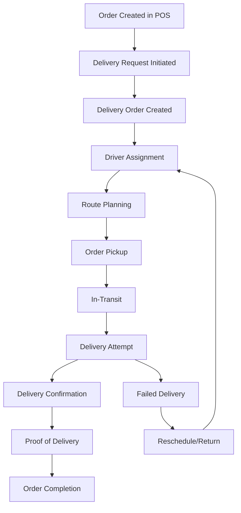

# PharmaSoft Home Delivery Management System Architecture

## Executive Summary

This document outlines the comprehensive architecture for implementing a home delivery management system for PharmaSoft, an Electron-based pharmacy POS application. The delivery system will integrate seamlessly with the existing transaction, inventory, customer, and multi-store management systems while providing a complete workflow from order placement to successful delivery.

## System Overview

### Current System Analysis

Based on the existing PharmaSoft architecture:
- **Frontend**: Electron application with jQuery-based UI
- **Backend**: Express.js server with REST APIs
- **Database**: NeDB (embedded NoSQL) with planned migration to SQL
- **Existing Modules**: Transactions, Inventory, Customers, Users, Multi-store, Loyalty, Analytics

### Delivery System Goals

1. **Complete Delivery Workflow**: From order creation to delivery confirmation
2. **Driver Management**: Profiles, availability, assignment, and performance tracking
3. **Route Optimization**: Efficient delivery planning with real-time adjustments
4. **Customer Experience**: Tracking, notifications, and feedback system
5. **Seamless Integration**: With existing POS and inventory systems

## 1. Delivery Workflow Components

### 1.1 Delivery Order Lifecycle



### 1.2 Delivery Order States

| State | Description | Business Rules |
|-------|-------------|----------------|
| PENDING | Order created, awaiting assignment | Auto-assign based on availability |
| ASSIGNED | Driver assigned, route planned | Notify driver and customer |
| PICKED | Order collected from store | Update inventory as "out for delivery" |
| IN_TRANSIT | Order en route to customer | Send tracking updates |
| DELIVERED | Successfully delivered | Record proof of delivery |
| CANCELLED | Order cancelled | Restock inventory if applicable |
| FAILED | Delivery attempt failed | Schedule retry or return |

## 2. Database Schema Design

### 2.1 Delivery Orders Table

```sql
CREATE TABLE delivery_orders (
    id INTEGER PRIMARY KEY,
    transaction_id INTEGER NOT NULL UNIQUE,
    customer_id INTEGER NOT NULL,
    store_id INTEGER NOT NULL,
    delivery_address TEXT NOT NULL,
    delivery_lat DECIMAL(10,8),
    delivery_lng DECIMAL(11,8),
    delivery_pincode VARCHAR(6),
    delivery_phone VARCHAR(15),
    delivery_instructions TEXT,
    delivery_status VARCHAR(20) DEFAULT 'PENDING',
    priority_level INTEGER DEFAULT 1, -- 1=Normal, 2=Urgent, 3=Emergency
    scheduled_delivery_time TIMESTAMP,
    estimated_delivery_time TIMESTAMP,
    actual_delivery_time TIMESTAMP,
    delivery_charge DECIMAL(8,2) DEFAULT 0.00,
    distance_km DECIMAL(8,2),
    driver_id INTEGER,
    route_id INTEGER,
    created_at TIMESTAMP DEFAULT CURRENT_TIMESTAMP,
    updated_at TIMESTAMP DEFAULT CURRENT_TIMESTAMP,
    sync_version INTEGER DEFAULT 1,
    FOREIGN KEY (transaction_id) REFERENCES transactions(id),
    FOREIGN KEY (customer_id) REFERENCES customers(id),
    FOREIGN KEY (store_id) REFERENCES stores(id),
    FOREIGN KEY (driver_id) REFERENCES drivers(id),
    FOREIGN KEY (route_id) REFERENCES delivery_routes(id)
);
```

### 2.2 Drivers Table

```sql
CREATE TABLE drivers (
    id INTEGER PRIMARY KEY,
    store_id INTEGER NOT NULL,
    employee_id INTEGER, -- Link to users table if driver is employee
    name VARCHAR(100) NOT NULL,
    phone VARCHAR(15) UNIQUE,
    email VARCHAR(100),
    license_number VARCHAR(50),
    license_expiry DATE,
    vehicle_number VARCHAR(20),
    vehicle_type VARCHAR(20), -- BIKE, CAR, VAN, SCOOTER
    vehicle_capacity INTEGER DEFAULT 10, -- Maximum orders per trip
    is_available BOOLEAN DEFAULT TRUE,
    current_location_lat DECIMAL(10,8),
    current_location_lng DECIMAL(11,8),
    last_location_update TIMESTAMP,
    work_schedule JSON, -- Working hours and days
    performance_rating DECIMAL(3,2) DEFAULT 5.0,
    total_deliveries INTEGER DEFAULT 0,
    successful_deliveries INTEGER DEFAULT 0,
    created_at TIMESTAMP DEFAULT CURRENT_TIMESTAMP,
    updated_at TIMESTAMP DEFAULT CURRENT_TIMESTAMP,
    sync_version INTEGER DEFAULT 1,
    FOREIGN KEY (store_id) REFERENCES stores(id),
    FOREIGN KEY (employee_id) REFERENCES users(id)
);
```

### 2.3 Delivery Status Updates Table

```sql
CREATE TABLE delivery_status_updates (
    id INTEGER PRIMARY KEY,
    delivery_order_id INTEGER NOT NULL,
    status VARCHAR(20) NOT NULL,
    location_lat DECIMAL(10,8),
    location_lng DECIMAL(11,8),
    notes TEXT,
    photo_url VARCHAR(255), -- For proof of delivery
    signature_url VARCHAR(255), -- Digital signature
    updated_by INTEGER, -- Driver ID
    update_time TIMESTAMP DEFAULT CURRENT_TIMESTAMP,
    FOREIGN KEY (delivery_order_id) REFERENCES delivery_orders(id),
    FOREIGN KEY (updated_by) REFERENCES drivers(id)
);
```

### 2.4 Delivery Routes Table

```sql
CREATE TABLE delivery_routes (
    id INTEGER PRIMARY KEY,
    store_id INTEGER NOT NULL,
    route_name VARCHAR(100) NOT NULL,
    route_description TEXT,
    driver_id INTEGER,
    route_date DATE NOT NULL,
    estimated_duration_minutes INTEGER,
    actual_duration_minutes INTEGER,
    total_distance_km DECIMAL(8,2),
    total_orders INTEGER DEFAULT 0,
    route_status VARCHAR(20) DEFAULT 'PLANNED', -- PLANNED, ACTIVE, COMPLETED
    created_at TIMESTAMP DEFAULT CURRENT_TIMESTAMP,
    updated_at TIMESTAMP DEFAULT CURRENT_TIMESTAMP,
    FOREIGN KEY (store_id) REFERENCES stores(id),
    FOREIGN KEY (driver_id) REFERENCES drivers(id)
);
```

### 2.5 Route Waypoints Table

```sql
CREATE TABLE route_waypoints (
    id INTEGER PRIMARY KEY,
    route_id INTEGER NOT NULL,
    delivery_order_id INTEGER,
    waypoint_order INTEGER NOT NULL,
    location_name VARCHAR(100),
    location_lat DECIMAL(10,8),
    location_lng DECIMAL(11,8),
    estimated_arrival_time TIMESTAMP,
    actual_arrival_time TIMESTAMP,
    status VARCHAR(20) DEFAULT 'PENDING', -- PENDING, ARRIVED, COMPLETED
    notes TEXT,
    FOREIGN KEY (route_id) REFERENCES delivery_routes(id),
    FOREIGN KEY (delivery_order_id) REFERENCES delivery_orders(id),
    UNIQUE(route_id, waypoint_order)
);
```

## 3. Driver Management System

### 3.1 Driver Profiles and Availability

**Driver Registration & Verification:**
- Personal information and contact details
- Vehicle registration and documents
- License verification and expiry tracking
- Background check status

**Availability Management:**
- Working hours configuration
- Real-time availability status
- Break/time-off scheduling
- Emergency contact information

### 3.2 Driver Assignment Algorithm

```javascript
function assignDriver(deliveryOrder) {
    // 1. Filter available drivers
    const availableDrivers = getAvailableDrivers(
        deliveryOrder.store_id,
        deliveryOrder.scheduled_delivery_time
    );
    
    // 2. Calculate driver scores
    const scoredDrivers = availableDrivers.map(driver => ({
        driver,
        score: calculateDriverScore(driver, deliveryOrder)
    }));
    
    // 3. Sort by score (highest first)
    scoredDrivers.sort((a, b) => b.score - a.score);
    
    // 4. Assign best driver
    return scoredDrivers[0]?.driver;
}

function calculateDriverScore(driver, deliveryOrder) {
    let score = 0;
    
    // Performance rating (40% weight)
    score += driver.performance_rating * 0.4;
    
    // Proximity to store (30% weight)
    const distance = calculateDistance(
        driver.current_location,
        deliveryOrder.store_location
    );
    score += Math.max(0, 10 - distance) * 0.3;
    
    // Current workload (20% weight)
    const currentOrders = getCurrentDriverOrders(driver.id);
    score += Math.max(0, 10 - currentOrders) * 0.2;
    
    // Vehicle capacity (10% weight)
    const capacityUtilization = currentOrders / driver.vehicle_capacity;
    score += Math.max(0, 10 - capacityUtilization * 10) * 0.1;
    
    return score;
}
```

### 3.3 Performance Tracking

**Metrics Tracked:**
- On-time delivery rate
- Customer satisfaction scores
- Average delivery time
- Order accuracy
- Fuel efficiency (if applicable)

**Performance Dashboard:**
- Real-time performance metrics
- Historical trends
- Comparative analysis
- Incentive tracking

## 4. Route Planning and Optimization

### 4.1 Route Optimization Algorithm

```javascript
async function optimizeDeliveryRoute(deliveryOrders, driver) {
    // 1. Geocode all delivery addresses
    const locations = await Promise.all(
        deliveryOrders.map(order => geocodeAddress(order.delivery_address))
    );
    
    // 2. Calculate distance matrix
    const distanceMatrix = await calculateDistanceMatrix(locations);
    
    // 3. Apply Traveling Salesman Problem (TSP) solver
    const optimizedRoute = solveTSP(distanceMatrix, {
        vehicleCapacity: driver.vehicle_capacity,
        timeWindows: deliveryOrders.map(o => o.delivery_time_window),
        priorities: deliveryOrders.map(o => o.priority_level)
    });
    
    // 4. Add real-time traffic considerations
    const routeWithTraffic = await applyTrafficData(optimizedRoute);
    
    // 5. Calculate estimated times
    const routeWithETAs = calculateEstimatedTimes(routeWithTraffic);
    
    return routeWithETAs;
}
```

### 4.2 Real-time Route Adjustments

**Dynamic Recalculation Triggers:**
- New order added to existing route
- Traffic conditions change
- Driver location updates
- Order cancellations or delays
- Weather conditions

**Adjustment Strategy:**
1. Evaluate impact on current route
2. Calculate alternative routes
3. Notify driver of changes
4. Update customer ETAs
5. Log route changes for analytics

## 5. Customer Experience Features

### 5.1 Delivery Tracking Interface

**Web/Mobile Tracking Portal:**
- Real-time order status
- Driver location on map
- Estimated delivery time
- Communication with driver
- Delivery instructions management

**Tracking Information Available:**
- Order confirmation and processing
- Driver assignment with details
- Real-time location updates
- Estimated arrival time window
- Delivery completion confirmation

### 5.2 Notification System

```javascript
const notificationChannels = {
    SMS: sendSMSNotification,
    EMAIL: sendEmailNotification,
    WHATSAPP: sendWhatsAppNotification,
    PUSH: sendPushNotification
};

async function sendDeliveryUpdate(customer, update) {
    const preferences = await getCustomerNotificationPreferences(customer.id);
    
    for (const [channel, enabled] of Object.entries(preferences)) {
        if (enabled && notificationChannels[channel]) {
            await notificationChannels[channel](customer, update);
        }
    }
}
```

**Notification Types:**
- Order confirmation
- Driver assignment
- Out for delivery
- Estimated arrival time
- Delivery completion
- Delivery delays or issues

### 5.3 Feedback and Rating System

**Customer Feedback Collection:**
- Delivery experience rating (1-5 stars)
- Driver professionalism rating
- Packaging quality feedback
- Comments and suggestions
- Issue reporting

**Driver Performance Impact:**
- Ratings affect driver score
- Feedback used for training
- Complaint tracking system
- Recognition for excellent service

## 6. Integration Points with Existing Systems

### 6.1 Transaction System Integration

**POS Integration Points:**
1. **Order Creation**: Add delivery option during checkout
2. **Payment Processing**: Include delivery fees in transaction
3. **Inventory Management**: Reserve items for delivery orders
4. **Receipt Generation**: Include delivery information on receipts

```javascript
// Extension to existing transaction creation
function createDeliveryTransaction(transactionData) {
    if (transactionData.isDelivery) {
        // Create delivery order
        const deliveryOrder = {
            transaction_id: transactionData.id,
            customer_id: transactionData.customer_id,
            delivery_address: transactionData.delivery_address,
            delivery_charge: calculateDeliveryFee(transactionData),
            scheduled_delivery_time: transactionData.delivery_time
        };
        
        // Create delivery order via API
        return api.post('/delivery/orders', deliveryOrder);
    }
}
```

### 6.2 Inventory System Integration

**Inventory Impact:**
- Reserve stock for confirmed delivery orders
- Update inventory when orders are picked up
- Handle returns and restocking
- Batch tracking for delivery orders

### 6.3 Customer Management Integration

**Customer Data Enhancement:**
- Delivery addresses management
- Delivery preferences
- Notification preferences
- Delivery history

### 6.4 Multi-store Integration

**Cross-store Delivery:**
- Store-specific delivery zones
- Inter-store transfers for delivery
- Centralized driver pool management
- Zone-based routing optimization

## 7. Technical Implementation Approach

### 7.1 Backend API Design

**Delivery Management API Endpoints:**

```javascript
// Delivery Orders
GET    /api/delivery/orders              // List all delivery orders
GET    /api/delivery/orders/:id          // Get specific delivery order
POST   /api/delivery/orders              // Create new delivery order
PUT    /api/delivery/orders/:id          // Update delivery order
DELETE /api/delivery/orders/:id          // Cancel delivery order

// Driver Management
GET    /api/delivery/drivers             // List all drivers
GET    /api/delivery/drivers/:id         // Get driver details
POST   /api/delivery/drivers             // Register new driver
PUT    /api/delivery/drivers/:id         // Update driver info
GET    /api/delivery/drivers/:id/location // Get driver location
POST   /api/delivery/drivers/:id/location // Update driver location

// Route Management
GET    /api/delivery/routes              // List delivery routes
POST   /api/delivery/routes              // Create new route
GET    /api/delivery/routes/:id          // Get route details
PUT    /api/delivery/routes/:id          // Update route
POST   /api/delivery/routes/:id/optimize  // Optimize route

// Tracking
GET    /api/delivery/tracking/:orderId    // Get tracking info
POST   /api/delivery/status-updates      // Update delivery status
GET    /api/delivery/eta/:orderId        // Get estimated arrival time
```

### 7.2 Real-time Features Implementation

**WebSocket Integration:**
```javascript
// Real-time delivery tracking
io.on('connection', (socket) => {
    // Customer tracking
    socket.on('subscribe-tracking', (orderId) => {
        socket.join(`tracking-${orderId}`);
    });
    
    // Driver updates
    socket.on('driver-location-update', (data) => {
        socket.to(`tracking-${data.orderId}`)
               .emit('location-update', data);
    });
    
    // Status updates
    socket.on('status-update', (data) => {
        socket.to(`tracking-${data.orderId}`)
               .emit('delivery-status', data);
    });
});
```

### 7.3 Mobile Considerations for Drivers

**Driver Mobile App Features:**
- Route navigation with turn-by-turn directions
- Order details and customer information
- Signature capture for proof of delivery
- Photo capture for delivery confirmation
- Real-time communication with customers
- Performance metrics dashboard

**Offline Capability:**
- Cache route and order data
- Sync updates when connection restored
- Basic navigation without internet
- Local storage for signatures and photos

### 7.4 Map Integration

**Mapping Service Integration:**
```javascript
// Google Maps API integration
class DeliveryMapService {
    async geocodeAddress(address) {
        // Convert address to coordinates
    }
    
    async calculateRoute(waypoints) {
        // Calculate optimal route between waypoints
    }
    
    async getTrafficData(route) {
        // Get real-time traffic information
    }
    
    async calculateETA(route, traffic) {
        // Calculate estimated arrival time
    }
}
```

## 8. Implementation Roadmap

### Phase 1: Core Delivery Management (4-6 weeks)
- Database schema implementation
- Basic delivery order creation
- Driver registration and management
- Simple route planning
- POS integration for delivery orders

### Phase 2: Advanced Features (4-6 weeks)
- Route optimization algorithms
- Real-time tracking system
- Driver mobile application
- Customer notification system
- Performance analytics

### Phase 3: Enhanced Experience (3-4 weeks)
- Customer tracking portal
- Advanced route adjustments
- Feedback and rating system
- Multi-store delivery coordination
- Delivery zone management

### Phase 4: Optimization & Scale (2-3 weeks)
- Machine learning for route optimization
- Predictive delivery time estimation
- Advanced analytics dashboard
- Integration with third-party delivery services
- Performance tuning and optimization

## 9. Security and Compliance

### 9.1 Data Security
- Encrypt sensitive customer information
- Secure driver authentication
- API rate limiting and authentication
- Audit logging for all delivery operations

### 9.2 Pharmacy Compliance
- Prescription delivery verification
- Controlled substance delivery protocols
- Temperature-sensitive medication handling
- Delivery documentation requirements
- Age verification for restricted medications

## 10. Performance Considerations

### 10.1 Scalability
- Horizontal scaling of delivery services
- Database optimization for delivery queries
- Caching strategies for frequently accessed data
- Load balancing for real-time features

### 10.2 Reliability
- Fallback mechanisms for route failures
- Backup communication channels
- Data synchronization strategies
- Error handling and recovery procedures

## Conclusion

This comprehensive architecture provides a solid foundation for implementing a robust home delivery management system for PharmaSoft. The design ensures seamless integration with existing systems while providing advanced features for efficient delivery operations, excellent customer experience, and scalable growth.

The modular approach allows for phased implementation, ensuring that core functionality can be delivered quickly while building toward more advanced features. The architecture supports both single-store and multi-store operations, making it suitable for pharmacies of all sizes.