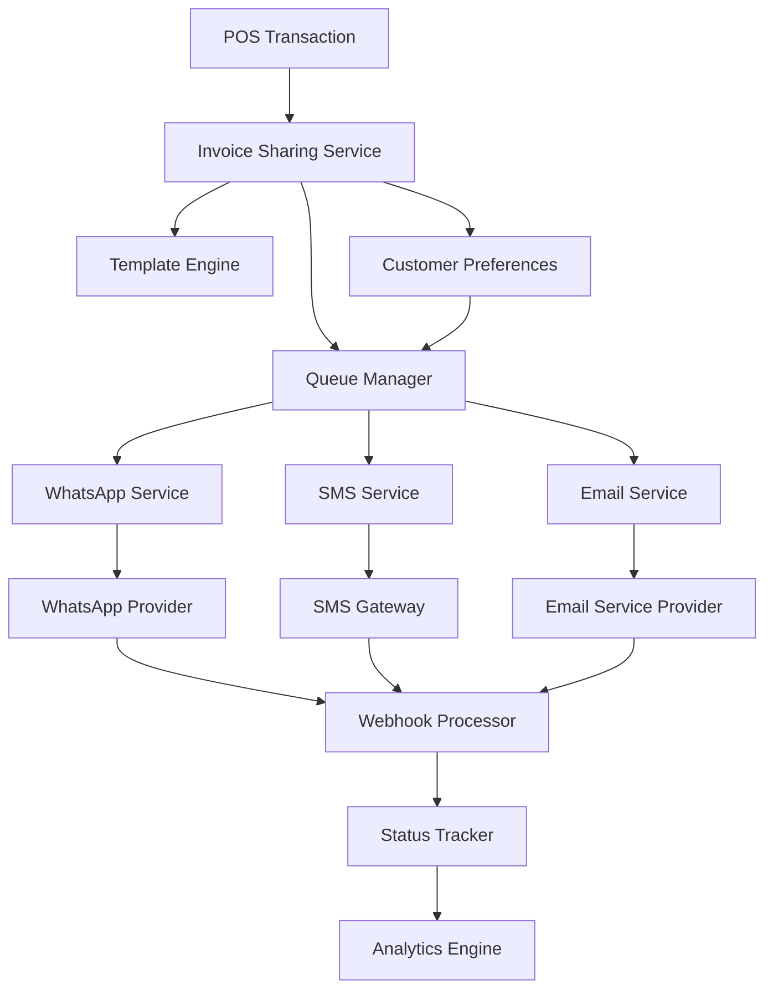
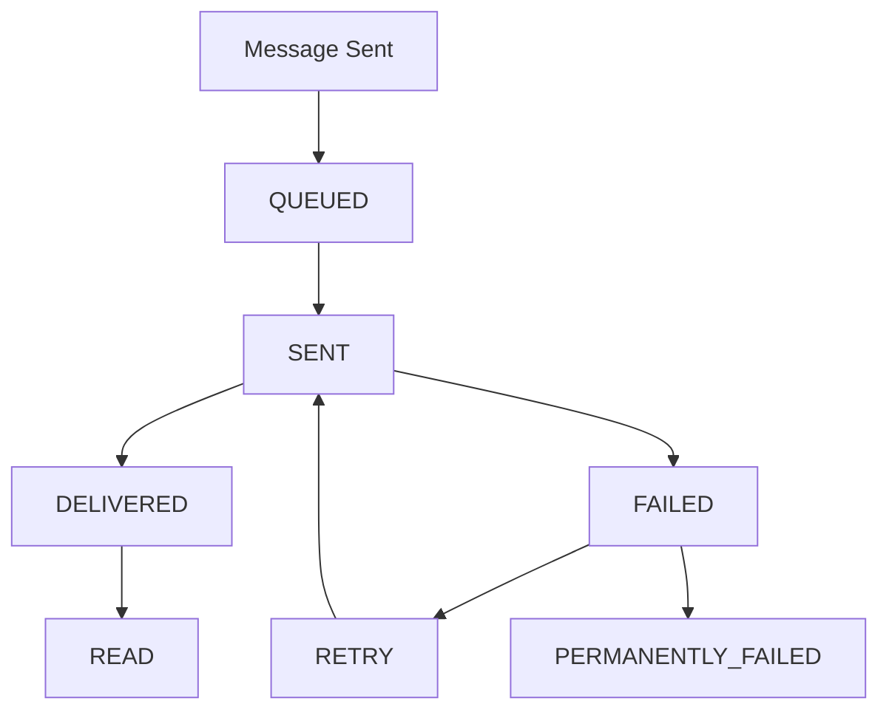
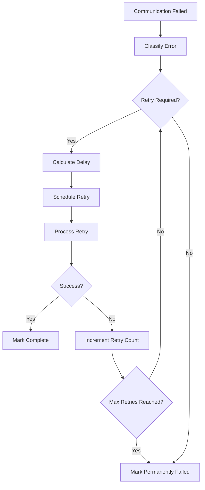

# Invoice Sharing Architecture for PharmaSoft

## Executive Summary

This document presents a comprehensive architecture for implementing invoice sharing via WhatsApp, SMS, and email in PharmaSoft, a pharmacy management system built with Node.js/Express and NeDB. The solution enables customers to receive their invoices and receipts through multiple digital channels, with robust template management, delivery tracking, and error handling capabilities.

## Table of Contents

1. [System Overview](#system-overview)
2. [Communication Channels Architecture](#communication-channels-architecture)
3. [Invoice/Receipt Format Specifications](#invoicereceipt-format-specifications)
4. [Template Management System](#template-management-system)
5. [Database Schema Design](#database-schema-design)
6. [API Architecture](#api-architecture)
7. [Queue System Design](#queue-system-design)
8. [Delivery Tracking and Status Updates](#delivery-tracking-and-status-updates)
9. [Error Handling and Retry Mechanisms](#error-handling-and-retry-mechanisms)
10. [UI/UX Components](#uiux-components)
11. [Integration Points](#integration-points)
12. [Security Considerations](#security-considerations)
13. [Performance and Scalability](#performance-and-scalability)
14. [Implementation Roadmap](#implementation-roadmap)

## System Overview

### Current System Analysis

PharmaSoft is built on:
- **Backend**: Node.js with Express framework
- **Database**: NeDB (file-based NoSQL)
- **Frontend**: HTML/CSS/JavaScript with Bootstrap
- **Architecture**: Single-page application with RESTful APIs

### Integration Points

The invoice sharing system integrates with existing components:

1. **Transaction System** (`api/transactions.js`): Source of invoice data
2. **Customer Management** (`api/customers.js`): Customer contact information
3. **POS System** (`assets/js/pos.js`): Transaction completion and receipt generation
4. **Store Management** (`api/stores.js`): Multi-store support

### High-Level Architecture



## Communication Channels Architecture

### WhatsApp Integration

**Service Class**: `services/whatsapp-service.js`

**Key Features**:
- Provider-agnostic interface supporting multiple WhatsApp Business API providers
- Message formatting optimized for WhatsApp's 4,096 character limit
- Media attachment support for PDF invoices
- Interactive buttons for customer actions
- Template message support for compliance

**Architecture**:
```javascript
class WhatsAppService {
  constructor(provider) {
    this.provider = provider; // 'twilio', 'messagebird', 'local'
    this.client = this.initializeProvider();
  }
  
  async sendMessage(recipient, content, options = {}) {
    // Format message for WhatsApp
    const formattedContent = this.formatMessage(content);
    
    // Send via provider
    const response = await this.client.sendMessage({
      to: recipient,
      body: formattedContent,
      ...options
    });
    
    return {
      messageId: response.messageId,
      status: 'SENT',
      provider: this.provider
    };
  }
}
```

### SMS Gateway Integration

**Service Class**: `services/sms-service.js`

**Key Features**:
- Ultra-compact message formatting (160 character limit)
- Multiple SMS provider support (Twilio, MessageBird, local gateways)
- Concatenated SMS for longer messages
- Delivery receipt handling
- International number formatting

### Email Service Integration

**Service Class**: `services/email-service.js`

**Key Features**:
- HTML email templates with CSS styling
- PDF attachment generation
- Multiple provider support (SendGrid, SMTP, local)
- Email analytics (opens, clicks)
- Bounce handling and unsubscribe management

### In-App Receipt Generation

**Service Class**: `services/inapp-service.js`

**Key Features**:
- Complete receipt with all transaction details
- Offline storage and synchronization
- QR code generation for easy sharing
- Digital signature support
- Export to PDF functionality

## Invoice/Receipt Format Specifications

### WhatsApp Format

**Constraints**:
- Maximum 4,096 characters
- Limited formatting (bold, italic)
- Emoji support for visual appeal

**Template**:
```
🧾 [STORE_NAME]
📋 Invoice #[INVOICE_NUMBER]
📅 [DATE] [TIME]
👤 [CUSTOMER_NAME]
💰 Total: ₹[TOTAL_AMOUNT]
💳 Payment: [PAYMENT_METHOD]
📍 Store: [STORE_LOCATION]

Thank you for your purchase! 🙏

This is an automated message from [STORE_NAME]
```

### SMS Format

**Constraints**:
- Maximum 160 characters per message
- Plain text only
- No formatting

**Template**:
```
[STORE_NAME]: Invoice #[INVOICE_NUMBER] on [DATE]. Amount: ₹[TOTAL_AMOUNT]. Thank you!
```

### Email Format

**Components**:
- HTML email with professional styling
- PDF attachment with complete invoice details
- Responsive design for mobile devices
- Interactive elements (view invoice, contact support)

**Structure**:
```html
<!DOCTYPE html>
<html>
<head>
    <meta charset="utf-8">
    <title>Invoice from [STORE_NAME]</title>
</head>
<body>
    <div class="email-container">
        <header>
            <h1>🧾 Invoice #[INVOICE_NUMBER]</h1>
        </header>
        <section class="invoice-details">
            <!-- Transaction details -->
        </section>
        <section class="payment-info">
            <!-- Payment information -->
        </section>
        <footer>
            <!-- Store information and contact details -->
        </footer>
    </div>
</body>
</html>
```

### In-App Format

**Features**:
- Complete transaction details
- Product breakdown with images
- Loyalty points earned
- Payment method details
- Store information
- Share and print options

## Template Management System

### Template Engine

**Service Class**: `services/template-engine.js`

**Core Capabilities**:
- Multi-language support
- Variable substitution
- Conditional blocks and loops
- Media attachment handling
- Template preview and testing

**Template Structure**:
```javascript
{
  _id: "template_123",
  name: "WhatsApp Invoice Template",
  type: "WHATSAPP",
  language: "en",
  content: "🧾 {{store_name}}\n📋 Invoice #{{invoice_number}}...",
  variables: ["store_name", "invoice_number", "date", "total_amount"],
  conditions: {
    "show_loyalty_points": "{{customer_loyalty_enabled}}",
    "show_doctor_info": "{{prescription_required}}"
  },
  media: {
    "header_image": "{{store_logo}}",
    "footer_signature": "{{store_signature}}"
  },
  created_at: "2024-01-01T00:00:00Z",
  updated_at: "2024-01-01T00:00:00Z"
}
```

### Template Categories

1. **Invoice Templates**:
   - WhatsApp Invoice
   - SMS Invoice
   - Email Invoice
   - In-App Receipt

2. **Notification Templates**:
   - Payment Confirmation
   - Delivery Status
   - Appointment Reminders
   - Prescription Ready

3. **Marketing Templates**:
   - Promotional Offers
   - Loyalty Program Updates
   - Health Tips
   - Seasonal Campaigns

### Variable System

**Standard Variables**:
- `{{store_name}}`: Pharmacy name
- `{{invoice_number}}`: Transaction invoice number
- `{{customer_name}}`: Customer full name
- `{{total_amount}}`: Total transaction amount
- `{{payment_method}}`: Payment method used
- `{{date}}`: Transaction date
- `{{time}}`: Transaction time

**Conditional Variables**:
- `{{customer_loyalty_enabled}}`: Show loyalty information
- `{{prescription_required}}`: Show prescription details
- `{{doctor_name}}`: Prescribing doctor
- `{{delivery_required}}`: Show delivery information

## Database Schema Design

### Communication Logs Table

```javascript
{
  _id: "comm_123",
  transaction_id: "trans_456",
  customer_id: "cust_789",
  store_id: 1,
  communication_type: "WHATSAPP", // WHATSAPP, SMS, EMAIL, INAPP
  recipient: "+919876543210",
  content: "Message content...",
  template_id: "template_123",
  template_data: { /* Template variables */ },
  status: "SENT", // PENDING, PROCESSING, SENT, DELIVERED, READ, FAILED, BOUNCED
  external_id: "provider_message_id",
  error_code: null,
  error_message: null,
  sent_at: "2024-01-01T10:00:00Z",
  delivered_at: "2024-01-01T10:01:00Z",
  read_at: "2024-01-01T10:05:00Z",
  retry_count: 0,
  max_retries: 3,
  created_at: "2024-01-01T10:00:00Z",
  updated_at: "2024-01-01T10:05:00Z"
}
```

### Templates Table

```javascript
{
  _id: "template_123",
  name: "WhatsApp Invoice Template",
  type: "WHATSAPP",
  category: "INVOICE",
  language: "en",
  content: "Template content with variables...",
  variables: ["store_name", "invoice_number"],
  conditions: { /* Conditional logic */ },
  media: { /* Media attachments */ },
  is_active: true,
  is_default: true,
  store_id: 1,
  created_by: "user_123",
  created_at: "2024-01-01T00:00:00Z",
  updated_at: "2024-01-01T00:00:00Z"
}
```

### Customer Preferences Table

```javascript
{
  _id: "pref_123",
  customer_id: "cust_789",
  whatsapp: {
    enabled: true,
    phone: "+919876543210",
    preferred_time: "09:00-18:00"
  },
  sms: {
    enabled: false,
    phone: "+919876543210"
  },
  email: {
    enabled: true,
    email: "customer@example.com",
    preferred_format: "html"
  },
  inapp: {
    enabled: true,
    auto_download: false
  },
  communication_types: {
    invoices: true,
    promotions: false,
    reminders: true,
    updates: false
  },
  created_at: "2024-01-01T00:00:00Z",
  updated_at: "2024-01-01T00:00:00Z"
}
```

### Communication Queue Table

```javascript
{
  _id: "queue_123",
  communication_log_id: "comm_456",
  channel: "whatsapp",
  recipient: "+919876543210",
  content: "Message content...",
  priority: 5, // 1-10, where 10 is highest
  status: "PENDING", // PENDING, PROCESSING, COMPLETED, FAILED
  attempts: 0,
  max_attempts: 3,
  next_attempt_at: "2024-01-01T10:00:00Z",
  scheduled_for: "2024-01-01T10:00:00Z",
  created_at: "2024-01-01T09:59:00Z",
  updated_at: "2024-01-01T10:00:00Z"
}
```

### Analytics Tables

#### Daily Analytics
```javascript
{
  _id: "analytics_123",
  store_id: 1,
  date: "2024-01-01",
  channel: "whatsapp",
  total_sent: 150,
  total_delivered: 145,
  total_failed: 5,
  total_read: 120,
  success_rate: 96.67,
  average_delivery_time: 45, // seconds
  created_at: "2024-01-02T00:00:00Z",
  updated_at: "2024-01-02T00:00:00Z"
}
```

#### Hourly Analytics
```javascript
{
  _id: "hourly_123",
  store_id: 1,
  date_hour: "2024-01-01T10:00:00Z",
  channel: "whatsapp",
  sent: 15,
  delivered: 14,
  failed: 1,
  created_at: "2024-01-01T10:00:00Z"
}
```

## API Architecture

### Core Communication API (`api/communications.js`)

#### Endpoints:

**POST /api/communications/share-invoice**
```javascript
// Request body
{
  transactionId: "trans_123",
  customerId: "cust_456",
  customerInfo: {
    phone: "+919876543210",
    email: "customer@example.com"
  },
  channels: {
    whatsapp: true,
    sms: false,
    email: true,
    inapp: true
  },
  customMessage: "Thank you for your purchase!"
}

// Response
{
  success: true,
  data: {
    communicationIds: ["comm_123", "comm_124", "comm_125"],
    queuedChannels: ["whatsapp", "email", "inapp"],
    estimatedDelivery: "2024-01-01T10:01:00Z"
  }
}
```

**GET /api/communications/status**
```javascript
// Query parameters
{
  communicationIds: ["comm_123", "comm_124"],
  transactionId: "trans_123",
  customerId: "cust_456"
}

// Response
{
  success: true,
  data: [
    {
      _id: "comm_123",
      communication_type: "WHATSAPP",
      recipient: "+919876543210",
      status: "DELIVERED",
      sent_at: "2024-01-01T10:00:00Z",
      delivered_at: "2024-01-01T10:01:00Z",
      read_at: null
    }
  ]
}
```

### Template Management API (`api/communication-templates.js`)

**Endpoints**:
- GET /api/communication-templates
- POST /api/communication-templates
- PUT /api/communication-templates/:id
- DELETE /api/communication-templates/:id
- POST /api/communication-templates/:id/preview

### Customer Preferences API (`api/customer-preferences.js`)

**Endpoints**:
- GET /api/customer-preferences/:customerId
- PUT /api/customer-preferences/:customerId
- POST /api/customer-preferences/bulk-update

### Analytics API (`api/communication-analytics.js`)

**Endpoints**:
- GET /api/communication-analytics/dashboard
- GET /api/communication-analytics/reports
- GET /api/communication-analytics/performance

## Queue System Design

### Queue Manager (`services/queue-manager.js`)

**Architecture**:
- Priority-based queue system
- Separate queues for each communication channel
- Concurrent processing with configurable limits
- Exponential backoff retry mechanism
- Queue monitoring and management

**Queue Processing Flow**:


**Priority Levels**:
1. **Critical (10)**: Payment confirmations, emergency notifications
2. **High (7-9)**: Invoice delivery, appointment reminders
3. **Normal (4-6)**: Marketing messages, general notifications
4. **Low (1-3)**: Analytics reports, system notifications

**Rate Limiting**:
- WhatsApp: 100 messages per minute
- SMS: 50 messages per minute
- Email: 200 messages per minute
- In-App: No limit (local processing)

## Delivery Tracking and Status Updates

### Webhook Processing

**Service Class**: `services/webhook-processor.js`

**Provider Integration**:
- WhatsApp Business API webhooks
- Twilio SMS delivery receipts
- SendGrid email events
- Custom provider webhooks

**Status Flow**:


### Real-Time Updates

**Socket.IO Integration**:
- Live status updates in POS interface
- Real-time delivery tracking dashboard
- Customer-facing status notifications

### Analytics Engine

**Metrics Tracked**:
- Delivery success rates by channel
- Average delivery times
- Peak usage periods
- Error patterns and frequencies
- Customer engagement metrics

## Error Handling and Retry Mechanisms

### Error Classification System

**Service Class**: `services/error-classifier.js`

**Error Categories**:
1. **Temporary Errors**: Rate limits, network timeouts, server busy
2. **Provider-Specific**: Template not found, authentication expired
3. **Configuration Errors**: Invalid API keys, missing configuration
4. **Content Errors**: Message too long, invalid content
5. **Permanent Failures**: Invalid recipient, number blocked

### Retry Manager

**Service Class**: `services/retry-manager.js`

**Retry Strategy**:
- Exponential backoff with jitter
- Category-specific retry limits
- Content modification for content errors
- Circuit breaker pattern for provider failures

**Retry Flow**:


### Circuit Breaker Pattern

**Service Class**: `services/circuit-breaker.js`

**States**:
- **CLOSED**: Normal operation
- **OPEN**: Provider is down, no requests sent
- **HALF_OPEN**: Testing provider recovery

**Thresholds**:
- Failure threshold: 5 consecutive failures
- Reset timeout: 60 seconds
- Monitoring period: 10 seconds

### Error Monitoring and Alerting

**Service Class**: `services/error-monitoring.js`

**Alert Types**:
- High error rate warnings
- Provider downtime alerts
- Configuration error notifications
- Permanent failure notifications

**Alert Channels**:
- In-app notifications
- Email alerts to administrators
- System dashboard alerts

## UI/UX Components

### POS Integration

**Enhanced Transaction Completion**:
- Share button in transaction completion flow
- Customer contact selection interface
- Channel preference display
- Real-time delivery status

**Dialog Components**:
```javascript
// Share Invoice Dialog
{
  customerSelection: {
    existingCustomers: "dropdown",
    quickAdd: "phone/email input"
  },
  channelOptions: {
    whatsapp: "checkbox with phone validation",
    sms: "checkbox with character count",
    email: "checkbox with email validation",
    inapp: "checkbox (always available)"
  },
  messagePreview: {
    livePreview: "channel-specific formatting",
    characterCount: "SMS character limits"
  },
  deliveryStatus: {
    realTimeUpdates: "Socket.IO integration",
    statusIndicators: "success/warning/error states"
  }
}
```

### Customer Preferences Management

**Interface Features**:
- Customer search and selection
- Channel preference toggles
- Communication type preferences
- Bulk preference updates
- Preference import/export

### Analytics Dashboard

**Dashboard Components**:
- Summary cards with key metrics
- Interactive charts for trends
- Channel performance comparison
- Real-time communication status
- Detailed reports and exports

**Visualizations**:
- Line charts for delivery trends
- Doughnut charts for channel distribution
- Heat maps for peak usage times
- Progress bars for success rates

## Integration Points

### Transaction System Integration

**Hook Points**:
1. **Transaction Completion**: Trigger invoice sharing
2. **Payment Confirmation**: Send payment receipts
3. **Refund Processing**: Send refund notifications
4. **Loyalty Updates**: Send points earned notifications

**Data Flow**:
```javascript
// Transaction completion hook
async function onTransactionComplete(transactionData) {
  // Check customer preferences
  const preferences = await getCustomerPreferences(transactionData.customer_id);
  
  // Determine channels to use
  const channels = determineChannels(preferences, transactionData);
  
  // Queue communications
  await queueCommunications(transactionData, channels);
  
  // Update transaction record
  await updateTransactionWithCommunicationIds(transactionData.id, communicationIds);
}
```

### Customer Management Integration

**Contact Information Sync**:
- Automatic phone number format validation
- Email verification and bounce handling
- Preference synchronization across channels
- Unsubscribe handling

### Store Management Integration

**Multi-Store Support**:
- Store-specific templates
- Channel configuration per store
- Analytics segmentation by store
- Store-level branding

## Security Considerations

### Data Protection

**PII Handling**:
- Phone number encryption in database
- Email address obfuscation in logs
- GDPR compliance for data retention
- Customer consent management

**API Security**:
- JWT-based authentication
- Rate limiting per customer
- Input validation and sanitization
- CORS configuration

### Provider Security

**API Key Management**:
- Encrypted storage of provider credentials
- Key rotation policies
- Access logging and monitoring
- Backup provider configurations

**Webhook Security**:
- Signature verification for all webhooks
- IP whitelisting for provider endpoints
- Request timestamp validation
- Replay attack prevention

## Performance and Scalability

### Caching Strategy

**Template Caching**:
- In-memory template storage
- Redis integration for distributed caching
- Cache invalidation on template updates
- Pre-rendered template variants

**Customer Preference Caching**:
- Frequent customer preferences in memory
- Cache warming for active customers
- Lazy loading for infrequent customers

### Database Optimization

**Indexing Strategy**:
```javascript
// Communication logs indexes
{ transaction_id: 1 }
{ customer_id: 1, created_at: -1 }
{ status: 1, created_at: -1 }
{ communication_type: 1, status: 1 }

// Analytics indexes
{ store_id: 1, date: -1 }
{ channel: 1, date: -1 }
{ date_hour: 1, channel: 1 }
```

**Data Archiving**:
- Automated archival of old communication logs
- Analytics data aggregation and summarization
- Cleanup of expired retry queue items
- Retention policies for different data types

### Horizontal Scaling

**Queue Processing**:
- Multiple worker processes
- Load balancing across instances
- Distributed queue with Redis
- Auto-scaling based on queue length

**Database Scaling**:
- Migration from NeDB to PostgreSQL for production
- Read replicas for analytics queries
- Connection pooling
- Database sharding strategy

## Implementation Roadmap

### Phase 1: Core Infrastructure (4 weeks)

**Week 1-2: Foundation**
- Database schema implementation
- Basic API endpoints
- Template engine development
- Queue system setup

**Week 3-4: Channel Integration**
- WhatsApp service implementation
- SMS service implementation
- Email service implementation
- Basic error handling

### Phase 2: Advanced Features (3 weeks)

**Week 5-6: Tracking and Analytics**
- Webhook processing system
- Delivery tracking implementation
- Analytics engine development
- Status update mechanisms

**Week 7: Error Handling**
- Error classification system
- Retry mechanism implementation
- Circuit breaker pattern
- Error monitoring setup

### Phase 3: UI/UX and Integration (3 weeks)

**Week 8-9: User Interface**
- POS integration components
- Customer preferences interface
- Analytics dashboard development
- Real-time status updates

**Week 10: Testing and Optimization**
- End-to-end testing
- Performance optimization
- Security testing
- Documentation completion

### Phase 4: Deployment and Monitoring (2 weeks)

**Week 11: Deployment**
- Production environment setup
- Database migration scripts
- Configuration management
- Monitoring and alerting setup

**Week 12: Go-Live and Support**
- User training materials
- Go-live support
- Performance monitoring
- Issue resolution

## Technical Specifications

### Dependencies

**New Packages Required**:
```json
{
  "express-rate-limit": "^6.7.0",
  "socket.io": "^4.6.1",
  "redis": "^4.6.5",
  "nodemailer": "^6.9.1",
  "twilio": "^4.7.2",
  "pdfkit": "^0.13.0",
  "handlebars": "^4.7.7",
  "moment": "^2.29.4",
  "crypto": "^1.0.1",
  "helmet": "^6.1.5",
  "cors": "^2.8.5"
}
```

**Configuration Requirements**:
```javascript
// Environment variables
WHATSAPP_PROVIDER=twilio
TWILIO_ACCOUNT_SID=your_account_sid
TWILIO_AUTH_TOKEN=your_auth_token
TWILIO_WHATSAPP_NUMBER=your_whatsapp_number

SMS_PROVIDER=twilio
SMS_API_KEY=your_sms_api_key

EMAIL_PROVIDER=sendgrid
SENDGRID_API_KEY=your_sendgrid_api_key

REDIS_URL=redis://localhost:6379
JWT_SECRET=your_jwt_secret

RATE_LIMIT_WHATSAPP=100
RATE_LIMIT_SMS=50
RATE_LIMIT_EMAIL=200
```

### Monitoring and Logging

**Log Levels**:
- ERROR: Critical errors and failures
- WARN: Warning conditions and retries
- INFO: General information and status updates
- DEBUG: Detailed debugging information

**Metrics to Track**:
- Message volume by channel
- Delivery success rates
- Average processing times
- Error frequencies and types
- Queue lengths and processing times

### Backup and Recovery

**Data Backup Strategy**:
- Daily database backups
- Incremental backups for communication logs
- Template versioning and backup
- Configuration backup and restore

**Disaster Recovery**:
- Provider failover mechanisms
- Queue persistence across restarts
- Data consistency checks
- Recovery procedures and documentation

## Conclusion

This comprehensive architecture provides a robust, scalable, and maintainable solution for invoice sharing via WhatsApp, SMS, and email in PharmaSoft. The design addresses all key requirements including multi-channel support, template management, delivery tracking, error handling, and user interface components.

The modular architecture allows for incremental implementation and testing, reducing risk and ensuring a smooth rollout. The system is designed to handle the scale requirements of a growing pharmacy business while maintaining high reliability and performance standards.

Key benefits of this architecture:
- **Multi-channel reach**: Customers can choose their preferred communication method
- **Automated delivery**: Minimal manual intervention required
- **Real-time tracking**: Complete visibility into delivery status
- **Robust error handling**: Intelligent retry mechanisms and failure recovery
- **Scalable design**: Can grow with business needs
- **Comprehensive analytics**: Data-driven insights for optimization
- **Security first**: Protects customer data and ensures compliance

The implementation roadmap provides a clear path from development to deployment, with realistic timelines and milestones. The architecture is flexible enough to accommodate future requirements and technology changes.