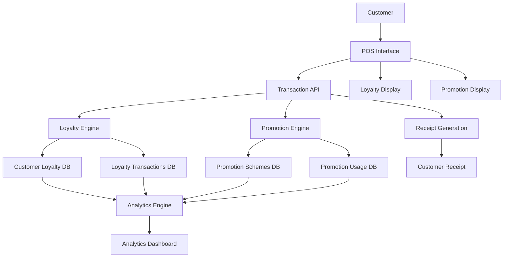

# Loyalty Program and Promotional Schemes Implementation Architecture

## Table of Contents
1. [Executive Summary](#executive-summary)
2. [System Overview](#system-overview)
3. [Implementation Phases](#implementation-phases)
4. [Database Implementation](#database-implementation)
5. [API Implementation](#api-implementation)
6. [UI Implementation](#ui-implementation)
7. [Integration Implementation](#integration-implementation)
8. [Testing Strategy](#testing-strategy)
9. [Deployment Strategy](#deployment-strategy)
10. [Maintenance and Monitoring](#maintenance-and-monitoring)

## Executive Summary

This document provides a comprehensive implementation guide for adding a loyalty program and promotional schemes to PharmaSpot, a pharmacy management system. The solution includes:

- A points-based loyalty system with four tiers (Basic, Silver, Gold, Platinum)
- A flexible promotional schemes engine supporting multiple promotion types
- Complete integration with existing transaction and customer management systems
- Comprehensive analytics and reporting capabilities
- Customer-facing and admin interfaces

The implementation is designed to be minimal, non-disruptive, and follows existing PharmaSpot patterns for consistency.

## System Overview

### Architecture Diagram



### Key Components

1. **Loyalty Engine**: Manages points earning, redemption, and tier progression
2. **Promotion Engine**: Validates and applies various promotional schemes
3. **Database Layer**: Stores all loyalty and promotion data
4. **Analytics Engine**: Generates reports and insights
5. **UI Components**: Interfaces for customers and staff
6. **Integration Layer**: Connects with existing transaction system

## Implementation Phases

### Phase 1: Foundation (Week 1-2)
- Database schema implementation
- Core API endpoints for loyalty accounts
- Basic customer loyalty registration
- Points earning mechanism

### Phase 2: Promotions (Week 3-4)
- Promotion schemes database and API
- Promotion validation engine
- Integration with transaction system
- Basic promotion application at POS

### Phase 3: Redemption & UI (Week 5-6)
- Rewards catalog implementation
- Points redemption mechanism
- Customer-facing loyalty display
- Admin management interfaces

### Phase 4: Analytics & Polish (Week 7-8)
- Analytics and reporting implementation
- Performance optimization
- Testing and bug fixes
- Documentation and training materials

## Database Implementation

### Step 1: Database Schema Creation

Create the following new tables in the existing NeDB database structure:

#### customer_loyalty_accounts Table
```javascript
// File: server/databases/customer-loyalty-accounts.db
{
  _id: "unique_id",
  customer_id: "customer_reference",
  loyalty_account_number: "LOY-XXXXX",
  current_points: 0,
  tier: "Basic",
  tier_expiry_date: "2024-12-31",
  total_points_earned: 0,
  total_points_redeemed: 0,
  enrollment_date: "2023-01-01",
  last_activity_date: "2023-01-01",
  is_active: true,
  created_at: "2023-01-01T00:00:00.000Z",
  updated_at: "2023-01-01T00:00:00.000Z"
}
```

#### loyalty_transactions Table
```javascript
// File: server/databases/loyalty-transactions.db
{
  _id: "unique_id",
  customer_loyalty_id: "loyalty_account_reference",
  transaction_id: "transaction_reference",
  transaction_type: "EARN|REDEEM|EXPIRE|ADJUST",
  points: 100,
  description: "Purchase points earned",
  reference_id: "transaction_or_adjustment_id",
  created_at: "2023-01-01T00:00:00.000Z"
}
```

#### promotion_schemes Table
```javascript
// File: server/databases/promotion-schemes.db
{
  _id: "unique_id",
  name: "Weekend Special",
  description: "10% off on weekends",
  promotion_type: "PERCENTAGE_DISCOUNT",
  discount_value: 10,
  minimum_purchase: 100,
  maximum_discount: 50,
  applicable_categories: ["category_ids"],
  applicable_products: ["product_ids"],
  customer_tiers: ["Silver", "Gold", "Platinum"],
  start_date: "2023-01-01",
  end_date: "2023-12-31",
  days_of_week: [0, 6],
  time_based: true,
  start_time: "09:00",
  end_time: "18:00",
  usage_limit: 100,
  usage_limit_per_customer: 5,
  is_active: true,
  priority: 1,
  created_at: "2023-01-01T00:00:00.000Z",
  updated_at: "2023-01-01T00:00:00.000Z"
}
```

#### promotion_usage Table
```javascript
// File: server/databases/promotion-usage.db
{
  _id: "unique_id",
  promotion_scheme_id: "promotion_reference",
  transaction_id: "transaction_reference",
  customer_id: "customer_reference",
  discount_amount: 15.50,
  original_amount: 155.00,
  final_amount: 139.50,
  used_at: "2023-01-01T00:00:00.000Z"
}
```

#### loyalty_rewards Table
```javascript
// File: server/databases/loyalty-rewards.db
{
  _id: "unique_id",
  name: "₹50 Discount",
  description: "Get ₹50 off on your next purchase",
  reward_type: "DISCOUNT",
  points_required: 500,
  discount_value: 50,
  discount_type: "FIXED_AMOUNT",
  applicable_categories: [],
  applicable_products: [],
  is_active: true,
  created_at: "2023-01-01T00:00:00.000Z",
  updated_at: "2023-01-01T00:00:00.000Z"
}
```

#### loyalty_reward_redemptions Table
```javascript
// File: server/databases/loyalty-reward-redemptions.db
{
  _id: "unique_id",
  customer_loyalty_id: "loyalty_account_reference",
  reward_id: "reward_reference",
  transaction_id: "transaction_reference",
  points_used: 500,
  redemption_status: "USED|EXPIRED",
  redeemed_at: "2023-01-01T00:00:00.000Z",
  expires_at: "2023-06-01T00:00:00.000Z"
}
```

### Step 2: Database Indexing

Create indexes for performance optimization:

```javascript
// customer_loyalty_accounts indexes
customerLoyaltyDB.ensureIndex({ fieldName: 'customer_id', unique: true });
customerLoyaltyDB.ensureIndex({ fieldName: 'loyalty_account_number', unique: true });
customerLoyaltyDB.ensureIndex({ fieldName: 'tier' });
customerLoyaltyDB.ensureIndex({ fieldName: 'is_active' });

// loyalty_transactions indexes
loyaltyTransactionsDB.ensureIndex({ fieldName: 'customer_loyalty_id' });
loyaltyTransactionsDB.ensureIndex({ fieldName: 'transaction_id' });
loyaltyTransactionsDB.ensureIndex({ fieldName: 'transaction_type' });
loyaltyTransactionsDB.ensureIndex({ fieldName: 'created_at' });

// promotion_schemes indexes
promotionSchemesDB.ensureIndex({ fieldName: 'is_active' });
promotionSchemesDB.ensureIndex({ fieldName: 'promotion_type' });
promotionSchemesDB.ensureIndex({ fieldName: 'start_date' });
promotionSchemesDB.ensureIndex({ fieldName: 'end_date' });
promotionSchemesDB.ensureIndex({ fieldName: 'priority' });

// promotion_usage indexes
promotionUsageDB.ensureIndex({ fieldName: 'promotion_scheme_id' });
promotionUsageDB.ensureIndex({ fieldName: 'customer_id' });
promotionUsageDB.ensureIndex({ fieldName: 'used_at' });

// loyalty_rewards indexes
loyaltyRewardsDB.ensureIndex({ fieldName: 'is_active' });
loyaltyRewardsDB.ensureIndex({ fieldName: 'reward_type' });
loyaltyRewardsDB.ensureIndex({ fieldName: 'points_required' });

// loyalty_reward_redemptions indexes
loyaltyRewardRedemptionsDB.ensureIndex({ fieldName: 'customer_loyalty_id' });
loyaltyRewardRedemptionsDB.ensureIndex({ fieldName: 'reward_id' });
loyaltyRewardRedemptionsDB.ensureIndex({ fieldName: 'redemption_status' });
loyaltyRewardRedemptionsDB.ensureIndex({ fieldName: 'redeemed_at' });
loyaltyRewardRedemptionsDB.ensureIndex({ fieldName: 'expires_at' });
```

## API Implementation

### Step 1: Create API Files

#### api/loyalty.js
Create the loyalty API file with all endpoints for loyalty account management:

```javascript
const app = require("express")();
const Datastore = require("@seald-io/nedb");
const path = require("path");
const moment = require("moment");

// Database initialization and endpoints as designed in the architecture
// (Include all endpoints from the design document)
```

#### api/promotions.js
Create the promotions API file with all endpoints for promotion management:

```javascript
const app = require("express")();
const Datastore = require("@seald-io/nedb");
const path = require("path");
const moment = require("moment");

// Database initialization and endpoints as designed in the architecture
// (Include all endpoints from the design document)
```

#### api/loyalty-analytics.js
Create the analytics API file for reporting:

```javascript
const app = require("express")();
const Datastore = require("@seald-io/nedb");
const path = require("path");
const moment = require("moment");

// Database initialization and endpoints as designed in the architecture
// (Include all endpoints from the design document)
```

### Step 2: Register APIs in Server

Update the main server.js file to include the new API endpoints:

```javascript
// Add to server.js after existing API registrations
app.use("/api/loyalty", require("./api/loyalty"));
app.use("/api/promotions", require("./api/promotions"));
app.use("/api/loyalty-analytics", require("./api/loyalty-analytics"));
```

## UI Implementation

### Step 1: Create JavaScript Files

#### assets/js/loyalty.js
Create the loyalty JavaScript file with all UI components:

```javascript
// Include all loyalty UI functions from the design document
// Customer registration, tier display, points history, etc.
```

### Step 2: Update Existing Files

#### assets/js/pos.js
Modify the POS JavaScript to integrate loyalty and promotions:

```javascript
// Add loyalty and promotion integration to existing POS functions
// Include customer lookup, loyalty display, promotion application, etc.
```

#### assets/js/analytics.js
Update analytics JavaScript to include loyalty analytics:

```javascript
// Add loyalty analytics functions to existing analytics
// Include report generation, chart updates, data export, etc.
```

### Step 3: Update HTML Templates

#### Update POS Interface
Add loyalty and promotion components to the POS interface:

```html
<!-- Add to existing POS template -->
<div class="loyalty-section">
    <!-- Customer loyalty information display -->
</div>

<div class="promotions-section">
    <!-- Available promotions display -->
</div>
```

#### Add Loyalty Management Pages
Create new HTML templates for loyalty management:

```html
<!-- loyalty-management.html -->
<div class="loyalty-management">
    <!-- Loyalty account management interface -->
</div>
```

#### Update Analytics Interface
Add loyalty analytics tabs to existing analytics:

```html
<!-- Add to existing analytics template -->
<div class="tab-pane" id="loyalty-analytics">
    <!-- Loyalty analytics interface -->
</div>
```

## Integration Implementation

### Step 1: Transaction System Integration

#### Modify Transaction Processing
Update the transaction processing flow to include loyalty and promotions:

```javascript
// In api/transactions.js, modify the checkout function
function processTransactionWithLoyalty(req, res) {
    // 1. Get customer information
    // 2. Check loyalty eligibility
    // 3. Calculate points to earn
    // 4. Find applicable promotions
    // 5. Apply best promotion
    // 6. Update loyalty points
    // 7. Record promotion usage
    // 8. Complete transaction
}
```

#### Update Receipt Generation
Modify receipt generation to include loyalty information:

```javascript
// In receipt generation function
function generateReceiptWithLoyalty(transactionData) {
    // Add loyalty points earned
    // Add current tier status
    // Add promotion applied
    // Add points balance
}
```

### Step 2: Customer Management Integration

#### Update Customer Registration
Modify customer registration to include loyalty enrollment:

```javascript
// In customer registration function
function registerCustomerWithLoyalty(customerData) {
    // 1. Create customer account
    // 2. Create loyalty account
    // 3. Generate loyalty number
    // 4. Set initial tier
    // 5. Return combined data
}
```

#### Update Customer Lookup
Enhance customer search to include loyalty information:

```javascript
// In customer search function
function searchCustomerWithLoyalty(searchTerm) {
    // 1. Search customer database
    // 2. Join with loyalty accounts
    // 3. Return combined results
}
```

## Testing Strategy

### Unit Testing

#### API Testing
Test all API endpoints with various scenarios:

```javascript
// Example test for loyalty enrollment
describe('Loyalty Enrollment API', () => {
    it('should enroll new customer in loyalty program', async () => {
        const response = await request(app)
            .post('/api/loyalty/enroll')
            .send({
                customerId: 'test_customer_id',
                enrollmentSource: 'POS'
            });
        
        expect(response.status).toBe(201);
        expect(response.body.loyaltyAccountNumber).toMatch(/^LOY-\d{5}$/);
    });
});
```

#### Business Logic Testing
Test loyalty calculations and promotion validation:

```javascript
// Example test for points calculation
describe('Points Calculation', () => {
    it('should calculate points correctly for basic tier', () => {
        const points = calculatePointsEarned(1000, 'Basic');
        expect(points).toBe(10); // 1% of 1000
    });
    
    it('should apply tier bonus for gold tier', () => {
        const points = calculatePointsEarned(1000, 'Gold');
        expect(points).toBe(15); // 1.5% of 1000 with 50% bonus
    });
});
```

### Integration Testing

#### End-to-End Transaction Flow
Test complete transaction with loyalty and promotions:

```javascript
describe('Transaction with Loyalty and Promotions', () => {
    it('should process transaction with points earning and promotion application', async () => {
        // 1. Create test customer with loyalty account
        // 2. Create test promotion
        // 3. Process transaction
        // 4. Verify points earned
        // 5. Verify promotion applied
        // 6. Verify loyalty account updated
    });
});
```

### Performance Testing

#### Load Testing
Test system performance under load:

```javascript
// Example load test for loyalty points calculation
describe('Loyalty Performance', () => {
    it('should handle 1000 points calculations per second', async () => {
        const startTime = Date.now();
        const promises = [];
        
        for (let i = 0; i < 1000; i++) {
            promises.push(calculatePointsEarned(Math.random() * 1000, 'Gold'));
        }
        
        await Promise.all(promises);
        const endTime = Date.now();
        
        expect(endTime - startTime).toBeLessThan(1000); // Should complete in < 1 second
    });
});
```

## Deployment Strategy

### Phase 1: Database and API Deployment
1. Deploy database schema updates
2. Deploy new API endpoints
3. Run database migration scripts
4. Verify API functionality

### Phase 2: UI Deployment
1. Deploy updated JavaScript files
2. Deploy new HTML templates
3. Update CSS styles
4. Test UI functionality

### Phase 3: Integration Deployment
1. Deploy transaction system updates
2. Deploy customer management updates
3. Deploy receipt generation updates
4. Test end-to-end functionality

### Phase 4: Analytics Deployment
1. Deploy analytics API
2. Deploy analytics UI
3. Initialize analytics data
4. Test reporting functionality

### Rollback Plan
1. Database backup before deployment
2. Version control for all code changes
3. Feature flags for gradual rollout
4. Monitoring for early issue detection

## Maintenance and Monitoring

### Performance Monitoring
1. Monitor API response times
2. Track database query performance
3. Monitor memory usage
4. Set up alerts for performance degradation

### Business Metrics Monitoring
1. Track customer enrollment rates
2. Monitor points issuance and redemption
3. Track promotion usage rates
4. Monitor customer tier progression

### Data Maintenance
1. Regular database cleanup
2. Points expiration processing
3. Archive old transaction data
4. Backup and recovery procedures

### Security Monitoring
1. Monitor for fraudulent activity
2. Track unusual redemption patterns
3. Monitor API access patterns
4. Regular security audits

## Conclusion

This implementation architecture provides a comprehensive guide for adding loyalty program and promotional schemes to PharmaSpot. The design follows existing patterns for consistency, minimizes disruption to current operations, and provides a solid foundation for future enhancements.

The phased implementation approach allows for gradual rollout and testing, reducing risk and ensuring smooth integration with existing systems. The comprehensive testing strategy and maintenance plan ensure long-term reliability and performance.

With this architecture in place, PharmaSpot will be able to:
1. Increase customer retention through loyalty programs
2. Drive sales through targeted promotions
3. Gain valuable insights through analytics
4. Enhance customer experience with personalized offers
5. Maintain competitive advantage in the pharmacy market

The implementation is designed to be scalable, maintainable, and extensible, allowing for future enhancements and additional features as business needs evolve.