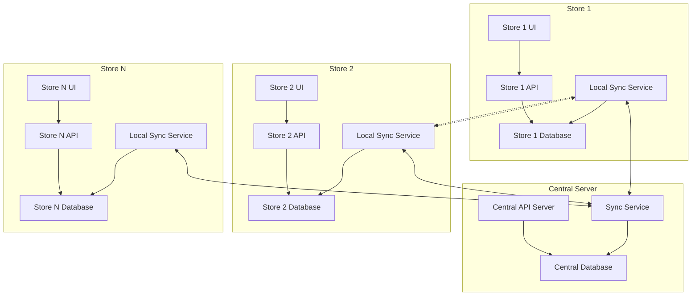
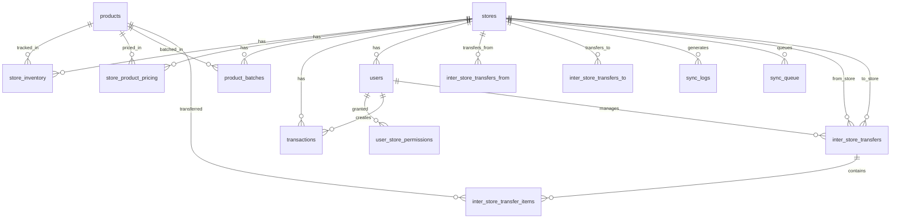
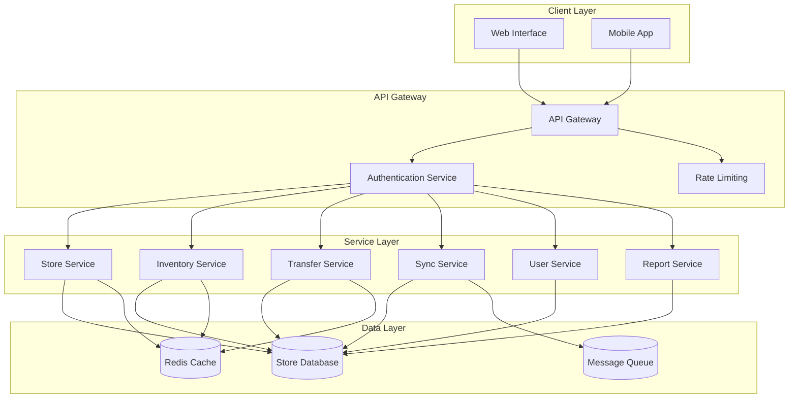
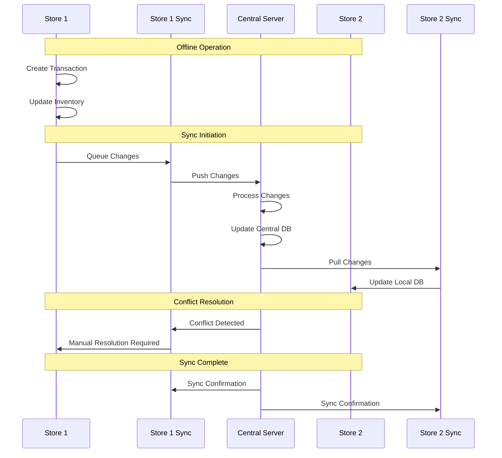
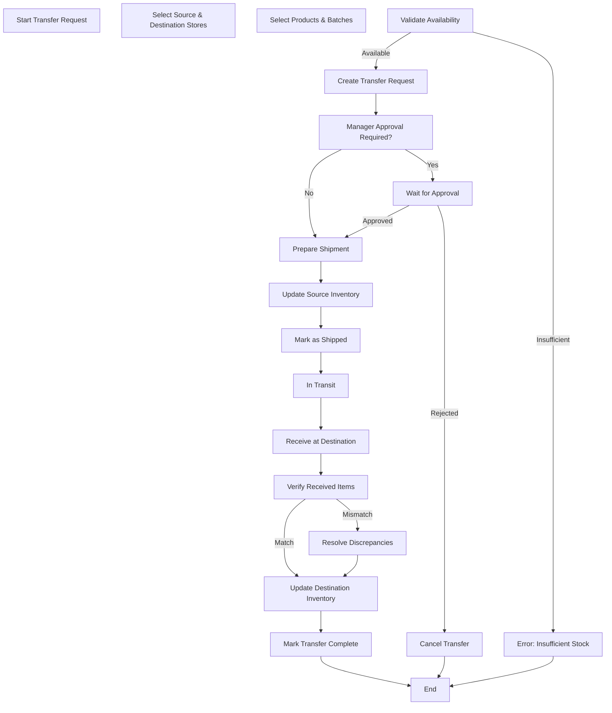
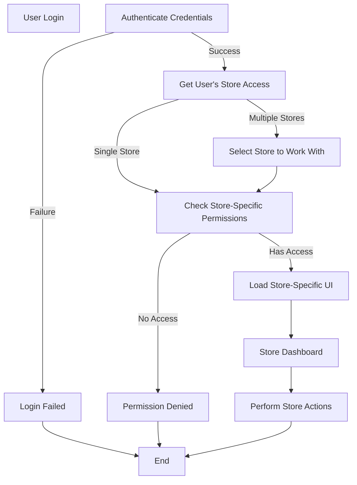
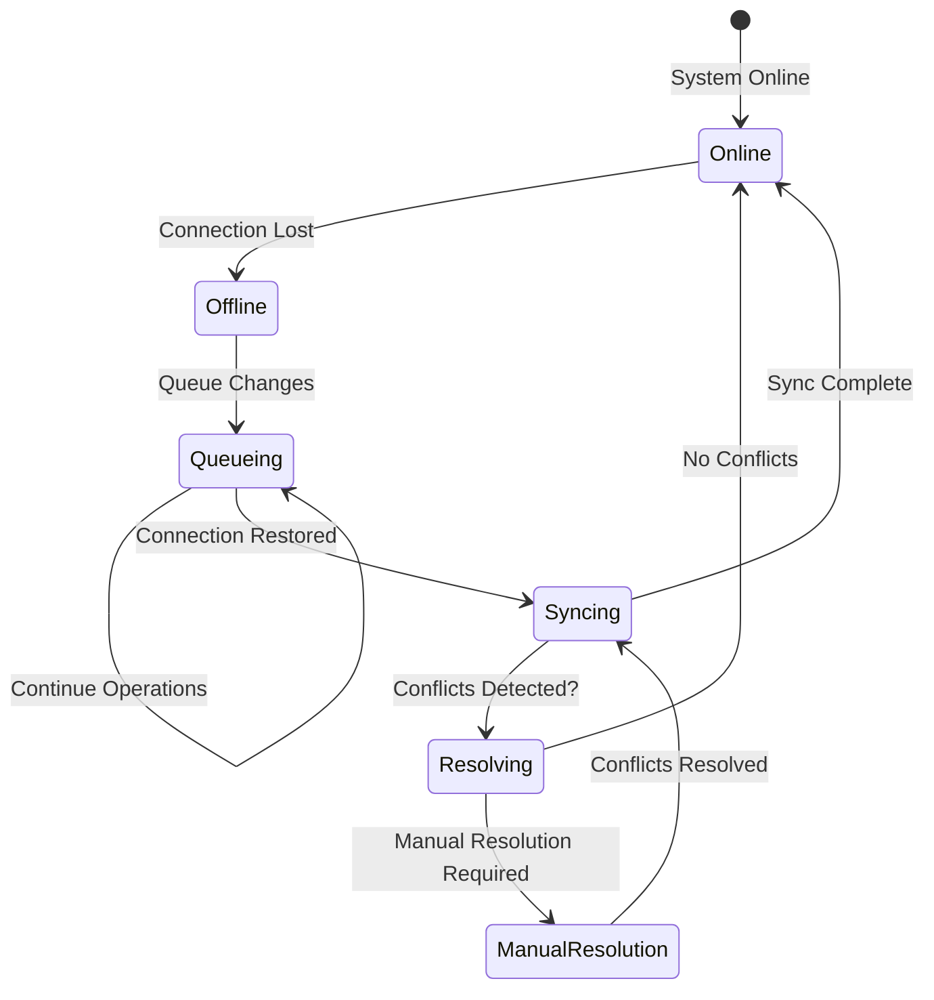
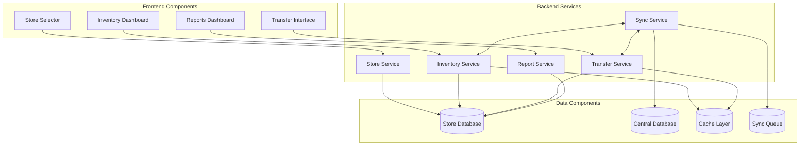
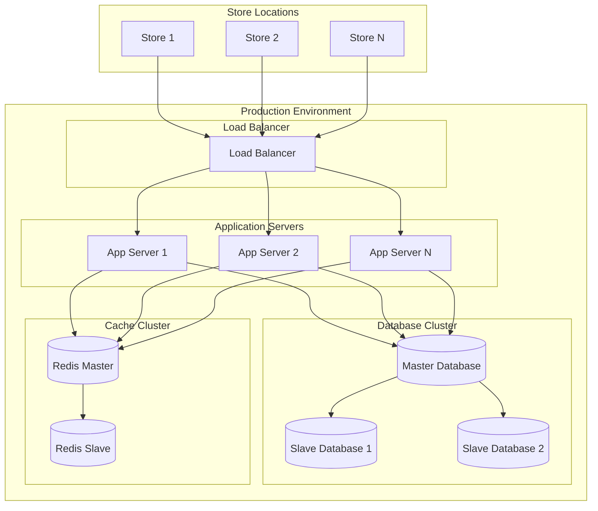
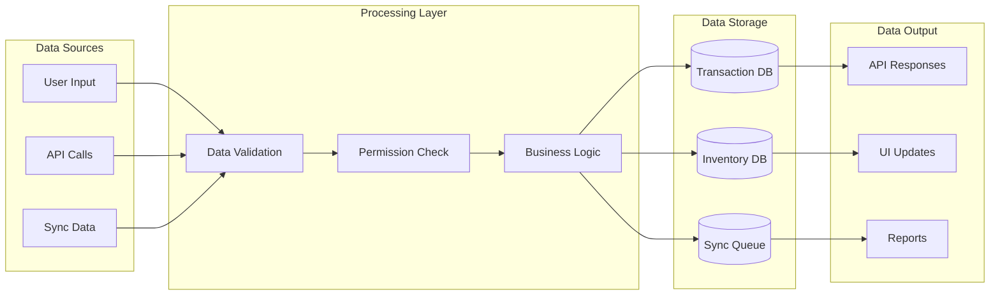

# Multi-Store Inventory Management Architecture Diagrams

## 1. System Architecture Overview

## 2. Database Schema Relationship

## 3. API Layer Architecture

## 4. Data Synchronization Flow

## 5. Inter-Store Transfer Flow

## 6. User Permission Flow

## 7. Offline Operation Flow

## 8. Component Interaction Diagram

## 9. Deployment Architecture

## 10. Data Flow Architecture

These diagrams provide a visual representation of the multi-store inventory management architecture, complementing the detailed technical documentation. They illustrate the relationships between components, data flows, and operational processes that will be implemented as part of the multi-store enhancement to PharmaSpot.