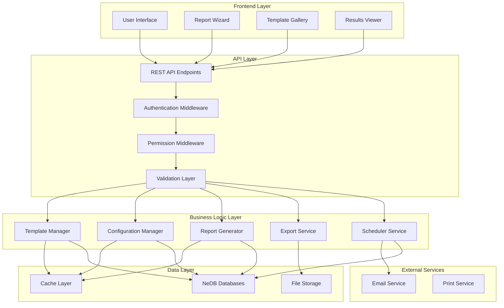

# Report Builder Technical Specifications

## Overview

This document provides comprehensive technical specifications for the PharmaSoft custom report builder system. It covers system architecture, technology stack, data models, API specifications, performance requirements, and deployment guidelines.

## System Architecture

### High-Level Architecture



### Component Architecture

#### Frontend Components
```javascript
// Frontend component structure
const frontendComponents = {
  // Core components
  'ReportBuilderDashboard': {
    path: 'src/components/dashboard/ReportBuilderDashboard.js',
    dependencies: ['TemplateGallery', 'RecentReports'],
    description: 'Main dashboard for report builder'
  },
  
  'TemplateGallery': {
    path: 'src/components/templates/TemplateGallery.js',
    dependencies: ['TemplateCard', 'FilterControls'],
    description: 'Gallery for browsing and selecting report templates'
  },
  
  'ReportConfiguration': {
    path: 'src/components/configuration/ReportConfiguration.js',
    dependencies: ['FilterStep', 'ColumnsStep', 'SortStep', 'PreviewStep'],
    description: 'Wizard for configuring report parameters'
  },
  
  'ReportResults': {
    path: 'src/components/results/ReportResults.js',
    dependencies: ['DataTable', 'SummaryCards', 'ChartViewer'],
    description: 'Viewer for generated report results'
  },
  
  // Utility components
  'FilterControls': {
    path: 'src/components/common/FilterControls.js',
    dependencies: [],
    description: 'Reusable filter controls for various data types'
  },
  
  'DataTable': {
    path: 'src/components/common/DataTable.js',
    dependencies: ['Pagination', 'ColumnSelector'],
    description: 'Sortable, paginated data table component'
  }
};
```

#### Backend Components
```javascript
// Backend service structure
const backendServices = {
  // Core services
  'TemplateService': {
    path: 'src/services/TemplateService.js',
    dependencies: ['DatabaseService', 'ValidationService'],
    description: 'Manages report templates and configurations'
  },
  
  'ReportGenerationService': {
    path: 'src/services/ReportGenerationService.js',
    dependencies: ['QueryService', 'DataProcessor', 'CacheService'],
    description: 'Handles report generation and data processing'
  },
  
  'ExportService': {
    path: 'src/services/ExportService.js',
    dependencies: ['PDFExporter', 'ExcelExporter', 'CSVExporter', 'JSONExporter'],
    description: 'Manages report export in various formats'
  },
  
  'ScheduleService': {
    path: 'src/services/ScheduleService.js',
    dependencies: ['EmailService', 'ReportGenerationService'],
    description: 'Handles scheduled report generation and delivery'
  },
  
  // Utility services
  'PermissionService': {
    path: 'src/services/PermissionService.js',
    dependencies: ['UserService'],
    description: 'Manages user permissions and access control'
  },
  
  'CacheService': {
    path: 'src/services/CacheService.js',
    dependencies: [],
    description: 'Manages caching for reports and frequently accessed data'
  }
};
```

## Technology Stack

### Frontend Technologies

#### Core Framework
- **Language**: JavaScript (ES6+)
- **Framework**: Vanilla JavaScript with jQuery (existing PharmaSoft pattern)
- **CSS Framework**: Bootstrap 4.6
- **Build Tools**: Gulp, Webpack
- **Package Manager**: npm

#### UI Components
- **Charts**: Chart.js 3.x
- **Date Handling**: Moment.js
- **Form Validation**: jQuery Validation
- **Data Tables**: DataTables.net
- **File Upload**: Dropzone.js

#### Development Tools
- **Code Quality**: ESLint, Prettier
- **Testing**: Jest, Jasmine
- **Documentation**: JSDoc
- **Version Control**: Git

### Backend Technologies

#### Core Platform
- **Runtime**: Node.js 16.x
- **Framework**: Express.js 4.x
- **Database**: NeDB (embedded NoSQL)
- **File System**: Node.js fs module
- **Authentication**: JWT tokens

#### Processing Libraries
- **PDF Generation**: PDFKit
- **Excel Generation**: ExcelJS
- **CSV Processing**: csv-parser, csv-writer
- **Date Handling**: Moment.js
- **Data Validation**: Joi

#### Development Tools
- **Code Quality**: ESLint, Prettier
- **Testing**: Jest, Supertest
- **Documentation**: JSDoc
- **Process Management**: PM2

### Infrastructure Technologies

#### Development Environment
- **Operating System**: Windows 10/11 (existing)
- **Containerization**: Docker (optional)
- **Version Control**: Git
- **CI/CD**: GitHub Actions or Jenkins

#### Production Environment
- **Operating System**: Windows Server 2019+
- **Web Server**: IIS or Nginx
- **Process Manager**: PM2
- **Monitoring**: New Relic or similar
- **Backup**: File system backup

## Data Models

### Database Schema

#### Report Templates Collection
```javascript
{
  _id: "string",                    // Primary key (UUID)
  name: "string",                   // Template name
  description: "string",            // Template description
  category: "string",               // Category: sales, inventory, customers, financial
  icon: "string",                   // FontAwesome icon class
  isSystem: "boolean",              // System template vs user-created
  
  dataSource: {
    primary: "string",              // Primary collection name
    collections: ["string"],        // All collections involved
    joins: [                        // Join configurations
      {
        from: "string",             // Source collection
        to: "string",               // Target collection
        on: "string",               // Join field
        type: "string",             // inner, left, right
        select: ["string"]          // Fields to select
      }
    ]
  },
  
  defaultFilters: {
    dateRange: "string",            // today, yesterday, this-week, etc.
    storeId: "string",              // current, specific store ID
    // Other default filter values
  },
  
  availableFilters: [
    {
      key: "string",                // Filter key
      type: "string",               // date-range, select, text, number
      label: "string",              // Display label
      required: "boolean",          // Whether filter is required
      options: "array"              // Available options (for select type)
    }
  ],
  
  columns: [
    {
      key: "string",                // Column key/field name
      label: "string",              // Display label
      type: "string",               // string, number, date, currency, percentage
      width: "string",              // Column width (CSS)
      format: "string",             // Format string (optional)
      visible: "boolean"            // Default visibility
    }
  ],
  
  summaries: [
    {
      key: "string",                // Summary key
      label: "string",              // Display label
      calculation: "string"         // Calculation expression
    }
  ],
  
  charts: [
    {
      type: "string",               // bar, line, pie, etc.
      title: "string",              // Chart title
      xAxis: "string",              // X-axis field
      yAxis: "string",              // Y-axis field
      limit: "number"               // Data limit (optional)
    }
  ],
  
  // Metadata
  createdBy: "string",              // User ID who created the template
  createdAt: "Date",                // Creation timestamp
  updatedAt: "Date",                // Last update timestamp
  version: "string",                // Template version
  isActive: "boolean",              // Whether template is active
  
  // Usage tracking
  usageCount: "number",             // Number of times used
  lastUsed: "Date"                  // Last usage timestamp
}
```

#### Report Configurations Collection
```javascript
{
  _id: "string",                    // Primary key (UUID)
  name: "string",                   // Configuration name
  description: "string",            // Configuration description
  templateId: "string",             // Reference to report template
  
  // User-defined filter values
  filters: {
    dateRange: {
      start: "Date",                // Start date
      end: "Date"                   // End date
    },
    storeId: "string",              // Selected store ID
    categoryId: "string",           // Selected category ID
    // Other filter values based on template
  },
  
  // Column customizations
  columnCustomizations: [
    {
      key: "string",                // Column key
      visible: "boolean",           // Visibility override
      width: "string",              // Width override
      label: "string",              // Label override
      format: "string"              // Format override
    }
  ],
  
  // Sort configuration
  sortBy: "string",                 // Sort field
  sortOrder: "string",              // asc, desc
  
  // Grouping configuration
  groupBy: "string",                // Group field
  groupSortBy: "string",            // Group sort field
  groupSortOrder: "string",         // Group sort order
  
  // Pagination configuration
  pageSize: "number",               // Page size
  showPagination: "boolean",        // Whether to show pagination
  
  // Metadata
  createdBy: "string",              // User ID who created the configuration
  createdAt: "Date",                // Creation timestamp
  updatedAt: "Date",                // Last update timestamp
  isPublic: "boolean",              // Whether configuration is shared
  sharedWith: ["string"],           // Array of user IDs it's shared with
  
  // Usage tracking
  usageCount: "number",             // Number of times used
  lastUsed: "Date"                  // Last usage timestamp
}
```

#### Report Executions Collection
```javascript
{
  _id: "string",                    // Primary key (UUID)
  configurationId: "string",        // Reference to report configuration
  templateId: "string",             // Reference to report template
  
  // Execution parameters
  executionParameters: {
    filters: "object",              // Filter values used
    columns: ["string"],            // Columns selected
    sortBy: "string",               // Sort field
    sortOrder: "string",            // Sort order
    // Other execution parameters
  },
  
  // Execution results
  executionStatus: "string",       // pending, running, completed, failed, cancelled
  startTime: "Date",                // Execution start time
  endTime: "Date",                  // Execution end time
  duration: "number",               // Execution duration in milliseconds
  
  // Result statistics
  totalRecords: "number",           // Total records processed
  returnedRecords: "number",        // Records returned (after filtering)
  resultSize: "number",             // Result size in bytes
  
  // Error information (if failed)
  errorMessage: "string",           // Error message
  errorDetails: "object",           // Detailed error information
  
  // Output information
  outputFormat: "string",           // json, csv, pdf, excel
  outputFile: "string",              // Output file path (if saved)
  downloadUrl: "string",            // Download URL (if applicable)
  
  // Metadata
  executedBy: "string",             // User ID who executed the report
  executedAt: "Date",               // Execution timestamp
  ipAddress: "string",              // Client IP address
  userAgent: "string",               // Client user agent
  
  // Performance metrics
  queryTime: "number",              // Database query time
  processingTime: "number",         // Data processing time
  renderTime: "number",             // Rendering time
  
  // Cache information
  cacheHit: "boolean",              // Whether result was from cache
  cacheKey: "string",               // Cache key used
  cacheExpiry: "Date"               // Cache expiry time
}
```

## API Specifications

### Base URL Structure
```
Base URL: /api/reports-builder/
Content-Type: application/json
Authentication: Bearer token (JWT)
```

### Response Format Standard
```javascript
// Success Response
{
  "success": true,
  "data": {},           // Response data
  "message": "string",  // Success message
  "timestamp": "ISO8601"
}

// Error Response
{
  "success": false,
  "error": {
    "code": "string",     // Error code
    "message": "string",  // Error message
    "details": {}         // Additional error details
  },
  "timestamp": "ISO8601"
}

// Paginated Response
{
  "success": true,
  "data": {
    "items": [],          // Data items
    "pagination": {
      "page": "number",
      "limit": "number",
      "total": "number",
      "pages": "number"
    }
  },
  "message": "string",
  "timestamp": "ISO8601"
}
```

### Template Endpoints

#### GET /api/reports-builder/templates
Get all report templates with optional filtering.

**Parameters:**
- `category` (string, optional): Filter by category
- `isSystem` (boolean, optional): Filter system vs user templates
- `isActive` (boolean, optional): Filter active templates
- `limit` (number, optional): Maximum number of results
- `offset` (number, optional): Number of results to skip

**Response:**
```javascript
{
  "success": true,
  "data": [
    {
      "_id": "template-uuid",
      "name": "Daily Sales Summary",
      "description": "Daily sales performance report",
      "category": "sales",
      "icon": "fa-chart-line",
      "isSystem": true,
      "usageCount": 150,
      "lastUsed": "2023-12-15T10:30:00Z"
    }
  ],
  "message": "Templates retrieved successfully"
}
```

#### GET /api/reports-builder/templates/:id
Get a specific template by ID.

**Path Parameters:**
- `id` (string, required): Template ID

**Response:**
```javascript
{
  "success": true,
  "data": {
    "_id": "template-uuid",
    "name": "Daily Sales Summary",
    "description": "Daily sales performance report",
    "category": "sales",
    "icon": "fa-chart-line",
    "isSystem": true,
    "dataSource": { ... },
    "defaultFilters": { ... },
    "availableFilters": [ ... ],
    "columns": [ ... ],
    "summaries": [ ... ],
    "charts": [ ... ],
    "createdBy": "user-uuid",
    "createdAt": "2023-01-01T00:00:00Z",
    "updatedAt": "2023-12-01T00:00:00Z",
    "version": "1.0",
    "isActive": true,
    "usageCount": 150,
    "lastUsed": "2023-12-15T10:30:00Z"
  },
  "message": "Template retrieved successfully"
}
```

#### POST /api/reports-builder/templates
Create a new report template.

**Request Body:**
```javascript
{
  "name": "Custom Sales Report",
  "description": "My custom sales report",
  "category": "sales",
  "icon": "fa-chart-bar",
  "dataSource": { ... },
  "defaultFilters": { ... },
  "availableFilters": [ ... ],
  "columns": [ ... ],
  "summaries": [ ... ],
  "charts": [ ... ]
}
```

**Response:**
```javascript
{
  "success": true,
  "data": {
    "_id": "new-template-uuid",
    // ... other template fields
  },
  "message": "Template created successfully"
}
```

#### PUT /api/reports-builder/templates/:id
Update an existing template.

**Path Parameters:**
- `id` (string, required): Template ID

**Request Body:**
```javascript
{
  "name": "Updated Template Name",
  "description": "Updated description",
  // ... other fields to update
}
```

**Response:**
```javascript
{
  "success": true,
  "data": {
    "_id": "template-uuid",
    // ... updated template fields
  },
  "message": "Template updated successfully"
}
```

#### DELETE /api/reports-builder/templates/:id
Delete a template.

**Path Parameters:**
- `id` (string, required): Template ID

**Response:**
```javascript
{
  "success": true,
  "data": {
    "deleted": 1
  },
  "message": "Template deleted successfully"
}
```

### Configuration Endpoints

#### GET /api/reports-builder/configurations
Get all report configurations.

**Parameters:**
- `templateId` (string, optional): Filter by template ID
- `createdBy` (string, optional): Filter by creator
- `isPublic` (boolean, optional): Filter public configurations
- `limit` (number, optional): Maximum number of results
- `offset` (number, optional): Number of results to skip

**Response:**
```javascript
{
  "success": true,
  "data": [
    {
      "_id": "config-uuid",
      "name": "My Sales Report",
      "description": "Custom sales configuration",
      "templateId": "template-uuid",
      "createdBy": "user-uuid",
      "isPublic": false,
      "usageCount": 25,
      "lastUsed": "2023-12-15T10:30:00Z"
    }
  ],
  "message": "Configurations retrieved successfully"
}
```

#### POST /api/reports-builder/configurations
Create a new report configuration.

**Request Body:**
```javascript
{
  "name": "My Sales Report",
  "description": "Custom sales configuration",
  "templateId": "template-uuid",
  "filters": {
    "dateRange": {
      "start": "2023-12-01",
      "end": "2023-12-31"
    },
    "storeId": "store-uuid"
  },
  "columnCustomizations": [ ... ],
  "sortBy": "date",
  "sortOrder": "desc",
  "pageSize": 50
}
```

**Response:**
```javascript
{
  "success": true,
  "data": {
    "_id": "new-config-uuid",
    // ... other configuration fields
  },
  "message": "Configuration created successfully"
}
```

### Report Generation Endpoints

#### POST /api/reports-builder/generate
Generate a report from configuration or template.

**Request Body:**
```javascript
{
  "configurationId": "config-uuid",  // Optional
  "templateId": "template-uuid",      // Optional (if no configuration)
  "filters": {                       // Optional (override defaults)
    "dateRange": {
      "start": "2023-12-01",
      "end": "2023-12-31"
    }
  },
  "format": "json"                   // json, csv, pdf, excel
}
```

**Response:**
```javascript
{
  "success": true,
  "data": {
    "executionId": "execution-uuid"
  },
  "message": "Report generation started"
}
```

#### GET /api/reports-builder/generate/:executionId/status
Get the status of a report generation.

**Path Parameters:**
- `executionId` (string, required): Execution ID

**Response:**
```javascript
{
  "success": true,
  "data": {
    "executionId": "execution-uuid",
    "status": "completed",
    "startTime": "2023-12-15T10:30:00Z",
    "endTime": "2023-12-15T10:30:15Z",
    "duration": 15000,
    "totalRecords": 1250,
    "returnedRecords": 1250,
    "progress": 100
  },
  "message": "Execution status retrieved"
}
```

#### GET /api/reports-builder/generate/:executionId/results
Get the results of a generated report.

**Path Parameters:**
- `executionId` (string, required): Execution ID

**Query Parameters:**
- `page` (number, optional): Page number (default: 1)
- `limit` (number, optional): Page size (default: 25)

**Response:**
```javascript
{
  "success": true,
  "data": {
    "executionId": "execution-uuid",
    "totalRecords": 1250,
    "currentPage": 1,
    "pageSize": 25,
    "totalPages": 50,
    "data": [
      {
        "date": "2023-12-15",
        "invoiceNumber": "INV-001",
        "customerName": "John Doe",
        "items": 5,
        "total": 1250.50
      }
    ],
    "summaries": [
      {
        "key": "totalSales",
        "label": "Total Sales",
        "value": 25000.75,
        "type": "currency"
      }
    ],
    "charts": [
      {
        "type": "line",
        "title": "Sales Trend",
        "data": [ ... ]
      }
    ]
  },
  "message": "Report results retrieved"
}
```

### Export Endpoints

#### POST /api/reports-builder/export/:executionId
Export a generated report.

**Path Parameters:**
- `executionId` (string, required): Execution ID

**Request Body:**
```javascript
{
  "format": "pdf",                   // pdf, excel, csv, json
  "template": "pdf-standard",         // Optional export template
  "options": {                       // Export-specific options
    "includeHeaders": true,
    "includeSummary": true
  }
}
```

**Response:**
```javascript
{
  "success": true,
  "data": {
    "exportId": "export-uuid",
    "filePath": "/exports/report_execution-uuid_1702654200000.pdf",
    "fileSize": 2048576,
    "format": "pdf"
  },
  "message": "Export completed successfully"
}
```

#### GET /api/reports-builder/export/:exportId/download
Download an exported report.

**Path Parameters:**
- `exportId` (string, required): Export ID

**Response:** File download with appropriate headers

## Performance Requirements

### Response Time Requirements

| Operation | Target Response Time | Maximum Acceptable |
|------------|---------------------|-------------------|
| Template List | < 500ms | 1s |
| Template Details | < 300ms | 500ms |
| Configuration List | < 500ms | 1s |
| Report Generation (Small) | < 5s | 10s |
| Report Generation (Medium) | < 15s | 30s |
| Report Generation (Large) | < 60s | 120s |
| Export Generation | < 10s | 30s |
| Report Results | < 1s | 2s |

### Throughput Requirements

| Metric | Target | Maximum |
|---------|---------|----------|
| Concurrent Users | 50 | 100 |
| Reports per Hour | 200 | 500 |
| Exports per Hour | 100 | 250 |
| API Requests per Minute | 1000 | 2000 |

### Resource Utilization

| Resource | Target Utilization | Maximum |
|-----------|-------------------|----------|
| CPU | 60% | 80% |
| Memory | 70% | 85% |
| Disk I/O | 50% | 75% |
| Network | 40% | 60% |

## Security Specifications

### Authentication

#### JWT Token Structure
```javascript
{
  "header": {
    "alg": "HS256",
    "typ": "JWT"
  },
  "payload": {
    "sub": "user-uuid",
    "username": "john.doe",
    "role": "manager",
    "permissions": ["reports.generate", "reports.view"],
    "storeId": "store-uuid",
    "iat": 1702654200,
    "exp": 1702740600
  }
}
```

#### Token Validation
- Algorithm: HS256
- Secret: Environment variable (JWT_SECRET)
- Expiration: 24 hours
- Refresh: Token refresh endpoint available

### Authorization

#### Permission Matrix
| Role | Templates | Configurations | Generate | Export | Schedule |
|-------|-----------|----------------|-----------|---------|----------|
| Admin | Full | Full | Full | Full | Full |
| Manager | Full | Full | Full | Limited | Full |
| Cashier | View | View/Duplicate | Limited | PDF/CSV | None |
| Viewer | View | View | View | PDF | None |

#### Data Access Control
- Store-based filtering applied automatically
- Time-based restrictions enforced
- Sensitive data masked based on permissions
- Audit logging for all data access

### Input Validation

#### Validation Rules
```javascript
const validationRules = {
  templateName: {
    required: true,
    minLength: 3,
    maxLength: 100,
    pattern: /^[a-zA-Z0-9\s\-_]+$/
  },
  dateRange: {
    required: true,
    format: 'date',
    minDate: '2020-01-01',
    maxDate: 'current'
  },
  pageSize: {
    required: false,
    type: 'number',
    min: 10,
    max: 1000,
    default: 25
  }
};
```

#### Sanitization
- HTML tags stripped from text inputs
- SQL injection prevention
- XSS protection
- File upload validation

## Error Handling

### Error Codes

#### System Errors
- `SYSTEM_ERROR`: Generic system error
- `DATABASE_ERROR`: Database operation failed
- `NETWORK_ERROR`: Network connectivity issue
- `TIMEOUT_ERROR`: Operation timed out

#### Validation Errors
- `VALIDATION_ERROR`: Input validation failed
- `MISSING_REQUIRED_FIELD`: Required field missing
- `INVALID_FORMAT`: Invalid data format
- `OUT_OF_RANGE`: Value outside allowed range

#### Business Logic Errors
- `TEMPLATE_NOT_FOUND`: Template doesn't exist
- `PERMISSION_DENIED`: Insufficient permissions
- `QUOTA_EXCEEDED`: Resource quota exceeded
- `CONCURRENT_LIMIT`: Too many concurrent operations

### Error Response Format
```javascript
{
  "success": false,
  "error": {
    "code": "VALIDATION_ERROR",
    "message": "Input validation failed",
    "details": {
      "field": "templateName",
      "reason": "Minimum length is 3 characters"
    },
    "timestamp": "2023-12-15T10:30:00Z",
    "requestId": "req-uuid"
  }
}
```

## Deployment Specifications

### Environment Configuration

#### Development Environment
```javascript
const developmentConfig = {
  database: {
    path: './data/dev',
    autoload: true
  },
  server: {
    port: 3000,
    host: 'localhost'
  },
  logging: {
    level: 'debug',
    console: true,
    file: './logs/dev.log'
  },
  cache: {
    enabled: true,
    ttl: 3600,
    maxSize: 100
  }
};
```

#### Production Environment
```javascript
const productionConfig = {
  database: {
    path: process.env.DB_PATH,
    autoload: true
  },
  server: {
    port: process.env.PORT || 8080,
    host: '0.0.0.0'
  },
  logging: {
    level: 'info',
    console: false,
    file: process.env.LOG_PATH
  },
  cache: {
    enabled: true,
    ttl: 7200,
    maxSize: 500
  },
  security: {
    jwtSecret: process.env.JWT_SECRET,
    sessionTimeout: 86400,
    maxLoginAttempts: 5
  }
};
```

### File Structure

```
pharmasoft/
├── src/
│   ├── components/          # Frontend components
│   ├── services/           # Backend services
│   ├── api/               # API routes
│   ├── models/            # Data models
│   ├── utils/             # Utility functions
│   └── config/            # Configuration files
├── assets/
│   ├── css/               # Stylesheets
│   ├── js/                # JavaScript files
│   └── images/            # Image assets
├── data/
│   ├── databases/         # NeDB database files
│   ├── exports/           # Export files
│   └── uploads/           # Uploaded files
├── logs/                 # Log files
├── tests/                # Test files
├── docs/                 # Documentation
└── build/                # Build output
```

### Monitoring and Logging

#### Logging Levels
- **ERROR**: System errors, exceptions
- **WARN**: Warning conditions, deprecated usage
- **INFO**: General information, significant events
- **DEBUG**: Detailed debugging information

#### Log Format
```javascript
{
  "timestamp": "2023-12-15T10:30:00.000Z",
  "level": "INFO",
  "message": "Report generated successfully",
  "userId": "user-uuid",
  "executionId": "execution-uuid",
  "duration": 15000,
  "ipAddress": "192.168.1.100",
  "userAgent": "Mozilla/5.0..."
}
```

#### Monitoring Metrics
- Response times
- Error rates
- Resource utilization
- User activity
- Report generation statistics

## Testing Specifications

### Unit Testing

#### Coverage Requirements
- Minimum 80% code coverage
- 100% coverage for critical security functions
- 90% coverage for data processing functions

#### Test Structure
```javascript
// Example unit test
describe('TemplateService', () => {
  describe('createTemplate', () => {
    it('should create a valid template', async () => {
      const templateData = {
        name: 'Test Template',
        category: 'sales',
        // ... other required fields
      };
      
      const result = await TemplateService.createTemplate(templateData);
      
      expect(result).toBeDefined();
      expect(result.name).toBe(templateData.name);
      expect(result._id).toBeDefined();
    });
    
    it('should throw error for invalid template', async () => {
      const invalidTemplate = {
        name: '', // Invalid empty name
        category: 'sales'
      };
      
      await expect(TemplateService.createTemplate(invalidTemplate))
        .rejects.toThrow('Validation Error');
    });
  });
});
```

### Integration Testing

#### API Testing
- Test all API endpoints
- Verify request/response formats
- Test error handling
- Validate authentication/authorization

#### Database Testing
- Test database operations
- Verify data integrity
- Test performance with large datasets
- Validate relationships

### Performance Testing

#### Load Testing
- Simulate concurrent users
- Test report generation performance
- Measure response times
- Identify bottlenecks

#### Stress Testing
- Test system limits
- Verify graceful degradation
- Test recovery procedures
- Validate resource limits

## Conclusion

This technical specification provides a comprehensive foundation for implementing the PharmaSoft custom report builder system. The specifications ensure:

1. **Scalability**: Architecture supports growth and increased usage
2. **Performance**: System meets response time and throughput requirements
3. **Security**: Comprehensive security measures protect sensitive data
4. **Maintainability**: Well-structured code and documentation
5. **Reliability**: Robust error handling and monitoring

The specifications serve as a detailed guide for development teams to implement a high-quality, enterprise-grade reporting system for pharmacy businesses.