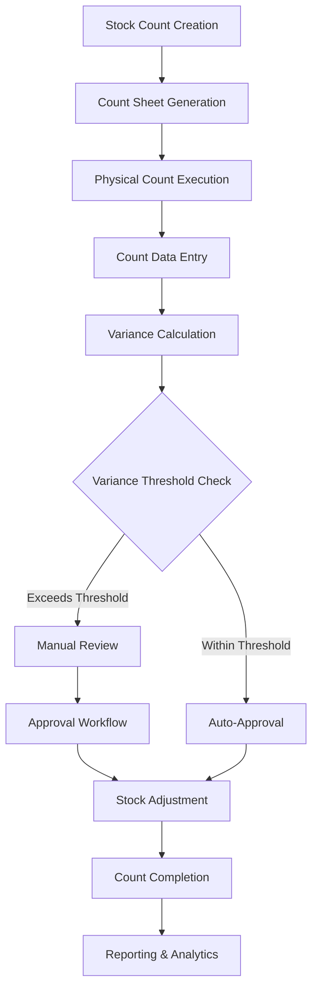
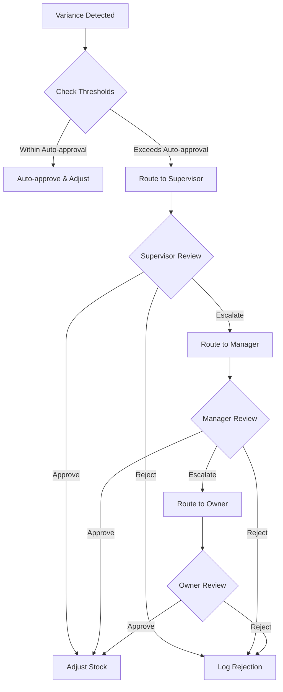

# PharmaSoft Physical Stock Counting Architecture Design

## Overview

This document outlines the comprehensive architecture for physical stock counting functionality in PharmaSoft, designed to manage the complete stock counting process from planning to reconciliation. The design integrates seamlessly with the existing inventory management, batch tracking, and multi-store capabilities.

## 1. Stock Counting Process Workflow

### 1.1 Process Flow Diagram



### 1.2 Detailed Process Steps

#### Stock Count Creation and Scheduling
- **Count Types**: Full inventory, partial counts, cycle counting, spot checks, expiry-focused counts
- **Scheduling**: One-time counts, recurring schedules (daily, weekly, monthly)
- **Assignment**: Designate counters, supervisors, and approvers
- **Scope Definition**: By category, location, supplier, expiry date, or custom filters

#### Count Sheet Generation
- **Dynamic Generation**: Based on current inventory data at time of count creation
- **Multiple Formats**: PDF for printing, Excel for import, mobile-friendly digital format
- **Organization**: Logical grouping by location, category, or alphabetically
- **Barcode Integration**: Include barcodes for scanning

#### Physical Count Data Entry
- **Multiple Methods**: Manual entry, barcode scanning, batch counting, mobile app
- **Offline Support**: Local storage with sync when connection restored
- **Real-time Updates**: Live progress tracking for multiple counters
- **Validation**: Immediate feedback on unusual quantities or data entry errors

#### Variance Calculation and Analysis
- **Automatic Calculation**: Compare expected vs. actual quantities
- **Variance Categorization**: By value, percentage, and absolute quantity
- **Historical Comparison**: Compare with previous count variances
- **Exception Flagging**: Highlight items requiring attention

#### Stock Adjustment Approval Workflow
- **Threshold-based Routing**: Auto-approve minor variances, route major ones for review
- **Multi-level Approval**: Supervisor, manager, and pharmacy owner levels
- **Audit Trail**: Complete tracking of all approvals and decisions
- **Rejection Handling**: Process for rejected adjustments with reasons

## 2. Count Types and Configurations

### 2.1 Full Inventory Counts
- **Scope**: All products in the store
- **Frequency**: Typically annual or semi-annual
- **Planning**: Requires store closure or after-hours execution
- **Resources**: Multiple teams, detailed planning, temporary storage

### 2.2 Partial Counts
- **By Category**: Specific product categories (e.g., antibiotics, cardiac drugs)
- **By Location**: Specific areas (e.g., shelf A, refrigerator B, warehouse C)
- **By Supplier**: Products from specific suppliers
- **By Value Range**: High-value items only

### 2.3 Cycle Counting
- **Rotating Schedule**: Count subsets of inventory regularly
- **ABC Analysis**: Frequency based on item value and movement
  - A-items (high value): Monthly counts
  - B-items (medium value): Quarterly counts
  - C-items (low value): Semi-annual counts
- **Continuous Process**: Ongoing throughout the year

### 2.4 Spot Checks
- **Random Selection**: Statistical sampling of inventory
- **Targeted**: Based on suspicion of theft, damage, or system errors
- **High-Risk Items**: Narcotics, expensive medications, fast-moving items
- **Frequency**: Weekly or bi-weekly

### 2.5 Expiry-Focused Counts
- **Near Expiry**: Products expiring within 30-90 days
- **Expired Products**: Identify and remove expired items
- **Batch Tracking**: Count by batch rather than just product
- **Regulatory Compliance**: Ensure proper handling of expired medications

## 3. Database Schema Design

### 3.1 Stock Count Sessions

```sql
CREATE TABLE stock_count_sessions (
    id INTEGER PRIMARY KEY,
    store_id INTEGER NOT NULL,
    count_name VARCHAR(200) NOT NULL,
    count_type VARCHAR(20) NOT NULL, -- FULL, PARTIAL, CYCLE, SPOT, EXPIRY
    count_status VARCHAR(20) DEFAULT 'PLANNED', -- PLANNED, ACTIVE, PAUSED, COMPLETED, CANCELLED
    scheduled_date DATE,
    started_at TIMESTAMP,
    completed_at TIMESTAMP,
    assigned_to JSON, -- Array of user IDs
    supervised_by INTEGER,
    approved_by INTEGER,
    count_scope JSON, -- Filters and criteria for what to count
    total_items INTEGER DEFAULT 0,
    counted_items INTEGER DEFAULT 0,
    variance_items INTEGER DEFAULT 0,
    total_variance_value DECIMAL(12,2) DEFAULT 0.00,
    notes TEXT,
    created_by INTEGER NOT NULL,
    created_at TIMESTAMP DEFAULT CURRENT_TIMESTAMP,
    updated_at TIMESTAMP DEFAULT CURRENT_TIMESTAMP,
    sync_version INTEGER DEFAULT 1,
    FOREIGN KEY (store_id) REFERENCES stores(id),
    FOREIGN KEY (supervised_by) REFERENCES users(id),
    FOREIGN KEY (approved_by) REFERENCES users(id),
    FOREIGN KEY (created_by) REFERENCES users(id)
);

-- Indexes
CREATE INDEX idx_stock_count_store ON stock_count_sessions(store_id);
CREATE INDEX idx_stock_count_status ON stock_count_sessions(count_status);
CREATE INDEX idx_stock_count_type ON stock_count_sessions(count_type);
CREATE INDEX idx_stock_count_date ON stock_count_sessions(scheduled_date);
```

### 3.2 Count Line Items

```sql
CREATE TABLE stock_count_items (
    id INTEGER PRIMARY KEY,
    count_session_id INTEGER NOT NULL,
    product_id INTEGER NOT NULL,
    batch_id INTEGER,
    expected_quantity INTEGER NOT NULL,
    counted_quantity INTEGER,
    variance_quantity INTEGER,
    unit_cost DECIMAL(10,2),
    variance_value DECIMAL(12,2),
    count_status VARCHAR(20) DEFAULT 'PENDING', -- PENDING, COUNTED, VERIFIED, ADJUSTED
    counted_by INTEGER,
    counted_at TIMESTAMP,
    verified_by INTEGER,
    verified_at TIMESTAMP,
    location_rack VARCHAR(50),
    location_shelf VARCHAR(50),
    notes TEXT,
    barcode_scanned BOOLEAN DEFAULT FALSE,
    expiry_date DATE,
    is_high_variance BOOLEAN DEFAULT FALSE,
    created_at TIMESTAMP DEFAULT CURRENT_TIMESTAMP,
    updated_at TIMESTAMP DEFAULT CURRENT_TIMESTAMP,
    FOREIGN KEY (count_session_id) REFERENCES stock_count_sessions(id),
    FOREIGN KEY (product_id) REFERENCES products(id),
    FOREIGN KEY (batch_id) REFERENCES product_batches(id),
    FOREIGN KEY (counted_by) REFERENCES users(id),
    FOREIGN KEY (verified_by) REFERENCES users(id)
);

-- Indexes
CREATE INDEX idx_count_items_session ON stock_count_items(count_session_id);
CREATE INDEX idx_count_items_product ON stock_count_items(product_id);
CREATE INDEX idx_count_items_batch ON stock_count_items(batch_id);
CREATE INDEX idx_count_items_status ON stock_count_items(count_status);
CREATE INDEX idx_count_items_variance ON stock_count_items(is_high_variance);
```

### 3.3 Variance Records and Adjustments

```sql
CREATE TABLE stock_count_variances (
    id INTEGER PRIMARY KEY,
    count_item_id INTEGER NOT NULL,
    variance_type VARCHAR(20) NOT NULL, -- SURPLUS, SHORTAGE, EXPIRED, DAMAGED
    variance_quantity INTEGER NOT NULL,
    variance_value DECIMAL(12,2) NOT NULL,
    variance_percentage DECIMAL(5,2),
    threshold_exceeded BOOLEAN DEFAULT FALSE,
    approval_status VARCHAR(20) DEFAULT 'PENDING', -- PENDING, APPROVED, REJECTED, ESCALATED
    approved_by INTEGER,
    approved_at TIMESTAMP,
    rejection_reason TEXT,
    adjustment_reference_id INTEGER, -- Link to stock_adjustments table
    notes TEXT,
    created_at TIMESTAMP DEFAULT CURRENT_TIMESTAMP,
    updated_at TIMESTAMP DEFAULT CURRENT_TIMESTAMP,
    FOREIGN KEY (count_item_id) REFERENCES stock_count_items(id),
    FOREIGN KEY (approved_by) REFERENCES users(id),
    FOREIGN KEY (adjustment_reference_id) REFERENCES stock_adjustments(id)
);

-- Indexes
CREATE INDEX idx_variances_count_item ON stock_count_variances(count_item_id);
CREATE INDEX idx_variances_type ON stock_count_variances(variance_type);
CREATE INDEX idx_variances_status ON stock_count_variances(approval_status);
CREATE INDEX idx_variances_threshold ON stock_count_variances(threshold_exceeded);
```

### 3.4 Approval Workflow Tracking

```sql
CREATE TABLE stock_count_approvals (
    id INTEGER PRIMARY KEY,
    count_session_id INTEGER NOT NULL,
    approval_level INTEGER NOT NULL, -- 1: Supervisor, 2: Manager, 3: Owner
    required_approver_role VARCHAR(20) NOT NULL, -- SUPERVISOR, MANAGER, OWNER
    approver_id INTEGER,
    approval_status VARCHAR(20) DEFAULT 'PENDING', -- PENDING, APPROVED, REJECTED, SKIPPED
    approved_at TIMESTAMP,
    rejection_reason TEXT,
    comments TEXT,
    created_at TIMESTAMP DEFAULT CURRENT_TIMESTAMP,
    updated_at TIMESTAMP DEFAULT CURRENT_TIMESTAMP,
    FOREIGN KEY (count_session_id) REFERENCES stock_count_sessions(id),
    FOREIGN KEY (approver_id) REFERENCES users(id)
);

-- Indexes
CREATE INDEX idx_approvals_session ON stock_count_approvals(count_session_id);
CREATE INDEX idx_approvals_level ON stock_count_approvals(approval_level);
CREATE INDEX idx_approvals_status ON stock_count_approvals(approval_status);
```

### 3.5 Count Templates and Schedules

```sql
CREATE TABLE stock_count_templates (
    id INTEGER PRIMARY KEY,
    store_id INTEGER NOT NULL,
    template_name VARCHAR(100) NOT NULL,
    template_type VARCHAR(20) NOT NULL, -- FULL, PARTIAL, CYCLE, SPOT, EXPIRY
    count_scope JSON, -- Reusable filters and criteria
    approval_workflow JSON, -- Approval levels and thresholds
    variance_thresholds JSON, -- Percentage and value thresholds
    is_active BOOLEAN DEFAULT TRUE,
    created_by INTEGER NOT NULL,
    created_at TIMESTAMP DEFAULT CURRENT_TIMESTAMP,
    updated_at TIMESTAMP DEFAULT CURRENT_TIMESTAMP,
    FOREIGN KEY (store_id) REFERENCES stores(id),
    FOREIGN KEY (created_by) REFERENCES users(id)
);

CREATE TABLE stock_count_schedules (
    id INTEGER PRIMARY KEY,
    template_id INTEGER NOT NULL,
    schedule_name VARCHAR(100) NOT NULL,
    schedule_type VARCHAR(20) NOT NULL, -- DAILY, WEEKLY, MONTHLY, QUARTERLY, YEARLY
    schedule_config JSON, -- Cron-like configuration
    next_execution_date TIMESTAMP,
    last_execution_date TIMESTAMP,
    is_active BOOLEAN DEFAULT TRUE,
    created_at TIMESTAMP DEFAULT CURRENT_TIMESTAMP,
    updated_at TIMESTAMP DEFAULT CURRENT_TIMESTAMP,
    FOREIGN KEY (template_id) REFERENCES stock_count_templates(id)
);
```

## 4. API Endpoints Design

### 4.1 Stock Count Session Management

```javascript
// GET /api/stock-counts - Get all stock count sessions
// Query parameters: storeId, status, type, dateRange, page, limit
app.get("/api/stock-counts", function (req, res) {
    // Implementation for retrieving stock count sessions with pagination and filtering
});

// POST /api/stock-counts - Create new stock count session
app.post("/api/stock-counts", function (req, res) {
    // Implementation for creating new stock count session
    // Validate required fields: storeId, countName, countType, countScope
    // Generate count items based on scope
    // Assign users and set up approval workflow
});

// GET /api/stock-counts/:id - Get specific stock count session
app.get("/api/stock-counts/:id", function (req, res) {
    // Implementation for retrieving specific stock count session with items
});

// PUT /api/stock-counts/:id - Update stock count session
app.put("/api/stock-counts/:id", function (req, res) {
    // Implementation for updating stock count session
    // Allowed updates: status, notes, assigned users
});

// DELETE /api/stock-counts/:id - Cancel stock count session
app.delete("/api/stock-counts/:id", function (req, res) {
    // Implementation for cancelling stock count session
    // Only allowed for PLANNED status
});
```

### 4.2 Count Item Management

```javascript
// GET /api/stock-counts/:sessionId/items - Get count items for session
app.get("/api/stock-counts/:sessionId/items", function (req, res) {
    // Implementation for retrieving count items
    // Support filtering: status, location, variance
});

// POST /api/stock-counts/:sessionId/items - Add count items
app.post("/api/stock-counts/:sessionId/items", function (req, res) {
    // Implementation for adding items to count session
    // For dynamic scope expansion during counting
});

// PUT /api/stock-counts/:sessionId/items/:itemId - Update count item
app.put("/api/stock-counts/:sessionId/items/:itemId", function (req, res) {
    // Implementation for updating count item
    // Update: countedQuantity, notes, location, status
});

// POST /api/stock-counts/:sessionId/items/batch - Batch update count items
app.post("/api/stock-counts/:sessionId/items/batch", function (req, res) {
    // Implementation for batch updating multiple count items
    // For efficient bulk counting operations
});
```

### 4.3 Variance Management

```javascript
// GET /api/stock-counts/:sessionId/variances - Get variances for session
app.get("/api/stock-counts/:sessionId/variances", function (req, res) {
    // Implementation for retrieving variance analysis
});

// POST /api/stock-counts/:sessionId/variances - Create variance records
app.post("/api/stock-counts/:sessionId/variances", function (req, res) {
    // Implementation for creating variance records
    // Auto-calculate based on count data
});

// PUT /api/stock-counts/:sessionId/variances/:varianceId/approve - Approve variance
app.put("/api/stock-counts/:sessionId/variances/:varianceId/approve", function (req, res) {
    // Implementation for approving variance with adjustment
});

// PUT /api/stock-counts/:sessionId/variances/:varianceId/reject - Reject variance
app.put("/api/stock-counts/:sessionId/variances/:varianceId/reject", function (req, res) {
    // Implementation for rejecting variance with reason
});
```

### 4.4 Barcode Scanning Integration

```javascript
// POST /api/stock-counts/:sessionId/scan - Process barcode scan
app.post("/api/stock-counts/:sessionId/scan", function (req, res) {
    // Implementation for barcode scanning
    // Return product details for quick counting
    // Support batch-level scanning
});

// GET /api/stock-counts/:sessionId/items/scan-ready - Get scannable items
app.get("/api/stock-counts/:sessionId/items/scan-ready", function (req, res) {
    // Implementation for mobile scanning interface
    // Return items optimized for barcode scanning
});
```

### 4.5 Reporting and Analytics

```javascript
// GET /api/stock-counts/:sessionId/report - Generate count report
app.get("/api/stock-counts/:sessionId/report", function (req, res) {
    // Implementation for generating comprehensive count report
});

// GET /api/stock-counts/analytics - Get stock count analytics
app.get("/api/stock-counts/analytics", function (req, res) {
    // Implementation for historical analytics
    // Parameters: dateRange, storeId, countType
});

// GET /api/stock-counts/:sessionId/export - Export count data
app.get("/api/stock-counts/:sessionId/export", function (req, res) {
    // Implementation for exporting count data
    // Formats: Excel, PDF, CSV
});
```

## 5. Data Collection Methods

### 5.1 Manual Entry Forms
- **Web Interface**: Responsive web forms for desktop counting
- **Tablet Interface**: Touch-optimized forms for tablet counting
- **Quick Entry**: Numeric keypad for fast quantity input
- **Batch Mode**: Count multiple units of same item quickly
- **Validation**: Real-time validation of entered quantities

### 5.2 Barcode Scanning Integration
- **USB Scanners**: Integration with standard barcode scanners
- **Mobile Camera**: Use phone camera for barcode scanning
- **Batch Scanning**: Scan multiple items and enter quantity
- **QR Code Support**: Support for QR codes with batch information
- **Offline Scanning**: Store scans locally and sync later

### 5.3 Mobile Device Support
- **Progressive Web App**: Mobile-optimized web interface
- **Native App Features**: Camera access, offline storage, notifications
- **Touch Interface**: Large buttons and swipe gestures
- **Voice Input**: Voice-to-text for notes and quantities
- **GPS Location**: Track counting location for large stores

### 5.4 Batch Counting Interface
- **Group Counting**: Count multiple items as a batch
- **Weight-based**: Use scales for high-volume small items
- **Container Counting**: Count by containers (boxes, bottles)
- **Estimate Mode**: Quick estimates for large quantities
- **Verification Mode**: Second count for high-value items

### 5.5 Import from External Devices
- **Excel Import**: Import count data from Excel files
- **CSV Import**: Support for various CSV formats
- **Scanner Data**: Import from dedicated counting devices
- **API Integration**: Connect with third-party counting systems
- **Validation**: Validate imported data before processing

## 6. Variance Management

### 6.1 Variance Calculation Logic

```javascript
function calculateVariance(expected, actual, unitCost) {
    const variance = {
        quantity: actual - expected,
        percentage: 0,
        value: 0,
        type: 'SURPLUS',
        isSignificant: false
    };
    
    // Calculate percentage variance
    if (expected > 0) {
        variance.percentage = Math.abs((variance.quantity / expected) * 100);
    }
    
    // Calculate value variance
    variance.value = Math.abs(variance.quantity) * unitCost;
    
    // Determine variance type
    if (variance.quantity < 0) {
        variance.type = 'SHORTAGE';
    } else if (variance.quantity > 0) {
        variance.type = 'SURPLUS';
    }
    
    // Check if variance exceeds thresholds
    const thresholdConfig = getVarianceThresholds();
    variance.isSignificant = 
        variance.percentage > thresholdConfig.percentage ||
        variance.value > thresholdConfig.value;
    
    return variance;
}
```

### 6.2 Variance Threshold Configuration

```javascript
const varianceThresholds = {
    autoApproval: {
        percentage: 5,    // 5% variance auto-approved
        value: 100         // $100 variance auto-approved
    },
    supervisorApproval: {
        percentage: 15,    // 15% requires supervisor approval
        value: 500         // $500 requires supervisor approval
    },
    managerApproval: {
        percentage: 25,    // 25% requires manager approval
        value: 1000        // $1000 requires manager approval
    },
    ownerApproval: {
        percentage: 50,    // 50% requires owner approval
        value: 5000        // $5000 requires owner approval
    }
};
```

### 6.3 Approval Workflows for Significant Variances



### 6.4 Variance Reporting and Analysis

#### Variance Categories
- **Theft/Loss**: Unexplained shortages
- **Data Entry Errors**: System vs. physical count mismatches
- **Damage**: Spoiled or damaged products
- **Expiry**: Expired products written off
- **Supplier Issues**: Incorrect deliveries or returns
- **System Errors**: Software or calculation errors

#### Variance Trend Analysis
- **Product-specific**: Identify consistently problematic items
- **Location-based**: Find problematic storage areas
- **User-based**: Track counter accuracy over time
- **Temporal**: Identify seasonal or time-based patterns
- **Value-based**: Focus on high-value item variances

### 6.5 Historical Variance Tracking

```sql
CREATE TABLE variance_history (
    id INTEGER PRIMARY KEY,
    product_id INTEGER NOT NULL,
    store_id INTEGER NOT NULL,
    count_date DATE NOT NULL,
    variance_type VARCHAR(20) NOT NULL,
    variance_quantity INTEGER NOT NULL,
    variance_value DECIMAL(12,2) NOT NULL,
    variance_percentage DECIMAL(5,2),
    resolved_by INTEGER,
    resolution_method VARCHAR(50),
    created_at TIMESTAMP DEFAULT CURRENT_TIMESTAMP,
    FOREIGN KEY (product_id) REFERENCES products(id),
    FOREIGN KEY (store_id) REFERENCES stores(id),
    FOREIGN KEY (resolved_by) REFERENCES users(id)
);
```

## 7. Integration Points

### 7.1 Integration with Existing Inventory System

#### Real-time Inventory Updates
```javascript
// Integration point with inventory.js
function updateInventoryFromCount(countSessionId) {
    // Get all approved variances from count session
    stockCountVariancesDB.find({
        count_session_id: countSessionId,
        approval_status: 'APPROVED'
    }, function(err, variances) {
        // Process each approved variance
        variances.forEach(variance => {
            // Create stock adjustment record
            createStockAdjustment(variance);
            
            // Update inventory quantity
            updateInventoryQuantity(variance.product_id, variance.variance_quantity);
            
            // Update batch quantity if applicable
            if (variance.batch_id) {
                updateBatchQuantity(variance.batch_id, variance.variance_quantity);
            }
        });
    });
}
```

#### Store Inventory Integration
```javascript
// Integration point with store-inventory.js
function updateStoreInventoryFromCount(storeId, countSessionId) {
    // Update store-specific inventory quantities
    stockCountItemsDB.find({
        count_session_id: countSessionId,
        count_status: 'VERIFIED'
    }, function(err, items) {
        items.forEach(item => {
            // Update store inventory
            storeInventoryDB.update({
                storeId: storeId,
                productId: item.product_id
            }, {
                $set: {
                    quantity: item.counted_quantity,
                    lastUpdated: new Date(),
                    updatedBy: 'stock-count'
                }
            });
        });
    });
}
```

### 7.2 Connection with Batch Management

#### Batch-level Counting
- **Batch Identification**: Count by specific batch numbers
- **Expiry Tracking**: Focus on near-expiry batches
- **Batch Consolidation**: Combine counts from multiple batches
- **Batch Transfers**: Move quantities between batches as needed

```javascript
// Integration point with batches.js
function updateBatchFromCount(batchId, countedQuantity) {
    batchesDB.findOne({ _id: batchId }, function(err, batch) {
        if (batch) {
            const variance = countedQuantity - batch.currentQuantity;
            
            // Update batch quantity
            batchesDB.update({ _id: batchId }, {
                $set: {
                    currentQuantity: countedQuantity,
                    lastCounted: new Date()
                }
            });
            
            // Create batch movement record
            createBatchMovement({
                batchId: batchId,
                movementType: 'COUNT_ADJUSTMENT',
                quantity: variance,
                referenceType: 'STOCK_COUNT',
                notes: 'Physical count adjustment'
            });
        }
    });
}
```

### 7.3 Integration with Store Management (Multi-store)

#### Cross-store Counting
- **Store-specific Counts**: Separate counts for each store
- **Centralized Templates**: Share count templates across stores
- **Consolidated Reporting**: Combine results from multiple stores
- **Inter-store Variance Analysis**: Compare variances between stores

```javascript
// Integration point with stores.js
function createMultiStoreCount(countConfig) {
    const selectedStores = countConfig.storeIds;
    
    selectedStores.forEach(storeId => {
        // Create count session for each store
        createStockCountSession({
            storeId: storeId,
            countName: countConfig.countName,
            countType: countConfig.countType,
            countScope: countConfig.countScope,
            isMultiStore: true,
            parentCountId: countConfig.parentCountId
        });
    });
}
```

### 7.4 Stock Adjustment Integration

#### Automatic Adjustment Creation
```javascript
// Integration point with stock-adjustments.js
function createStockAdjustmentFromVariance(variance) {
    const adjustment = {
        productId: variance.product_id,
        batchId: variance.batch_id,
        adjustmentQuantity: variance.variance_quantity,
        reason: `Stock Count - ${variance.variance_type}`,
        referenceType: 'STOCK_COUNT',
        referenceId: variance.count_session_id,
        createdBy: variance.approved_by,
        adjustmentDate: new Date().toISOString().split('T')[0]
    };
    
    // Create stock adjustment record
    stockAdjustmentsDB.insert(adjustment, function(err, adjustmentRecord) {
        if (!err) {
            // Link variance to adjustment
            stockCountVariancesDB.update(
                { _id: variance.id },
                { $set: { adjustment_reference_id: adjustmentRecord._id } }
            );
        }
    });
}
```

### 7.5 Integration with User Permissions

#### Permission-based Access Control
```javascript
// Integration point with store-permissions.js
function checkStockCountPermission(userId, storeId, action) {
    const requiredPermissions = {
        'create': ['canManageInventory'],
        'count': ['canManageInventory'],
        'approve': ['canManageInventory'],
        'report': ['canViewReports'],
        'admin': ['canManageSettings']
    };
    
    return storePermissionsDB.findOne({
        userId: userId,
        storeId: storeId,
        isActive: true
    }, function(err, permission) {
        if (err || !permission) return false;
        
        return requiredPermissions[action].some(perm => permission[perm]);
    });
}
```

## 8. Technical Implementation

### 8.1 Offline Counting Capabilities

#### Local Storage Strategy
```javascript
class OfflineCountManager {
    constructor() {
        this.localDB = new IndexedDB('StockCountOffline');
        this.syncQueue = [];
        this.isOnline = navigator.onLine;
    }
    
    // Save count data locally
    saveCountItem(countItem) {
        return this.localDB.add('countItems', {
            ...countItem,
            timestamp: Date.now(),
            synced: false
        });
    }
    
    // Sync when online
    async syncToServer() {
        if (!this.isOnline) return;
        
        const unsyncedItems = await this.localDB.getAll('countItems', 
            item => !item.synced);
        
        for (const item of unsyncedItems) {
            try {
                await this.uploadToServer(item);
                await this.markAsSynced(item.id);
            } catch (error) {
                console.error('Sync failed:', error);
                this.addToRetryQueue(item);
            }
        }
    }
    
    // Handle online/offline events
    setupNetworkListeners() {
        window.addEventListener('online', () => {
            this.isOnline = true;
            this.syncToServer();
        });
        
        window.addEventListener('offline', () => {
            this.isOnline = false;
        });
    }
}
```

#### Conflict Resolution
```javascript
function resolveSyncConflicts(localData, serverData) {
    const conflicts = [];
    
    localData.forEach(localItem => {
        const serverItem = serverData.find(s => s.id === localItem.id);
        
        if (serverItem && serverItem.version > localItem.version) {
            // Server has newer data
            conflicts.push({
                type: 'SERVER_NEWER',
                localItem: localItem,
                serverItem: serverItem,
                resolution: 'USE_SERVER'
            });
        } else if (serverItem && serverItem.version === localItem.version) {
            // Same version, check for field differences
            if (JSON.stringify(localItem) !== JSON.stringify(serverItem)) {
                conflicts.push({
                    type: 'FIELD_CONFLICT',
                    localItem: localItem,
                    serverItem: serverItem,
                    resolution: 'MANUAL_REVIEW'
                });
            }
        }
    });
    
    return conflicts;
}
```

### 8.2 Real-time Collaboration for Multiple Counters

#### WebSocket Implementation
```javascript
class StockCountCollaboration {
    constructor(countSessionId) {
        this.sessionId = countSessionId;
        this.ws = new WebSocket(`ws://localhost:3000/stock-count/${countSessionId}`);
        this.activeUsers = new Map();
        
        this.setupEventHandlers();
    }
    
    setupEventHandlers() {
        this.ws.onmessage = (event) => {
            const message = JSON.parse(event.data);
            
            switch (message.type) {
                case 'USER_JOINED':
                    this.handleUserJoined(message.data);
                    break;
                case 'ITEM_UPDATED':
                    this.handleItemUpdated(message.data);
                    break;
                case 'PROGRESS_UPDATE':
                    this.handleProgressUpdate(message.data);
                    break;
            }
        };
    }
    
    broadcastItemUpdate(itemId, updates) {
        this.ws.send(JSON.stringify({
            type: 'ITEM_UPDATE',
            data: {
                itemId: itemId,
                updates: updates,
                userId: getCurrentUserId(),
                timestamp: Date.now()
            }
        }));
    }
    
    handleItemUpdated(data) {
        // Update UI with real-time changes
        updateCountItemUI(data.itemId, data.updates);
        
        // Show notification for other user's changes
        if (data.userId !== getCurrentUserId()) {
            showNotification(`${data.userName} updated item ${data.itemId}`);
        }
    }
}
```

#### Progress Tracking
```javascript
function updateCountProgress(sessionId) {
    stockCountItemsDB.find({ count_session_id: sessionId }, 
    (err, items) => {
        const progress = {
            total: items.length,
            counted: items.filter(item => item.count_status === 'COUNTED').length,
            verified: items.filter(item => item.count_status === 'VERIFIED').length,
            pending: items.filter(item => item.count_status === 'PENDING').length
        };
        
        progress.percentage = (progress.counted / progress.total) * 100;
        
        // Update progress UI
        updateProgressBar(progress);
        
        // Broadcast to other counters
        if (collaboration) {
            collaboration.broadcastProgress(progress);
        }
    });
}
```

### 8.3 Performance Considerations for Large Inventories

#### Pagination and Lazy Loading
```javascript
class LargeInventoryHandler {
    constructor(sessionId) {
        this.sessionId = sessionId;
        this.pageSize = 100;
        this.currentPage = 0;
        this.loadedItems = new Map();
        this.cache = new Map();
    }
    
    async loadPage(pageNumber) {
        const cacheKey = `page_${pageNumber}`;
        
        if (this.cache.has(cacheKey)) {
            return this.cache.get(cacheKey);
        }
        
        const items = await stockCountItemsDB.find({
            count_session_id: this.sessionId
        })
        .skip(pageNumber * this.pageSize)
        .limit(this.pageSize)
        .exec();
        
        this.cache.set(cacheKey, items);
        return items;
    }
    
    async searchItems(query) {
        // Implement indexed search for large datasets
        const results = await stockCountItemsDB.find({
            count_session_id: this.sessionId,
            $or: [
                { product_name: new RegExp(query, 'i') },
                { barcode: new RegExp(query, 'i') },
                { batch_number: new RegExp(query, 'i') }
            ]
        })
        .limit(50)
        .exec();
        
        return results;
    }
}
```

#### Background Processing
```javascript
class BackgroundCountProcessor {
    constructor() {
        this.worker = new Worker('/js/count-processor-worker.js');
        this.setupWorkerHandlers();
    }
    
    processLargeCount(sessionId) {
        this.worker.postMessage({
            type: 'PROCESS_COUNT',
            sessionId: sessionId,
            options: {
                batchSize: 1000,
                enableProgress: true
            }
        });
    }
    
    setupWorkerHandlers() {
        this.worker.onmessage = (event) => {
            const { type, data } = event.data;
            
            switch (type) {
                case 'PROGRESS':
                    updateProcessingProgress(data);
                    break;
                case 'COMPLETED':
                    handleProcessingCompleted(data);
                    break;
                case 'ERROR':
                    handleProcessingError(data);
                    break;
            }
        };
    }
}
```

## 9. UI/UX Considerations

### 9.1 Count Sheet Interface Design

#### Desktop Counting Interface
```html
<!-- Main counting interface -->
<div class="count-sheet-container">
    <div class="count-header">
        <div class="count-info">
            <h2 id="count-name">Annual Inventory Count 2024</h2>
            <div class="count-progress">
                <div class="progress-bar">
                    <div class="progress-fill" style="width: 45%"></div>
                </div>
                <span class="progress-text">45% Complete (234/520 items)</span>
            </div>
        </div>
        <div class="count-actions">
            <button class="btn btn-primary" id="save-progress">Save Progress</button>
            <button class="btn btn-secondary" id="export-sheet">Export Sheet</button>
        </div>
    </div>
    
    <div class="count-filters">
        <input type="text" id="search-input" placeholder="Search products...">
        <select id="location-filter">
            <option value="">All Locations</option>
            <option value="rack-a">Rack A</option>
            <option value="rack-b">Rack B</option>
        </select>
        <select id="status-filter">
            <option value="">All Status</option>
            <option value="pending">Pending</option>
            <option value="counted">Counted</option>
        </select>
    </div>
    
    <div class="count-items-table">
        <table class="table table-striped">
            <thead>
                <tr>
                    <th>Product</th>
                    <th>Barcode</th>
                    <th>Batch</th>
                    <th>Expected</th>
                    <th>Counted</th>
                    <th>Variance</th>
                    <th>Actions</th>
                </tr>
            </thead>
            <tbody id="count-items-tbody">
                <!-- Dynamically populated -->
            </tbody>
        </table>
    </div>
</div>
```

#### Mobile Counting Interface
```html
<!-- Mobile-optimized counting interface -->
<div class="mobile-count-container">
    <div class="mobile-header">
        <h1>Stock Count</h1>
        <div class="mobile-progress">
            <div class="circular-progress">
                <svg viewBox="0 0 36 36">
                    <path class="circle-bg" d="M18 2.0845 a 15.9155 15.9155 0 0 1 0 31.831 a 15.9155 15.9155 0 0 1 0 -31.831"/>
                    <path class="circle-progress" d="M18 2.0845 a 15.9155 15.9155 0 0 1 0 31.831 a 15.9155 15.9155 0 0 1 0 -31.831" 
                          stroke-dasharray="45, 100"/>
                </svg>
                <div class="percentage">45%</div>
            </div>
        </div>
    </div>
    
    <div class="scan-section">
        <button class="scan-button" id="barcode-scan">
            <i class="fas fa-barcode"></i>
            Scan Barcode
        </button>
        <input type="text" id="manual-entry" placeholder="Enter barcode or product name">
    </div>
    
    <div class="count-item-card" id="current-item">
        <div class="product-info">
            <h3 id="product-name">Paracetamol 500mg</h3>
            <p id="product-details">Batch: B001, Exp: 2024-12</p>
        </div>
        <div class="quantity-input">
            <label>Expected: <span id="expected-qty">100</span></label>
            <input type="number" id="counted-qty" placeholder="Enter counted quantity">
        </div>
        <div class="item-actions">
            <button class="btn btn-primary" id="save-item">Save</button>
            <button class="btn btn-secondary" id="skip-item">Skip</button>
        </div>
    </div>
    
    <div class="recent-items">
        <h3>Recently Counted</h3>
        <div class="recent-list" id="recent-items-list">
            <!-- Dynamically populated -->
        </div>
    </div>
</div>
```

### 9.2 Progress Tracking Dashboard

#### Real-time Progress Dashboard
```javascript
class ProgressDashboard {
    constructor(sessionId) {
        this.sessionId = sessionId;
        this.chart = null;
        this.initializeDashboard();
    }
    
    initializeDashboard() {
        this.createProgressChart();
        this.setupRealTimeUpdates();
        this.loadInitialData();
    }
    
    createProgressChart() {
        const ctx = document.getElementById('progress-chart').getContext('2d');
        this.chart = new Chart(ctx, {
            type: 'doughnut',
            data: {
                labels: ['Counted', 'Pending', 'Verified'],
                datasets: [{
                    data: [0, 0, 0],
                    backgroundColor: [
                        '#28a745',
                        '#ffc107',
                        '#17a2b8'
                    ]
                }]
            },
            options: {
                responsive: true,
                plugins: {
                    legend: {
                        position: 'bottom'
                    }
                }
            }
        });
    }
    
    updateProgress(data) {
        this.chart.data.datasets[0].data = [
            data.counted,
            data.pending,
            data.verified
        ];
        this.chart.update();
        
        // Update statistics
        document.getElementById('total-items').textContent = data.total;
        document.getElementById('counted-items').textContent = data.counted;
        document.getElementById('variance-items').textContent = data.variances;
        document.getElementById('completion-rate').textContent = 
            `${((data.counted / data.total) * 100).toFixed(1)}%`;
    }
}
```

### 9.3 Variance Review and Approval Interface

#### Variance Review Dashboard
```html
<div class="variance-review-container">
    <div class="variance-summary">
        <div class="summary-card">
            <h3>Total Variance Value</h3>
            <p class="variance-amount" id="total-variance">$1,234.56</p>
        </div>
        <div class="summary-card">
            <h3>Items with Variance</h3>
            <p class="variance-count" id="variance-count">23</p>
        </div>
        <div class="summary-card">
            <h3>High Priority</h3>
            <p class="high-priority" id="high-priority">5</p>
        </div>
    </div>
    
    <div class="variance-filters">
        <select id="variance-type-filter">
            <option value="">All Types</option>
            <option value="shortage">Shortage</option>
            <option value="surplus">Surplus</option>
            <option value="expired">Expired</option>
        </select>
        <select id="threshold-filter">
            <option value="">All Thresholds</option>
            <option value="auto-approve">Auto-approve</option>
            <option value="supervisor">Supervisor Approval</option>
            <option value="manager">Manager Approval</option>
        </select>
    </div>
    
    <div class="variance-table">
        <table class="table table-striped">
            <thead>
                <tr>
                    <th>Product</th>
                    <th>Expected</th>
                    <th>Counted</th>
                    <th>Variance</th>
                    <th>Value</th>
                    <th>Threshold</th>
                    <th>Status</th>
                    <th>Actions</th>
                </tr>
            </thead>
            <tbody id="variance-tbody">
                <!-- Dynamically populated -->
            </tbody>
        </table>
    </div>
    
    <div class="bulk-actions">
        <button class="btn btn-success" id="bulk-approve">Approve Selected</button>
        <button class="btn btn-danger" id="bulk-reject">Reject Selected</button>
        <button class="btn btn-secondary" id="export-variances">Export Report</button>
    </div>
</div>
```

### 9.4 Mobile-Friendly Counting Interface

#### Progressive Web App Features
```javascript
// Service Worker for offline functionality
self.addEventListener('install', (event) => {
    event.waitUntil(
        caches.open('stock-count-v1').then((cache) => {
            return cache.addAll([
                '/',
                '/css/mobile-count.css',
                '/js/mobile-count.js',
                '/manifest.json'
            ]);
        })
    );
});

self.addEventListener('fetch', (event) => {
    event.respondWith(
        caches.match(event.request).then((response) => {
            return response || fetch(event.request);
        })
    );
});
```

#### Touch-Optimized Interface
```css
/* Mobile-specific styles */
.mobile-count-container {
    padding: 10px;
    font-size: 16px;
}

.scan-button {
    width: 100%;
    height: 60px;
    font-size: 18px;
    border-radius: 10px;
    background: #007bff;
    color: white;
    border: none;
    margin: 10px 0;
}

.quantity-input {
    font-size: 24px;
    text-align: center;
    padding: 15px;
    border: 2px solid #ddd;
    border-radius: 8px;
    margin: 10px 0;
}

.item-actions button {
    width: 48%;
    height: 50px;
    font-size: 16px;
    margin: 5px 1%;
}

/* Swipe gestures for navigation */
.count-item-card {
    transform: translateX(0);
    transition: transform 0.3s ease;
}

.count-item-card.swipe-left {
    transform: translateX(-80px);
}

.count-item-card.swipe-right {
    transform: translateX(80px);
}
```

### 9.5 Reporting and Analytics Dashboard

#### Comprehensive Reporting Interface
```javascript
class StockCountReports {
    constructor() {
        this.reports = {
            summary: new SummaryReport(),
            variance: new VarianceReport(),
            trends: new TrendsReport(),
            productivity: new ProductivityReport()
        };
    }
    
    generateReport(type, filters) {
        const report = this.reports[type];
        return report.generate(filters);
    }
    
    exportReport(reportData, format) {
        switch (format) {
            case 'excel':
                this.exportToExcel(reportData);
                break;
            case 'pdf':
                this.exportToPDF(reportData);
                break;
            case 'csv':
                this.exportToCSV(reportData);
                break;
        }
    }
    
    exportToExcel(data) {
        // Use SheetJS or similar library
        const ws = XLSX.utils.json_to_sheet(data);
        const wb = XLSX.utils.book_new();
        XLSX.utils.book_append_sheet(wb, ws, "Stock Count Report");
        XLSX.writeFile(wb, `stock-count-report-${Date.now()}.xlsx`);
    }
}
```

#### Analytics Charts and Visualizations
```html
<div class="analytics-dashboard">
    <div class="analytics-filters">
        <date-range-picker id="date-range"></date-range-picker>
        <select id="store-filter">
            <option value="">All Stores</option>
        </select>
        <select id="count-type-filter">
            <option value="">All Count Types</option>
        </select>
    </div>
    
    <div class="analytics-grid">
        <div class="chart-container">
            <h3>Variance Trends</h3>
            <canvas id="variance-trends-chart"></canvas>
        </div>
        
        <div class="chart-container">
            <h3>Count Accuracy by Category</h3>
            <canvas id="accuracy-by-category-chart"></canvas>
        </div>
        
        <div class="chart-container">
            <h3>Top Variance Items</h3>
            <canvas id="top-variance-items-chart"></canvas>
        </div>
        
        <div class="chart-container">
            <h3>Counting Efficiency</h3>
            <canvas id="efficiency-chart"></canvas>
        </div>
    </div>
    
    <div class="analytics-tables">
        <div class="table-container">
            <h3>Historical Comparison</h3>
            <table class="table table-striped" id="historical-comparison">
                <!-- Dynamically populated -->
            </table>
        </div>
    </div>
</div>
```

## 10. Implementation Roadmap

### Phase 1: Core Infrastructure (4-6 weeks)
- Database schema implementation
- Basic API endpoints development
- User interface framework
- Integration with existing inventory system

### Phase 2: Counting Functionality (3-4 weeks)
- Count sheet generation
- Manual data entry forms
- Basic variance calculation
- Simple approval workflow

### Phase 3: Advanced Features (4-5 weeks)
- Barcode scanning integration
- Mobile interface development
- Offline capabilities
- Real-time collaboration

### Phase 4: Analytics and Reporting (3-4 weeks)
- Variance analysis tools
- Historical reporting
- Trend analysis
- Export functionality

### Phase 5: Optimization and Testing (2-3 weeks)
- Performance optimization
- User acceptance testing
- Security testing
- Documentation

## Conclusion

This comprehensive design for physical stock counting functionality in PharmaSoft provides:

1. **Complete Process Management**: From planning to reconciliation
2. **Flexible Counting Methods**: Supporting various operational needs
3. **Robust Variance Management**: With configurable approval workflows
4. **Seamless Integration**: With existing inventory and batch systems
5. **Mobile-First Design**: For modern pharmacy operations
6. **Offline Capabilities**: Ensuring reliability in all conditions
7. **Comprehensive Analytics**: For continuous improvement

The architecture is designed to scale with the business and adapt to changing regulatory requirements while maintaining data integrity and operational efficiency.